# Design & Decision Record (DDR) — Labs 1–4, Pair 1
**GreenField Technologies | IoT Systems Design**

**Team Members:**
1. Nicolas Castaño
2. Oscar Andres Tepud

> Labs 1–4 are done in pairs. From Lab 5 on, this pair and Pair 2 work as one team: see [the team DDR](../labs5-8_equipo/DDR.md).
>
> **Sources.** Every number below comes from our lab reports (Labs 1–4, 22–23 Oct 2026), from the console photos in [`img/lab4/`](img/lab4/), or, where stated, from the course firmware. Anything we did not measure is marked **not measured** instead of estimated.

---

## 1. System Overview

*   **System Type:** [x] Component (Lab 1-2) | [x] System (Lab 3-6) | [ ] Environment (Lab 7-8)
*   **Description:** Two ESP32-C6-DevKitC-1 boards (RISC-V, 802.15.4 + Wi-Fi 6 + BLE on one 2.4 GHz front end) running Zephyr RTOS and OpenThread. In Labs 1–2 they are radio components measured link by link (a third board joins in Lab 2). From Lab 3 they form a two-node SoilSense system: **S** serves `/env/temp` and `/act/valve` over CoAP/CBOR (UDP 5683), and **C** creates the network and acts as the CoAP client. In Lab 4, S reads a **DS18B20** 1-Wire probe; C serves a simulated temperature.

| Board | Role | Identifiers we recorded |
|---|---|---|
| S | Server node (sensor + valve LED) | extaddr `36a9c06d2ab7de72` (`ot extaddr`, Lab 3); `/dev/ttyACM0` (CH343, VID `1a86`) on the Ubuntu laptop |
| C | Network creator (leader) and CoAP client | `/dev/tty.usbmodem5CBC0028321` on the Mac (Lab 3) |

The extaddr `36a9c06d2ab7de72` also appears as router `0x7000` in Lab 2's neighbor tables, so the same board was most likely B in Lab 2.

---

## 2. Lab Log & Stakeholder Summaries

### Lab 1: RF Characterization
*   **To Samuel (Architect):** At +20 dBm on channel 23, the link was perfect up to **≈5 m** (0/100 pings lost in each direction) and collapsed between 5 and 10 m (35–56 % loss). Reliability threshold: **average RSSI ≥ −83 dBm with LQ In ≥ 2**; at −89 dBm loss was 35–56 %. We use −85 dBm as the relocation limit. Recommended spacing, provisional: **5 m line of sight, 3 m light vegetation (+5 dB margin), 2 m dense vegetation (+10 dB)**. The fitted path-loss exponent is n ≈ 2.6, but measured loss is **≈52 dB above free space** at every distance. That points to our test setup (antenna orientation, laptops and cables nearby, height), not to the radio, so the campaign must be repeated outdoors before committing to a spacing.
*   **To Gustavo (Business):** For 10 ha at $40 per node: 5 m spacing → 4,000 nodes, **$160,000**; 3 m → 11,112 nodes, $444,480; 2 m → 25,000 nodes, $1,000,000. At the 15 m target, 445 nodes would cost $17,800. Node count grows with 1/spacing², so each metre recovered matters a lot. **Verdict: test more.** Neither proceed nor switch platform yet; if range stays under ≈10 m after fixing the setup, evaluate LoRa with the same method.
*   **To Edwin (Ops):** Field card below (§2.1).

#### 2.1 Field card for Edwin

**Three commands give 90 % of the diagnosis:** `ot state` (is it on the network?), `ot neighbor table` (how well does it hear its neighbor?), `ot scan energy 500` (is the channel noisy?).

| Problem | Check | Fix |
|---|---|---|
| **Won't join** | `ot state` says `disabled` | `ot ifconfig up`, then `ot thread start` |
| | `ot channel` differs from the leader's | Load the leader's dataset |
| | Wrong credentials | Never type the key: `ot dataset set active <hex>` from the leader's `ot dataset active -x` |
| | Old network in NVS (borrowed board) | `ot factoryreset`, reload the dataset |
| | Too far / antenna blocked | Join within ≤3 m, then move; keep metal away |
| | Still `child` | Wait up to 2 min before measuring |
| **Intermittent loss** | `ot neighbor table`: Avg RSSI < −85 dBm or LQ In ≤ 1 | Distance/obstacle: move closer, raise the node, or add a router in between |
| | RSSI fine but loss persists | Interference: `ot scan energy 500`, look for a new Wi-Fi on 1/6/11 |
| | Quantify | `ot ping <RLOC> 64 100 0.2` (never on both nodes at once); > 1 % loss + high noise → change channel from the leader with a pending dataset |

RSSI traffic light: **green** ≥ −80 dBm, LQ 2–3 · **yellow** −80 to −85 dBm, LQ 2 (no margin for rain or crops) · **red** < −85 dBm, LQ 0–1 (relocate or add a router).

### Lab 2: 6LoWPAN
*   **To Edwin:** **We did not measure a healing time.** Our logs have no timestamp for when B was unplugged and no `ot router table`, so we cannot say whether the 2-minute target is met. The one run compatible with a failure (E4) stopped answering after packet 19 and never recovered in the remaining ~180 s, but it may also have been C being re-provisioned. When a node goes dark, a field tech checks: `ot state` on the dark node, `ot neighbor table` on its neighbors (is it still listed, with what RSSI/LQ?), and whether its RLOC16 is still in `ot router table`. Then use the Lab 1 card.
*   **To Samuel:** Cost per hop, as a hypothesis: RTT was **16.0 ms** to the board one hop away and **≈32 ms** to the others, which fits ≈16 ms per hop but does not prove the route (`hlim` does not count mesh hops). B joined as child in 27.8 s and became router **5.985 s** later; A became leader in 14.5 s. Applications must address nodes by their **ML-EID**: it is stable for the node's lifetime in the network, while the RLOC encodes the parent/router and changes when the topology does.

### Lab 3: Thread & CoAP
*   **To Daniela (Customer):** The node no longer has to be asked over and over. With **Observe**, the client subscribed once and S sent **34 updates in about 5½ minutes**, only when the temperature changed by more than the threshold (23.43–25.22 °C); C sent no further requests. Each update is a 19-byte CoAP message. Fewer messages means less radio time, and the radio is what drains the batteries. A valve that sleeps between checks saves more energy but reacts later: **0.5 s on average with a 1 s check period, 3.3 s with 5 s, 7.6 s with 15 s** (we did not measure the battery saving itself).
*   **To Edwin:** A command is **confirmed** when it is sent as CON: the valve answers `2.04 Changed` with its new state (`{"v":1}` / `{"v":0}`), and a `GET` returns `2.05` with the current state. Invalid commands are rejected with `4.00 Bad Request`. When the valve is unreachable, a CON command ends in `ResponseTimeout` (error 28) after **69.4 s** (stopwatch); a NON command just says `Done` and gives no way to know if it arrived. Latency to expect from a sleepy valve is roughly the poll period: up to **≈5 s with a 5 s poll** (worst ping 4,988 ms).

### Lab 4: Real Sensors
*   **To Edwin:** A **dead sensor** and a **dead node** look different:
    *   **Dead sensor:** the node keeps answering. Its firmware declared `Sensor lost: 3 failed reads in a row` **5.2 s after the last good reading** (one read every 2 s), and from then on `/env/temp` stops serving the old value: per the course firmware, GET answers `5.03` once no reading is younger than 60 s. When the probe came back, S logged `Sensor back after 12 failed reads` (20.8 s after "lost").
    *   **Dead node:** there is no answer at all. The client only finds out when its request times out (**69.4 s** for a CON request, measured in Lab 3).

    We did not capture the 5.03 at the client, so the time for a client to see a lost sensor is bounded by the 60 s Max-Age, not measured.

---

## 3. Architecture Decision Records (ADRs)

**ADR-001: 802.15.4 channel for the SoilSense Thread network**
*   **Context:** 2.4 GHz is shared with Wi-Fi, BLE and microwave ovens. One Wi-Fi channel (≈20 MHz) covers four 802.15.4 channels (≈2 MHz each); farmhouse routers usually sit on Wi-Fi 1, 6 or 11. Noise eats link margin directly.
*   **Decision:** Channel **23** (2465 MHz) was used for the Lab 1 tests (`ot dataset channel 23`). For deployment, move to a gap channel: **15 or 20** (between Wi-Fi 1/6 and 6/11), or **25/26** if no Wi-Fi uses channels 12–13. In Lab 3 we already moved to channel 26.
*   **Rationale (PED domain):** Channel 23 sits inside Wi-Fi 11 (2452–2472 MHz), so it is only acceptable if no Wi-Fi 11 network is active on site. The gap channels avoid all three common Wi-Fi channels. **Noise floor on channel 23: not recorded** (the `ot scan energy 500` output is missing from our logs), so the choice cannot be confirmed with data yet.

    | 802.15.4 channel | Centre (MHz) | Overlapping Wi-Fi | Status |
    |---|---|---|---|
    | 11–14 | 2405–2420 | Wi-Fi 1 | Interfered |
    | **15** | 2425 | — | Gap 1/6 |
    | 16–19 | 2430–2445 | Wi-Fi 6 | Interfered |
    | **20** | 2450 | — | Gap 6/11 |
    | 21–24 (incl. 23) | 2455–2470 | Wi-Fi 11 | Interfered; used in Lab 1 |
    | **25, 26** | 2475, 2480 | — | Above Wi-Fi 11 |

    Consequences: a channel change on a deployed network must be pushed from the leader with a pending dataset, never node by node. Follow-up: run `ot scan energy 500` on the real site and pick the quietest gap channel.
*   **Status:** [x] Proposed | [ ] Accepted | [ ] Deprecated — accepted provisionally for testing; to be confirmed with an on-site energy scan.

**ADR-002: Thread mesh, not a star, for the field**
*   **Context:** Nodes must last 3 months on 2× AA (3 Ah × 3 V = 32.4 kJ → **≈4.2 mW average**), cover 10 ha, and keep working if one node fails.
*   **Decision:** Thread mesh over IEEE 802.15.4, with router-capable nodes, instead of a single-gateway star (Wi-Fi AP or a LoRaWAN-style gateway).
*   **Rationale:** Wi-Fi at ≈600 mW active exceeds the budget even at 1 % duty cycle (6 mW). 802.15.4 at ≈60 mW allows up to ≈7 % duty cycle (order-of-magnitude figures from the lab guide, not our measurements). A mesh has no single radio point of failure: routers re-route and the leader is re-elected. A star (Wi-Fi or LoRaWAN) loses the whole zone with its gateway. Our evidence is partial: per-hop RTT of ≈16 ms (Lab 2) is negligible for irrigation, but **we did not measure healing time**, so the self-healing claim still needs a timed test. The fallback if Lab 1's range stays short is LoRa (sub-GHz, longer range, star topology).
*   **Status:** [x] Proposed | [ ] Accepted | [ ] Deprecated — pending a healing-time measurement.

**ADR-003: CoAP + CBOR for uplink and downlink**
*   **Context:** S must publish temperature and accept valve commands over a 127-byte 802.15.4 frame, from battery-powered nodes.
*   **Decision:** CoAP over UDP (port 5683) with CBOR payloads: `/env/temp` (GET + Observe) and `/act/valve` (PUT + GET), commands sent as CON.
*   **Rationale:** Byte budget from our logs: Observe notifications were **19 B** of CoAP, valve responses **13 B**, requests **15–18 B**. That fits in one frame after 6LoWPAN compression, with no fragmentation. HTTP needs TCP (handshake, per-segment ACKs, text headers) on a lossy, sleepy link. MQTT also runs over TCP and needs a broker, so every node would talk to a central component instead of being addressable itself; it fits better on the IP side of a border router (Lab 5+) than on the radio side. CON gives commands an end-to-end confirmation (`2.04` or a timeout); Observe removes polling.
*   **Status:** [ ] Proposed | [x] Accepted | [ ] Deprecated

**ADR-004: Poll period for battery-powered valves**
*   **Context:** A sleepy end device (SED) only receives when it polls its parent, so the poll period trades latency for radio-on time.
*   **Decision:** **5 s** poll period for valve nodes.
*   **Rationale:** Measured with S as SED (10 pings per condition, ICMP): 1 s → 529.8 ms average, 40 % loss; **5 s → 3,267 ms average, max 4,988 ms, 10 % loss**; 15 s → 7,642 ms average, max 13,368 ms. 5 s keeps the worst case under the 5 s target for an irrigation command while polling 5× less often than 1 s. The loss figures are not conclusive (10 pings, S changed role during the series). **Energy estimate: not computed yet** — see §6.
*   **Status:** [x] Proposed | [ ] Accepted | [ ] Deprecated

---

## 4. ISO/IEC 30141 Mapping

### Domain Mapping

| Component | ISO Domain | Justification |
|---|---|---|
| Air (RF medium), Wi-Fi/microwave interference, soil, crops, humidity | PED | Physical entities that attenuate the signal or are observed (Lab 1) |
| Soil/air temperature (the measured quantity) | PED | The physical property `/env/temp` reports (Lab 4) |
| DS18B20 probe + read checks (range, max step, 3-fail "lost") | SCD | Sensing and its validity checks run on the device (Lab 4) |
| ESP32-C6 + Zephyr + OpenThread | SCD | Device running sensing, control and the network stack |
| 802.15.4 radio and antenna | SCD | Proximity networking inside the SCD |
| LED as logical valve (`/act/valve`) | SCD | Actuator driven by the device (Lab 3) |
| `/env/temp` and `/act/valve` API contracts | ASD | Application-level contracts consumed by clients (see below) |
| C as CoAP client | ASD (stand-in) | Plays the application role until a dashboard exists |
| Border router / gateway | RAID | Future (Lab 5) |
| Provisioning, RSSI/LQ monitoring, updates | OMD | Future |
| Gustavo, Edwin, Samuel, Daniela | UD | Users and stakeholders |

**API contracts (ASD entries), with CDDL:**

| Resource | Method | Success | Errors |
|---|---|---|---|
| `/env/temp` | GET, GET + Observe | `2.05 Content`, CBOR `{"t": float16}`; notifications on change ≥ 0.5 °C or every 45 s (heartbeat); **Max-Age 60** (Lab 4) | `5.03` when no reading is younger than 60 s (Lab 4) |
| `/act/valve` | PUT (CON) | `2.04 Changed`, CBOR `{"v": 0\|1}`; idempotent (`OPEN, no change -> 2.04`) | `4.00` if payload is not `{"v": 0\|1}` or `"0"`/`"1"` |
| `/act/valve` | GET | `2.05 Content`, CBOR `{"v": 0\|1}` | — |

```cddl
env-temp = { "t": float16 }      ; °C, e.g. a1 61 74 f9 4e33 = {"t": 24.80}
valve    = { "v": 0 / 1 }        ; 1 = open, 0 = closed
```

Threshold (0.5 °C), heartbeat (45 s) and Max-Age (60 s) are the values in the course firmware (`lab4_sensors/src/env_temp.c`); Max-Age 60 also appears in our Lab 4 log.

**IPv6 address classification (Lab 2):**

| Type | Example from our logs | Scope / stability | Use |
|---|---|---|---|
| Link-local | `fe80::/64` | One hop | Neighbor discovery, MLE |
| RLOC | `fd8d:…:0:ff:fe00:7000` | Mesh; **changes** with parent/router | Routing only |
| ML-EID | `fd8d:8d8e:8e06:9bf2:df42:2b86:d548:268b` | Mesh; **stable** while in the network | **Application addressing** (ping, CoAP) |

**Thread roles (Lab 2):** leader (A, partition manager, LED blue) · router (B, forwards traffic, LED green) · child (attached to a parent, does not forward, LED amber) · detached (LED red) · disabled.

### Component Capabilities

| Capability Category | Subcategory | Component/Feature | Active/Latent | Lab Introduced |
|---|---|---|---|---|
| Transducer | Actuation | On-board RGB LED (role colour; white = valve open) | Active | Lab 1 / Lab 3 |
| Transducer | Sensing | DS18B20 temperature probe (1-Wire) | Active | Lab 4 |
| Data | Processing | RSSI averaging, NVS-persisted dataset, 802.15.4 TX/RX | Active | Lab 1 |
| Data | Processing | Read validation (range, step, 3-fail lost), age tracking | Active | Lab 4 |
| Interface | Network | 802.15.4 / Thread, IPv6 (ML-EID) | Active | Lab 1 |
| Interface | Application | CoAP server `/env/temp`, `/act/valve` (UDP 5683) | Active | Lab 3 |
| Interface | Human | OpenThread CLI over serial (UART) | Active | Lab 1 |
| Supporting | Security | Hardware crypto accelerator; time sync | Latent | — |
| Latent | Network | Wi-Fi and BLE radios (same front end, no driver enabled) | Latent | — |

Wi-Fi and BLE stay latent: they share the 2.4 GHz front end with 802.15.4, Wi-Fi breaks the energy budget, BLE lacks the range, and not enabling them avoids coexistence arbitration and shrinks the attack surface. BLE remains an option for field provisioning.

---

## 5. First Principles Reflections

**Lab 1:**
1. **Why does RSSI drop with distance, and by how much per doubling?** The radiated power spreads over a sphere of area 4πd², so power density falls as 1/d²: **6 dB per doubling** in free space (20·log₁₀ d). Ground, walls and vegetation absorb, reflect and diffract, raising the exponent above 2. Our fit gave **n ≈ 2.6, i.e. ≈7.8 dB per doubling**.
2. **Why a much stronger signal than −100 dBm for PER < 1 %?** −100 dBm is the sensitivity under ideal conditions. On top of it go (i) the minimum SNR the demodulator needs, (ii) real noise from Wi-Fi and other sources above the thermal floor, and (iii) a fade margin for multipath and shadowing that move the instantaneous RSSI around the average. In our data −83 dBm (≈17 dB margin) was the weakest loss-free level and −89 dBm (≈11 dB) already lost 35–56 %: those **12–17 dB** are the practical cost of SNR, noise and fading in our setup (the guide expected ≈30 dB).
3. *(Optional)* **How does 802.15.4 survive Wi-Fi on the same band?** DSSS maps 4 bits to 32 chips, ≈9 dB of processing gain. A 2 MHz channel only catches ≈10–12 % of a 20 MHz Wi-Fi channel's power (≈10 dB less). CSMA-CA, MAC ACKs and retries recover collisions. A strong nearby Wi-Fi can still win, so a gap channel remains the main defence.

**Lab 2:**
1. **How does a 40-byte IPv6 header fit in a 127-byte frame? Which interface ID can the receiver rebuild?** 6LoWPAN header compression (IPHC, RFC 6282) elides everything the receiver can infer: version, traffic class and flow label when zero, payload length (from the frame), and the addresses when they derive from the mesh-local prefix and the MAC addresses. The **RLOC's** interface ID (`0:ff:fe00:<RLOC16>`) is built from the 16-bit short address in the MAC header, so it can be rebuilt. The ML-EID's interface ID is random and must travel inline.
2. **Why seconds and not minutes? What told A that B was gone, and what about a link with no traffic?** *Not measured in our run.* In principle: MAC-layer ACK failures on data frames reveal a dead next hop immediately when there is traffic, and the missing periodic MLE advertisements reveal it to all routers even without traffic. On a silent link, only the advertisement timeout notices the loss, so detection takes much longer.
3. **Why a *poor* A–C link instead of *no* link?** The poor direct link is the alternative path that keeps C reachable when B disappears; with no link, removing B partitions the network. For Daniela's field, every node should hear **at least two neighbors**, even weakly, so spacing must leave overlapping coverage, not just a chain.
4. *(Optional)* **Why ML-EID?** Because the RLOC encodes where the node is attached: if C moves to another parent, its old RLOC stops existing (or points to someone else), while its ML-EID stays the same. Not tested.

**Lab 3:**
1. **Why can CoAP use UDP where HTTP needs TCP? What do CON and NON give and give up?** CoAP brings its own minimal reliability per message (Message ID, ACK, exponential retransmission), so it does not need TCP's connection, handshake and stream state, which are expensive on a lossy, sleepy link. **CON** gives an end-to-end confirmation and a definite failure (we saw `ResponseTimeout` after 69.4 s). **NON** gives that up for one message and no waiting: our NON PUT only returned `Done`, with no way to know if it arrived.
2. **Why does Observe save battery compared with a GET every 60 s?** The server knows when the value changed, so it sends only then (34 notifications in 5½ min, none redundant). With periodic GETs, the client wakes up and transmits a request every time and the node must answer even when nothing changed, and changes between polls are missed. The radio of the battery node pays in both cases, but with Observe it only transmits when there is something new.
3. **Why did the sleepy valve receive the same PUT twice, and why was that harmless? What about a "toggle" command?** We saw `OPEN, no change -> 2.04` once with a 5 s poll but **could not show two receptions of the same Message ID** (inconclusive). The mechanism: the client retransmits a CON when its ACK does not arrive in time, and with a long poll the request can be delivered twice. It is harmless because "set v=1" is **idempotent**. A "toggle" command would flip the valve twice and leave it in the wrong state.
4. **Why CBOR and not a hand-made binary struct?** CBOR is self-describing (keys and types travel with the data), standard (RFC 8949), and has libraries everywhere, so any client can decode `a1 61 74 f9 …` as `{"t": 24.8}` without our C header. It stays compact (6 bytes here), and fields can be added without breaking old clients. A packed struct is equally small but breaks on endianness, padding and any version change.

**Lab 4:**
1. **Why 5.03 instead of the last value?** A stale value presented as current is a lie the client cannot detect: Daniela could irrigate, or not, based on a temperature from an hour ago. 5.03 makes "no fresh data" explicit, so the client can retry, alarm or fall back to a safe default.
2. **Sensor dead vs node unreachable?** "Sensor dead" needs an **answer from the node** (5.03, or the `Sensor lost` log) — the node is alive and says so. "Node unreachable" shows up **only as silence**: a CON request ends in timeout (69.4 s in Lab 3).
3. **Why can't a plausibility check stop a wrong but believable value?** Range and step checks only reject physically impossible readings (outside −40…85 °C, or jumps > 5 °C between samples). A probe lying in the sun or slightly miscalibrated returns believable values that pass every check. Only redundancy (a second sensor) or calibration against a reference can catch that. We did not measure our offset against a reference thermometer.
4. **Why can a busy radio make a sensor read fail?** The DS18B20's 1-Wire protocol is bit-banged: the CPU times every bit in microseconds on a GPIO. A radio interrupt in the middle of a bit corrupts the transaction. A sensor with its own bus hardware (I2C or SPI peripheral, e.g. a BMP280) lets the hardware keep the timing, so interrupts only delay the transfer. Our two `soilsense stats` windows showed **0 failed reads (0/90 and 0/84)**, but we cannot say which one, if any, had the radio busy.

---

## 6. Performance Baselines

| Metric | Target | Measured | Status |
|---|---|---|---|
| Lab 1: Max Range | > 20m | **≈5 m** (0 % loss); 10 m: 35–56 % loss | [ ] Pass — fails; setup suspected (≈52 dB excess loss) |
| Lab 2: Healing Time | < 120s | **not measured** (no timestamp of B's removal) | [ ] Pass — not verified |
| Lab 3: CoAP Latency | < 200ms | **not measured** (no CoAP RTT recorded; ICMP RTT 14 ms in Lab 1, 16–32 ms in Lab 2) | [ ] Pass — not verified |
| Lab 3: Poll Latency (5 s period) | < 5s | **3.27 s** average, 4.99 s max (ICMP, 9/10 replies) | [x] Pass |
| Lab 4: Time to see a lost sensor | ≤ 60s | **5.2 s** to `Sensor lost` in the node log; client-side 5.03 not captured | [x] Pass (node side) |
| Lab 4: Read failures, radio busy | < 5% | **0 %** in two windows (0/90, 0/84); radio load not labelled | [ ] Pass — not verified |

**Lab 1 distance table** (RSSI from the receiver's neighbor table; PER from 100 round-trip pings started by the Leader / the Router):

| d (m) | RSSI at Leader avg (dBm) | RSSI at Router avg (dBm) | LQ In L/R | PER from L (%) | PER from R (%) | Link margin (dB) |
|---|---|---|---|---|---|---|
| < 1 | −75 | −72 | 3 / 3 | 2.0 | 0.0 | 26.5 |
| ≈ 5 | −83 | −82 | 2 / 2 | **0.0** | **0.0** | 17.5 |
| ≈ 10 | −90 | −89 | 1 / 1 | 56.0 | 35.0 | 10.5 |
| ≈ 20 | n/a | −98 | n/a / 0 | 77.0 | 100.0 | 2.0 |

Link budget: Ptx +20 dBm, antenna gains ≈2 dBi each, sensitivity ≈−100 dBm → max path loss 124 dB. Fit: RSSI(d) ≈ −64.3 − 25.8·log₁₀(d) dBm. 100 pings with 0 losses only bounds PER < 3 % (95 % confidence); proving < 1 % needs ≥300 pings per point.

**Lab 3 sleepy end device** (S as SED, `ot ping <S-mleid> 16 10 1.3 64 40` from C):

| Poll period | Received | Loss | RTT min / avg / max (ms) |
|---|---|---|---|
| 1,000 ms | 6/10 | 40 % | 142 / 529.8 / 948 |
| 5,000 ms | 9/10 | 10 % | 1,110 / 3,267.1 / 4,988 |
| 15,000 ms | 10/10 | 0 % | 1,912 / 7,641.6 / 13,368 |

**Energy estimate for a sleepy valve: pending.** Needed: the 802.15.4 RX and deep-sleep currents from the ESP32-C6 datasheet (cite the table), ≈10 ms of radio per poll, then I_avg = (I_rx·0.010 s + I_sleep·(T_poll − 0.010 s)) / T_poll and battery life = 3,000 mAh / I_avg at T_poll = 5 s.

**Lab 4 acquisition timing** (`soilsense stats`, S with DS18B20): one read every 2 s; read time min 760.7 ms, mean **760.9 ms** (38 % of the period), max 779.2 ms — consistent with a 12-bit DS18B20 conversion (up to ≈750 ms). Still-air variation over 20 samples: 24.62–24.88 °C, σ ≈ 0.086 °C (not a calibration). A warm-air transient raised the reading **+2.24 °C** (24.88 → 27.12 °C) and crossed back under the half-way level 14–16 s after the peak.

---

## 7. Ethics & Sustainability Checklist

*   [x] **Lab 1:** Verified interference doesn't disrupt neighbors. Only passive energy scans and traffic between our own two boards; no deliberate interference. Radios off after each session (`ot thread stop`, `ot ifconfig down`).
*   [x] **Lab 2:** Our own network only: dataset generated with `ot dataset init new` (random key; the hex is omitted from the report). `ot thread stop` at the end is not in our logs.
*   [ ] **Lab 3 (safety):** *Proposed:* if the valve received OPEN and then loses its parent, it should **close itself after a bounded time** (e.g. the maximum planned irrigation time) instead of staying open indefinitely, and report the auto-close when it reconnects. Not implemented.
*   [ ] **Lab 4:** Safe default when sensor data is missing (Safety). *Proposed:* an irrigation rule that gets **5.03 or no answer** must not irrigate on old data: keep the valve **closed** and raise an alarm, retrying for up to one Max-Age (60 s) before declaring the sensor unavailable. Not implemented in a rule yet.

---

## 8. Viewpoint Analysis

| Viewpoint | Labs Addressed | Key Concerns Documented |
|---|---|---|
| Foundational | Lab 1 | Domains PED/SCD exercised; others projected (§4) |
| Business | Lab 1 | Cost of 10 ha vs spacing; verdict "test more" |
| Usage | Labs 1, 4 | Field card for Edwin; dead sensor vs dead node |
| Functional | Labs 1–4 | Domain mapping, API contracts as ASD entries |
| Trustworthiness | Lab 4 | Availability, integrity, reliability, resilience (§9) |
| Construction | — | Lab 8 |

---

## 9. Trustworthiness Audit (Lab 4+)

| Characteristic | Addressed? | How | Gaps |
|---|---|---|---|
| Availability | Partly | `/env/temp` answered on GET and Observe; Max-Age 60 bounds how long a reading is served | 5.03 path and client-side timeout not captured in Lab 4 |
| Confidentiality | No | Thread link-layer encryption with the network key only | No end-to-end security on CoAP → Lab 6 |
| Integrity | Partly | Range (−40…85 °C) and max-step (5 °C) checks; 0 rejected reads in our windows | No calibration against a reference; malicious tampering → Lab 6 |
| Reliability | Partly | 0 failed reads in 90 and 84 reads; mean read 760.9 ms | Windows not labelled quiet/busy; no long-run test |
| Resilience | Yes (sensor) | Unplugged probe: `Sensor lost` after 3 failed reads (5.2 s), `Sensor back` after 12 failed reads | Network healing not measured (Lab 2) |
| Safety | Proposed | Safe defaults in §7 (close valve, alarm) | Not implemented |
| Compliance | No | — | Boot warnings: `SHA-256 comparison failed` and `potentially insecure PSA ITS encryption key provider` to review before production |

---

## Evidence

All photos were taken on 22 Oct 2026. They are stored in [`img/lab4/`](img/lab4/); the file name says which lab each one belongs to. The dataset hex in the Lab 3 photos is pixelated.

### Lab 3

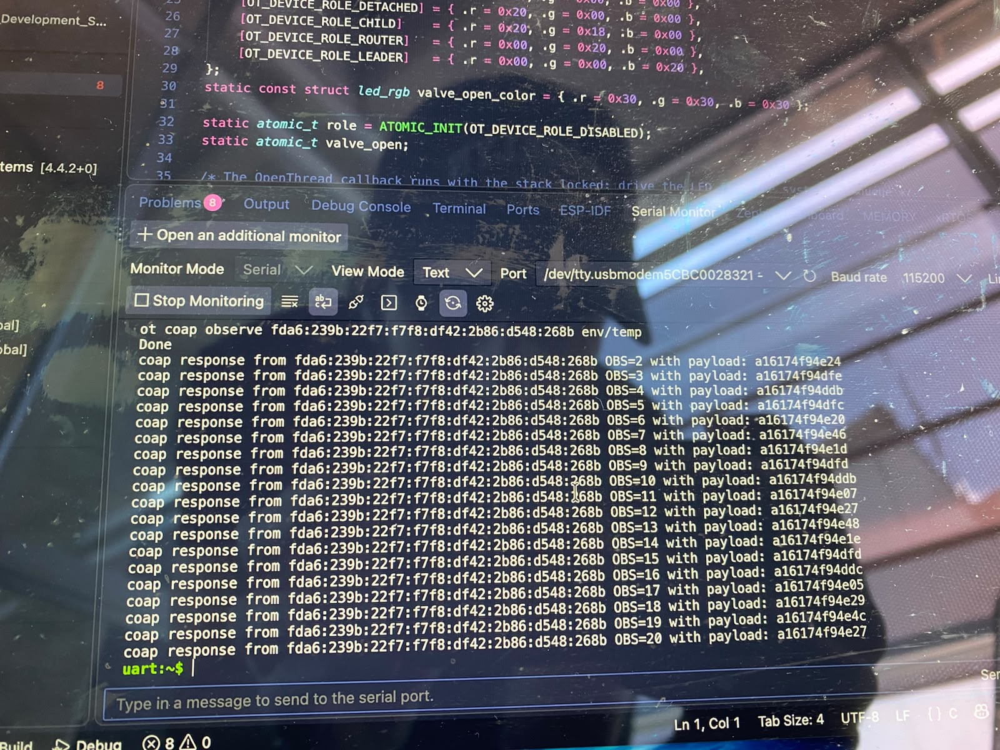
*Fig. 3.1 — Client C (Mac): `ot coap observe <S-mleid> env/temp` and the consecutive OBS sequence from S (network `fda6:…`, session A).*

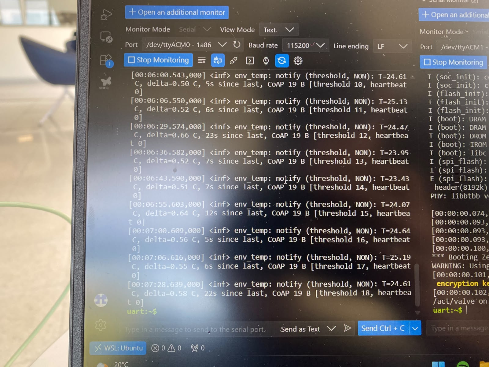
*Fig. 3.2 — Server S: `env_temp: notify (threshold, NON)`, 19 B per notification, heartbeat 0.*

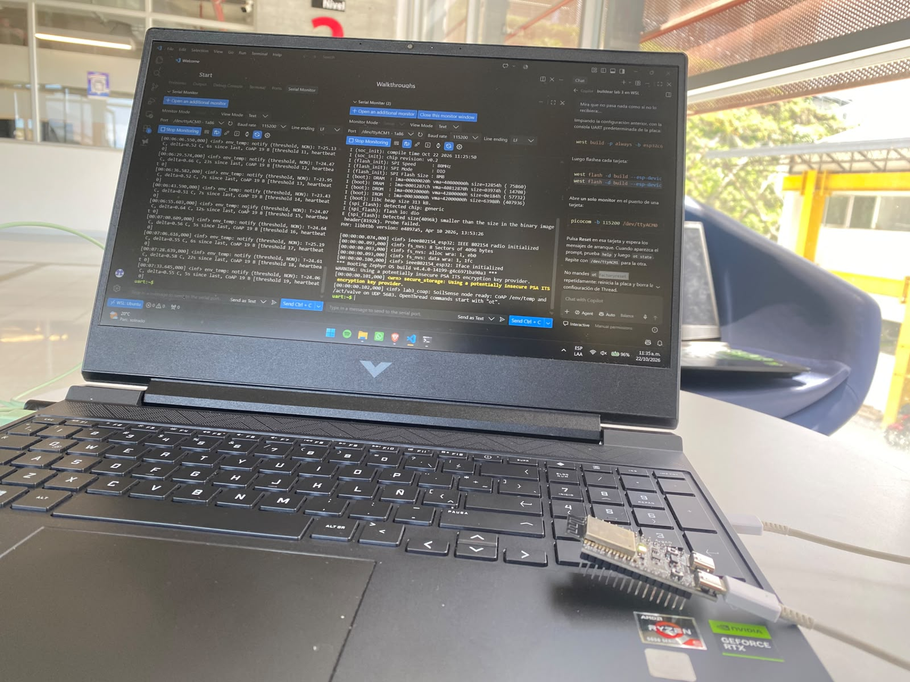
*Fig. 3.3 — Setup: S's console and boot log on the Ubuntu laptop (WSL), with the ESP32-C6 attached.*

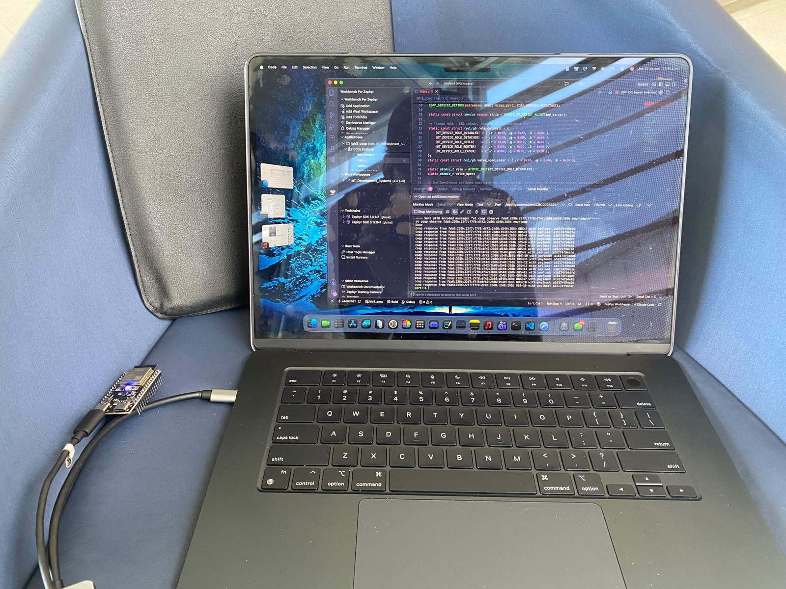
*Fig. 3.4 — C on the Mac running the Observe subscription; LED blue = leader.*

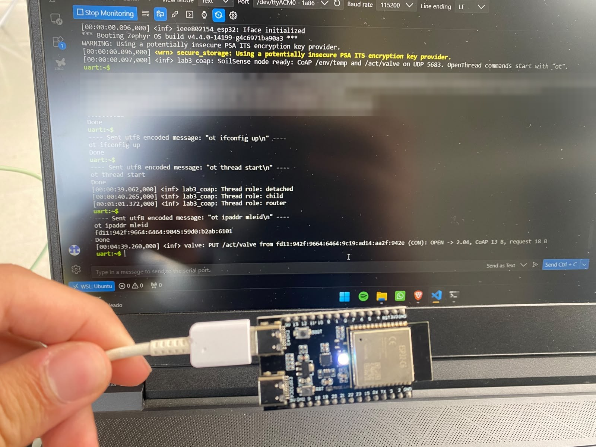
*Fig. 3.5 — Session B (`fd11:…`, channel 26): S joins as router, then `PUT /act/valve (CON): OPEN -> 2.04`; the LED turns white (valve open).*

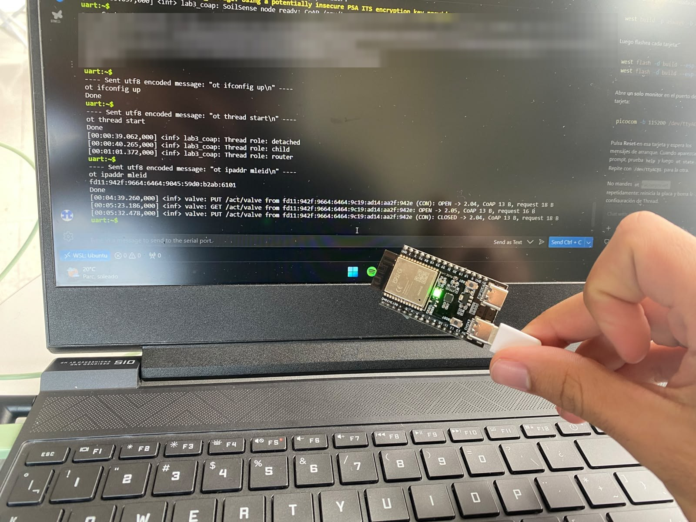
*Fig. 3.6 — `GET /act/valve: OPEN -> 2.05`, then `PUT (CON): CLOSED -> 2.04`; the LED returns to green (router).*

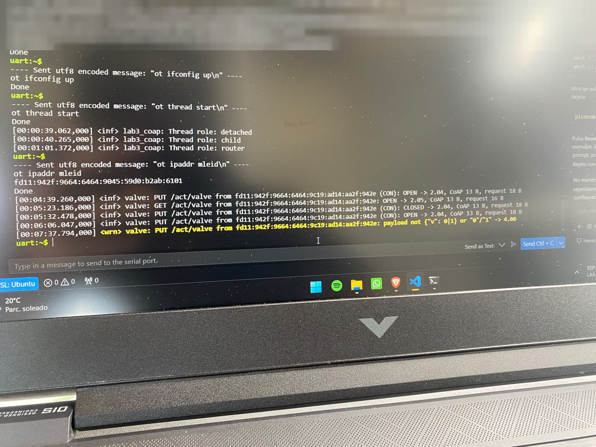
*Fig. 3.7 — PUT with value 7: `payload not {"v": 0|1} or "0"/"1" -> 4.00`.*

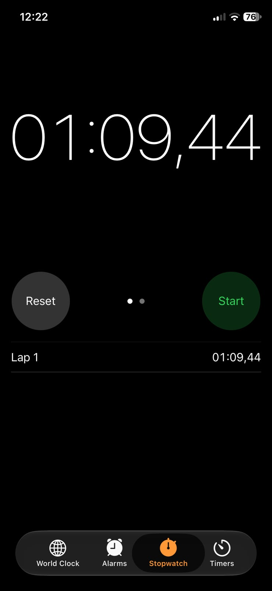
*Fig. 3.8 — Stopwatch for a CON request to an unreachable S: **69.44 s** until `ResponseTimeout`. Consistent with CoAP defaults (ACK_TIMEOUT 2 s × random factor up to 1.5, 4 retransmissions → 62–93 s).*

### Lab 4

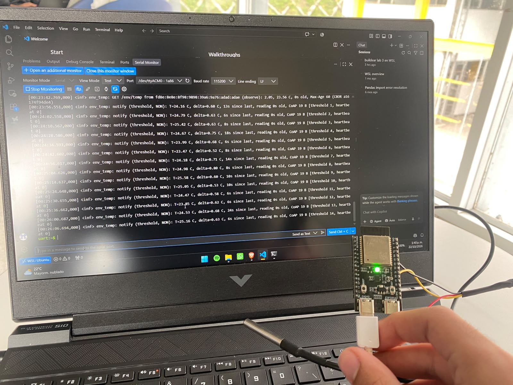
*Fig. 4.1 — S with the DS18B20 probe: `GET /env/temp (observe): 2.05, 23.56 C, 0s old, Max-Age 60`, followed by threshold notifications.*

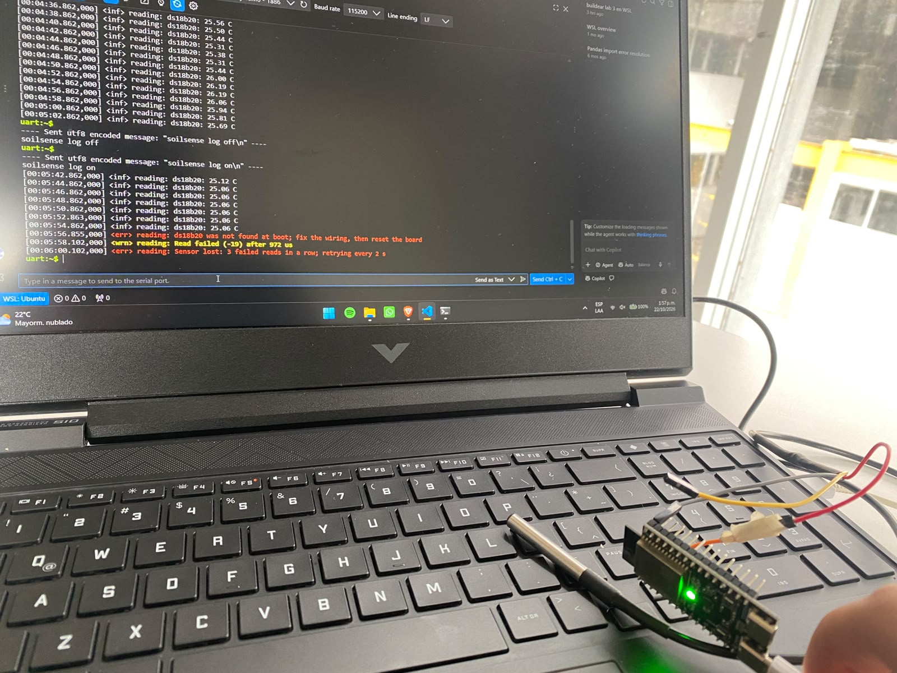
*Fig. 4.2 — Probe unplugged: last good read 25.06 °C at 00:05:54.862, `ds18b20 was not found`, `Read failed (-19)`, and `Sensor lost: 3 failed reads in a row` at 00:06:00.102.*

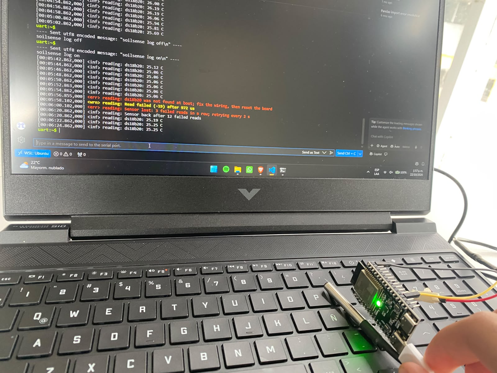
*Fig. 4.3 — Probe reconnected: `Sensor back after 12 failed reads` at 00:06:20.862, readings resume at 25.19 °C.*
