# Design & Decision Record (DDR) — Labs 1–4, Pair 2
**GreenField Technologies | IoT Systems Design**

**Team Members:**
1. Anderson Kaleth Angel
2. Camilo Obando

> Labs 1–4 are done in pairs. From Lab 5 on, this pair and Pair 1 work as one team: see [the team DDR](../labs5-8_equipo/DDR.md).

**Project:** SoilSense · **Course:** IoT Systems Design (4201327), Universidad Nacional de Colombia, Manizales campus · **Instructor:** Samuel Andrés Cifuentes Muñoz · **Hardware:** ESP32-C6-DevKitC with Zephyr + OpenThread · **Sources:** our Lab 1–4 reports (October 2026, written in Spanish and translated here, including the figure labels)

This DDR merges the pair's four lab reports into a single record. The labs build on each other: the Lab 1 radio carries the Lab 2 mesh, the mesh carries the Lab 3 CoAP application, and that application serves the real sensor of Lab 4. The headings follow the course template. Every design claim cites one of our own measurements.

**Conventions**
- **Fig. L.N** is figure N of the Lab L report; the original numbering is kept so the reports can be cross-checked. Labs 3 and 4 also carry the evidence code (E04a, E11, …). All images are in [`img/`](img/), one folder per lab.
- **(est.)** marks an estimate made with a model or an assumption; everything else is measured.
- **†** marks a value that the Lab 4 report flags with † and that has no screenshot behind it.
- Board letters are those of each report (see §1): in Lab 3 Board A is the client, in Lab 4 it is the field node. Labs 3–4 also use the guide's roles: **S** = field node (CoAP server) and **C** = client.

**Contents:** [1. System Overview](#1-system-overview) · [2. Lab Log](#2-lab-log--stakeholder-summaries) · [3. ADRs](#3-architecture-decision-records-adrs) · [4. ISO/IEC 30141](#4-isoiec-30141-mapping) · [5. First Principles](#5-first-principles-reflections) · [6. Performance](#6-performance-baselines) · [7. Ethics](#7-ethics--sustainability-checklist) · [8. Viewpoints](#8-viewpoint-analysis) · [9. Trustworthiness](#9-trustworthiness-audit-lab-4) · [Evidence](#evidence) · [Annexes](#annexes) · [References](#references)

---

## 1. System Overview

*   **System Type:** [x] Component (Lab 1-2) | [x] System (Lab 3-6) | [ ] Environment (Lab 7-8)
    *   Labs 1–2 worked at **component** level: one ESP32-C6, its radio, and the mesh it forms with identical boards. From Lab 3 on, this record describes a **system**: a field node that offers CoAP services and a client that consumes them. Status at the end of Lab 4: **System**.
*   **Description:** SoilSense is a network of soil sensors and irrigation valves for small farms, with battery-powered nodes that must last for months. In Labs 1–4 we built and measured the foundation of the field node: the ESP32-C6's IEEE 802.15.4 radio (Lab 1), a self-healing Thread mesh (Lab 2), a CoAP + CBOR application that reads sensors and commands valves with confirmation (Lab 3), and a real sensor that reports when its reading can no longer be trusted (Lab 4).

### Architecture at the end of Lab 4

| Layer | What was decided | Main evidence | ADR |
|-------|------------------|---------------|-----|
| Radio (IEEE 802.15.4 PHY/MAC) | Channel 15, in the gap between Wi-Fi channels 1 and 6. Tests at 0 dBm; +20 dBm proposed for the field | Reliable range of 5 m at 0 dBm indoors; RSSI threshold of −82 dBm | ADR-001, ADR-001b |
| Network (Thread) | Mesh with mains- or solar-powered routers; battery nodes as sleepy end devices (SED); applications use the ML-EID | Healing in ≈8 s; +14 ms of RTT per hop | ADR-002 |
| Application (CoAP over UDP) | `/env/temp` (GET and NON Observe) and `/act/valve` (idempotent CON PUT), CBOR payload | 15 + 17 B GET; 31 notifications vs. 300 GETs; CON fails explicitly after 71 s | ADR-003 |
| Valve energy (SED) | 5 s poll period | Mean RTT 2.8 s and maximum 4.6 s; ≈256 d of battery (est.) | ADR-004 |
| Sensing | DHT22 read every 2 s, with plausibility checks; 5.03 when no reading is younger than 60 s | 0.1 °C of noise; lost sensor visible in ≈60 s† | §4, §9 |

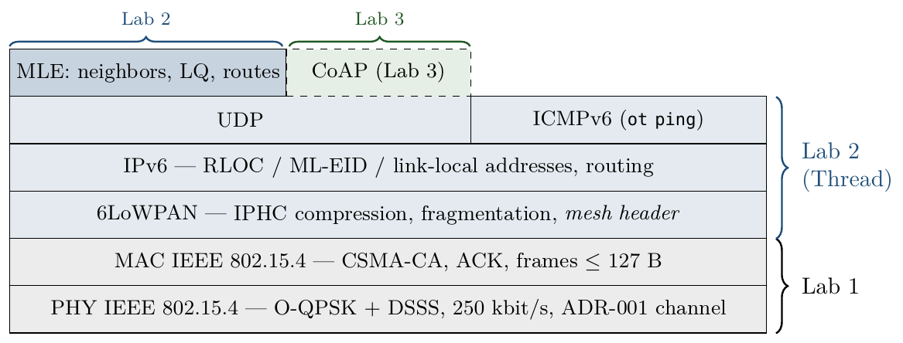

*Fig. 2.1 — Node stack: Lab 1 characterized PHY and MAC; Lab 2 added 6LoWPAN, IPv6 and MLE; Lab 3 put CoAP on top. MLE runs over UDP with link-local addresses.*

### The constraint that drives the design: the energy budget (Lab 1)

Two AA cells (≈3000 mAh at 3 V) store E = 3 Ah × 3600 s/h × 3 V = 32,400 J. For them to last three months (≈7.78 × 10⁶ s), the average power cannot exceed P̄ ≈ 4.2 mW, i.e., an average current of ≈1.4 mA. With Wi-Fi (∼200 mA while transmitting), a duty cycle of only 1 % already draws ≈6 mW. That is why the project uses the IEEE 802.15.4 radio:

| ESP32-C6 radio (reference values from the guide) | Wi-Fi | Bluetooth LE | IEEE 802.15.4 |
|---|---|---|---|
| Transmit current | ∼200 mA | ∼50 mA | ∼20 mA |
| Typical range | 100 m | 10 m | 100 m or more |
| Life on 2×AA | ∼1 week | ∼1 month | 3 months or more |

### Boards, roles and identifiers

| Lab | Boards | Roles | Recorded identifiers |
|-----|--------|-------|----------------------|
| 1 | Board 1 and Board 2 | Board 1 creates the network (leader); board 2 joins as child and becomes router after ≈2 min | Board 1 as seen from board 2: extended MAC `4aad8e407792b07e`, RLOC16 `0x3c00` (0 m run); `36e410573beb1e59`, `0xcc00` (5–15 m runs), see Annex B |
| 2 | A (board 1), B (board 2) and C (board 3, borrowed from another pair) | A leader; B and C routers | Router ID / RLOC16: A 34 / `0x8800`, B 26 / `0x6800`, C 42 / `0xa800`. Extended MAC: B `2606d32b3f3ec3d0`, C `866fe8684c45624b` (Fig. 2.3) |
| 3 | Board A = C (client) and Board B = S (server) | A leader and CoAP client; B router and, in Part 5, SED child of A | ML-EID: A `fd06:8e75:17d4:d588:4b47:ae4c:39be:ac82`, B `fd06:8e75:17d4:d588:b8b1:4e4b:97ee:63eb` |
| 4 | Board A = S (with the DHT22) and Board B = C (client) | B leader and CoAP client; A field node | ML-EID of S: `fd61:d5d3:6ae5:75d9:525a:1b73:b43c:b078` |

Between the 0 m run and the 5–15 m runs of Lab 1 the network was formed again (the mesh-local prefix changed) and board 1 appeared with a different extended MAC; that is why boards are identified by their role in each lab.

**Software and tools.** Zephyr + OpenThread for `esp32c6_devkitc/esp32c6/hpcore`, with one course firmware per lab: `lab1_radio`, `lab2_mesh`, `lab3_coap` and `lab4_sensors` (the latter with the `sensors/dht22.overlay` overlay on the field node). Built and flashed with `west` from Ubuntu (WSL) on Windows, with the boards attached to WSL through `usbipd`; OpenThread console (`ot …`) over the serial monitor. The commands for each lab are in [Annex A](#annex-a--commands-per-lab).

---

## 2. Lab Log & Stakeholder Summaries

### Lab 1: RF Characterization

*The architect's question:* what is the reliable range between nodes, which 2.4 GHz channel is cleanest, and which RSSI predicts 99 % delivery (PER < 1 %)?

*What we did:* two ESP32-C6 boards formed a two-node Thread network at 0 dBm, indoors. At 0, 5, 10 and 15 m we sent 100 pings of 64 B from board 2 to board 1 and read the average RSSI from the neighbor table. The full data are in [§6.1](#61-lab-1--range-rssi-and-packet-loss).

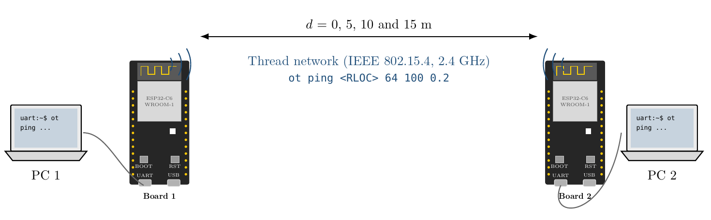

*Fig. 1.2 — Setup (illustration): each ESP32-C6-DevKitC is connected over UART to its own computer; the distance between boards was varied from 0 to 15 m.*

*   **To Samuel (Architect):**
    *   Reliable range: **5 m** indoors at 0 dBm (0 % loss over 100 pings). At 10 m the loss was 35 % and at 15 m there was no link.
    *   Threshold: **RSSI ≥ −82 dBm** for PER < 1 %. The link goes from perfect to dead between −82 and −98 dBm, so the receiver sensitivity (≈ −100 dBm) is not a usable design criterion.
    *   Model: log-distance with **n ≈ 3.2**, about 32–38 dB below free space between 5 and 15 m.
    *   Recommended spacing: **5 m** with the measured configuration, or ≈3 m if 10 dB are reserved for vegetation (est.). At +20 dBm the model gives ≈22 m without margin and **≈11 m with the vegetation margin** (est., ADR-001b).
    *   Channel: **15** (ADR-001), to be confirmed with an energy scan at the farm.
*   **To Edwin (Ops):** use channel 15, in the gap between Wi-Fi channels 1 and 6. If a node loses packets, check its RSSI: below −82 dBm it has to be moved closer or raised.
*   **To Gustavo (Product):** with the measured range, a 10-hectare field would need ≈4000 nodes (US\$160,000). Verdict: **△ test more** (details below).

**Field card for Edwin (Lab 1)**

| Symptom | What to check |
|---------|---------------|
| The node does not join | ☐ Same channel and dataset as the leader? (`ot channel`, `ot dataset active`) · ☐ Antenna clear of hands, metal or metal enclosures? · ☐ Last resort: `ot factoryreset` and load the dataset again |
| Intermittent loss | ☐ `ot neighbor table`: Avg RSSI < −82 dBm or LQ In ≤ 1 → move the node closer or raise it · ☐ A new Wi-Fi router on channel 1 or 6? · ☐ Vegetation or people in the line of sight? |
| Measured distances (indoors, 0 dBm) | ≤ 5 m: stable link (0 % loss) · 10 m: unstable (35 %) · 15 m: no link |
| Estimate at +20 dBm (to be validated) | ≈22 m without obstacles · ≈11 m with vegetation (10 dB margin) |

**Node installation flow (field technician)**
1. Load the network dataset into the node (`ot dataset set active`) and start Thread.
2. Wait until `ot state` shows `child` or `router`.
3. Check `ot neighbor table`: if the Avg RSSI is ≥ −82 dBm and LQ In ≥ 2, the node is installed.
4. If not, move the node closer or raise it and repeat step 3.

**Report for Gustavo — radio feasibility (Lab 1)**

| Item | Result |
|------|--------|
| Maximum reliable range | 5 m (PER < 1 % when RSSI ≥ −82 dBm), indoors and at low power |
| Recommended spacing | 5 m with the current configuration |
| Best channel | 15 (gap between Wi-Fi 1 and 6); avoid 11–14, 16–19 and 21–24 |
| 10-hectare field | ≈4000 nodes × US\$40 = US\$160,000 (at 5 m) |
| Verdict | **△ Test more.** The cost at 5 m is not viable, but the result is indoor and at low power. Repeat outdoors with raised nodes and at +20 dBm: the model estimates ≈22 m of range (≈250 nodes, US\$10,000), or ≈11 m with dense vegetation (≈1000 nodes, US\$40,000) |

| Spacing *s* (m) | Nodes for 10 ha (N ≈ A/s²) | Cost (US\$40 per node) |
|---:|---:|---:|
| 5 | 4000 | 160,000 |
| 10 | 1000 | 40,000 |
| 15 | 445 | 17,800 |
| 20 | 250 | 10,000 |

> **Update (Lab 2):** the mesh is only resilient if every node hears at least two routers (§5, Lab 2, Q3). Spacing has to be smaller than the range, so these counts are a minimum.

### Lab 2: 6LoWPAN

*Thread mesh network: IPv6 addressing, multi-hop and self-healing.* In the pilot a tractor ran over a node and everything that depended on it lost its connection. Edwin asked three questions: does a node beyond direct range reach the gateway through others (coverage)? does the network heal in under 2 min when a router dies (resilience)? and what does each hop cost (latency)?

*What we did:* a mesh of three ESP32-C6 boards (A leader; B and C routers) on channel 15 and at 0 dBm. We classified the IPv6 addresses of each node ([§4](#thread-addressing-lab-2)); with a MAC filter we degraded the A–C link to LQ 1 so that A would reach C through B, proved it with counters and measured the RTT at one and two hops; then we disconnected B with traffic in flight (the tractor test). The data are in [§6.2](#62-lab-2--coverage-per-hop-latency-and-self-healing).

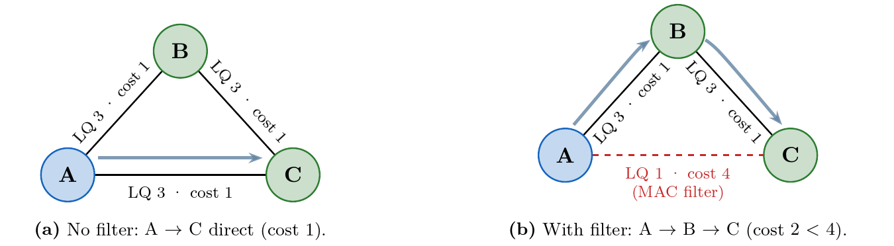

*Fig. 2.2 — Without the filter, A talks to C directly (cost 1). With the filter, the direct link drops to LQ 1 (cost 4) and the chosen route is A → B → C (cost 1 + 1 = 2). Thread prefers two good hops to one bad link.*

*   **To Samuel:**
    1. **Cost per hop:** ≈14 ms of RTT per additional hop (16.1 ms at one hop, 30.3 ms at two), growing linearly. A command crossing 5 hops would take ≈75 ms: about 10 hops fit within the 200 ms CoAP target.
    2. **Address:** firmware and applications must use the **ML-EID**.
    3. **Why:** the RLOC encodes where the node is attached and changes when it reattaches elsewhere in the mesh; the ML-EID is stable and the network resolves it with an address query. In the tractor test the route to C changed twice and the pings to the ML-EID never needed another address.
*   **To Edwin (Ops):**
    1. **Healing:** when the intermediate router was "killed" with traffic in flight, the network healed by itself in **≈8 s** (8 pings lost out of 200), and the optimal route came back by itself when B returned.
    2. **Target:** it meets the < 2 min target with a wide margin, as long as the node has another neighbor in range. Without an alternative route the network cannot heal.
    3. **If a node goes dark:** check that its neighbors are in range and, in `ot router table`, that every node has `Link 1` with at least two routers.

**Field checklist (update for Edwin, Lab 2).** LED code of the `lab2_mesh` firmware: off = *disabled*, red = *detached*, yellow = *child*, green = *router*, blue = *leader*.

| Symptom | What to check |
|---------|---------------|
| Red LED (*detached*) | ☐ Same dataset as the leader? (`ot dataset active`) · ☐ Any router in range? (`ot neighbor table`) · ☐ If it rebooted: `ot ifconfig up` and `ot thread start` |
| Yellow LED for more than 2 min | ☐ Normal up to 120 s; after that check `ot routereligible` |
| Several nodes offline | ☐ Did a router that was the only path go down? In `ot router table`, look for nodes with a single `Link 1` · ☐ More than one blue LED? Partition: check `ot leaderdata` |
| Intermittent loss | ☐ Low LQ In / LQ Out in `ot router table`: move the node closer or raise it · ☐ Neighbor RSSI below the Lab 1 threshold (−82 dBm) |

### Lab 3: Thread & CoAP

*CoAP: reading sensors and commanding valves.* The pilot left two complaints: the batteries of the Wi-Fi prototype lasted four days and the dashboard was slow to update, and an order to open a valve took 14 minutes without anyone knowing whether it had arrived.

*What we did:* on a two-board Thread network, Board A acted as CoAP client and leader (C) and Board B as field node (S) with two resources: `/env/temp` (simulated temperature) and `/act/valve` (irrigation valve). We read the temperature with a single datagram and with Observe, commanded the valve with a confirmable PUT, compared CON and NON with the node off the network, and measured the latency with the valve as a sleepy device. Contracts in [§4](#api-contracts--asd-entries-labs-34) and data in [§6.3](#63-lab-3--coap-observe-con-vs-non-and-the-sleepy-valve).

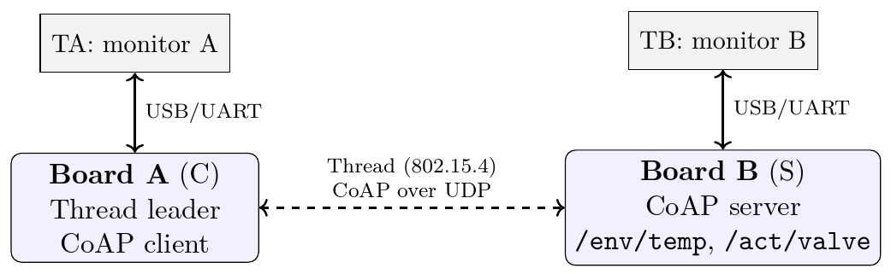

*Fig. 3.1 — Board A (C): Thread leader and CoAP client. Board B (S): CoAP server with `/env/temp` and `/act/valve`. Each board has its serial monitor open in parallel.*

*   **To Daniela (Customer):** readings now use much less battery because each one travels in a single small message (the reply weighs 17 bytes, against hundreds of bytes and 7 or more packets with HTTP over Wi-Fi). Also, the node no longer waits to be asked: it reports when the temperature changes by more than 0.5 °C. In 5 minutes of testing it sent 31 updates instead of the 300 queries a dashboard asking every second would make, which is why your dashboard updates as soon as the value changes. Battery-powered valves listen every 5 s: an order arrives in ≈3 s on average and the estimated battery life is hundreds of days (≈256 d with our assumptions), against the 4 days of the Wi-Fi prototype.
*   **To Edwin (Ops):**
    1. **How an order is confirmed:** every valve order travels as a confirmable message; the valve answers with an acknowledgment and its new state (open or closed), and repeating the same order does not change it.
    2. **If the valve does not answer:** the system retries for a little over a minute (71 s in our test) and then reports an explicit error, so an order is never taken as done without confirmation. That is why orders are never sent without confirmation.
    3. **Expected latency:** with the chosen setting the valve listens every 5 s; an order arrives in about 3 s on average and in about 5 s at most (measured: 2.8 s average and 4.6 s maximum).

### Lab 4: Real Sensors

*Real sensors: can you trust the reading?* The goal is to know when a reading can be trusted and how to tell a broken sensor from a dead node, assessing integrity, availability, reliability and resilience.

*What we did:* we wired a DHT22/AM2302 to Board A (S), powered from 3V3 and never from 5 V (VCC → 3V3, GND → GND, DAT → GPIO19; the module includes the pull-up resistor). Board B was leader and client (C). We measured resolution, noise, offset and response time; disconnected first the sensor and then the node; counted read failures with the radio idle and busy; and tested recovery and reset. Data in [§6.4](#64-lab-4--real-sensor-integrity-availability-reliability-and-resilience) and audit in [§9](#9-trustworthiness-audit-lab-4).

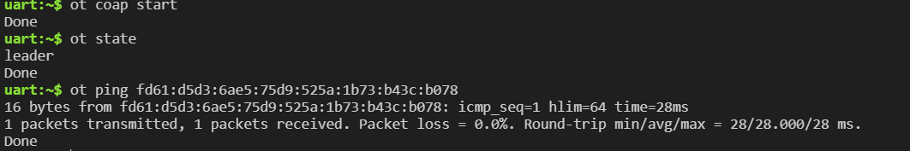

*Fig. 4.1 (E05) — Board B: `ot coap start`, `ot state` = leader and a 28 ms ping to the field node's ML-EID.*

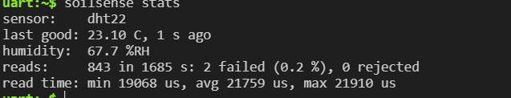

*Fig. 4.2 (E06) — Board A: the DHT22 is read every 2 s. 843 readings in 1685 s with 2 failed (0.2 %) and 0 rejected; read time from 19.1 to 21.9 ms (average 21.8 ms).*

*   **To Edwin:**
    *   If the client receives **5.03** with the text `no fresh reading`, the node is answering and the sensor failed: send someone to check the sensor wiring. It shows up ≈60 s after the last good reading.
    *   If there is no answer and **`ResponseTimeout`** appears, the node is down or off the network. With a confirmable request the alert arrives after 62–93 s (71 s measured in Lab 3; see the note in [§6.4](#64-lab-4--real-sensor-integrity-availability-reliability-and-resilience)).
    *   After recovery, the sensor comes back by itself within seconds, but every client must register its observation again.

| Failure | What the client receives | Time until it is known |
|---------|--------------------------|------------------------|
| Sensor disconnected, node alive | 5.03, text `no fresh reading` | ≈60 s† (equal to the contract's Max-Age) |
| Node off the network | Silence and `ResponseTimeout` | ≈45 s† in Lab 4 (see the note in §6.4); 62–93 s according to the CoAP parameters |

---

## 3. Architecture Decision Records (ADRs)

| ADR | Decision | Lab | Status |
|-----|----------|-----|--------|
| ADR-001 | IEEE 802.15.4 channel: channel 15 | 1 | Proposed |
| ADR-001b | Transmit power: +20 dBm for the field test | 1 | Proposed |
| ADR-002 | Topology: Thread mesh (vs. a LoRaWAN-style star) | 2 | Accepted |
| ADR-003 | CoAP + CBOR for uplink and downlink | 3 | Accepted |
| ADR-004 | 5 s poll period for battery-powered valves | 3 | Accepted (assumptions to be validated) |

> In the Lab 1 report the power decision was recorded as ADR-002. Here it is renumbered **ADR-001b** because the guide's ADR-002 is the topology (Lab 2); this way each number holds a single decision.

**ADR-001: IEEE 802.15.4 channel selection**
*   **Context:** the nodes share the 2.4 GHz band with the farms' Wi-Fi routers (usually on channels 1, 6 or 11) and with Bluetooth devices. These sources belong to the PED and raise the noise floor. Lab 1 showed that the link collapses within only ∼15 dB of RSSI, so every extra dB of noise noticeably cuts the range.
*   **Decision:** operate the network on **channel 15 (2425 MHz)**.
*   **Rationale:** channel 15 sits in the gap between Wi-Fi 1 and Wi-Fi 6, the two channels most used by home routers, and does not overlap any of the three non-overlapping Wi-Fi channels (Fig. 1.1). Channels 25 and 26 are also free of Wi-Fi, but they are close to the upper edge of the band. Channels 11–14, 16–19 and 21–24 are avoided. The 802.15.4 DSSS provides only ≈9 dB of processing gain, which is not enough against a nearby router on the same channel, so channel selection is the first line of defense (§5, Lab 1, Q3).
    *   *Noise floor:* not measured. The per-channel energy scan was not recorded in Lab 1; the decision rests on the Wi-Fi coexistence analysis.
    *   *Follow-up in later labs:* Lab 2 set channel 15 in the dataset (`ot dataset channel 15`). In Lab 3 the dataset was created with `ot dataset init new` without setting the channel and, according to the active dataset of Fig. 3.2 in the original report (redacted here because it contains the Network Key), the network ended up on **channel 20**, which is also in a Wi-Fi gap but is not the ADR's channel. Action: set channel 15 in the dataset in every test.
*   **Status:** [x] Proposed | [ ] Accepted | [ ] Deprecated — it becomes *Accepted* when a passive scan at the farm (`ot scan energy 500`) confirms that channel 15 has the lowest noise floor.

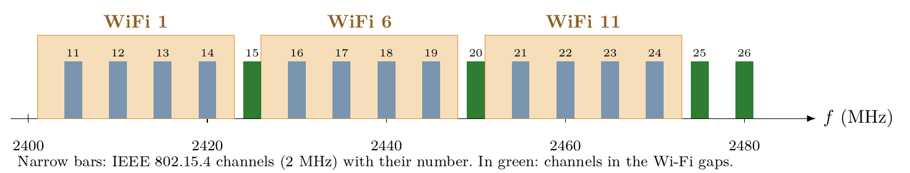

*Fig. 1.1 — 802.15.4 channels (11–26, 2 MHz wide, 5 MHz apart: f = 2405 + 5(k − 11) MHz) vs. Wi-Fi channels 1, 6 and 11 (≈22 MHz). In green, the channels that fall in the gaps: 15, 20, 25 and 26.*

**ADR-001b: Transmit power** *(ADR-002 in the Lab 1 report)*
*   **Context:** at 0 dBm the measured reliable range was 5 m, against a target of 20 m. With that spacing, 10 ha require ≈4000 nodes (US\$160,000). The ESP32-C6 supports up to +20 dBm, but transmitting with more power draws more current from an average budget of only 4.2 mW.
*   **Decision:** configure the nodes at **+20 dBm** (`ot txpower 20`) for the next field test.
*   **Rationale:** according to the fitted model (n ≈ 3.2; table in §6.1), +20 dBm brings the range to ≈22 m (est.), the only value that reaches the target. Each node transmits only a few frames per reading, so the battery impact is moderate compared with the saving of fewer nodes. If the outdoor test shows a longer range, the power can be lowered to save energy.
    *   *Update (Lab 2):* with ADR-002 the routers run on mains or solar power, so the energy cost of the power setting falls mainly on the battery nodes (SED), which transmit few frames.
    *   *State of the evidence:* Labs 2–4 were done at 0 dBm on a desk; the field test at +20 dBm is still pending.
*   **Status:** [x] Proposed | [ ] Accepted | [ ] Deprecated — it becomes *Accepted* after measuring range and consumption at +20 dBm in the field.

**ADR-002: Field network topology**
*   **Context:** in the pilot, a tractor destroyed a node and all the nodes that depended on it lost their connection. Operations requires the network to survive the loss of any node and heal in under 2 minutes, and valve control needs a known latency. The radio characterized in Lab 1 gives 5 reliable metres at 0 dBm indoors (≈22 m estimated at +20 dBm), not enough to cover the crop with a single hop. Alternatives: a Thread mesh on the same radio, or a long-range LoRaWAN-style star.
*   **Decision:** use a **Thread mesh** over IEEE 802.15.4 (channel from ADR-001), with **routers powered from the mains or a solar panel** and **battery-powered sensor nodes as sleepy end devices (SED)**. Applications address the nodes by their **ML-EID**.
*   **Rationale:**
    1. **Resilience:** when the intermediate router was disconnected with traffic in flight, the network healed in ≈8 s (8 pings lost out of 200), 15 times below the 120 s target and with no human intervention; when the router came back, the optimal route was restored by itself (§6.2).
    2. **Latency:** each additional hop costs ≈14 ms of RTT (16.1 ms at one hop, 30.3 ms at two), compatible with valve control. In a class A LoRaWAN star, a downlink command waits for the node's next uplink.
    3. **Coverage:** a node reaches its destination through others; B transmitted exactly 40 unicast frames for 20 pings from A to C (§6.2).
    4. **Native IPv6:** simplifies the CoAP, border router and security labs.
    *   *Accepted costs:* routers cannot run on batteries (with the receiver always on they last ≈6 d at 20 mA, or ≈41 h with the 73 mA RX current from the datasheet used in Lab 3), and the network is only resilient if the topology is redundant: every node with at least two routers in range (§5, Lab 2, Q3).

    | Criterion | Thread mesh (802.15.4) | LoRaWAN-style star |
    |-----------|------------------------|--------------------|
    | Topology | Mesh: every router forwards for its neighbors | Star: each node talks directly to one or more gateways |
    | Range per link | 5 m measured at 0 dBm indoors; ≈22 m estimated at +20 dBm (Lab 1) | Kilometres |
    | Data rate | 250 kbit/s | From about 0.3 to tens of kbit/s |
    | Latency | 16 ms (1 hop) and 30 ms (2 hops), measured | The downlink only arrives after an uplink from the node (class A): a command may wait until the next report |
    | Failure of a node | The network healed by itself in 8 s (measured) thanks to the alternative route | Only that node is lost; the gateway is the critical point |
    | Native IP | Yes: every node has an ML-EID | No: requires a network server and translation |
    | Energy of the relays | Routers always in RX (mains or solar) | No relay nodes; only the gateways need permanent power |
    | Infrastructure | None beyond the nodes (plus the Lab 5 border router) | Gateways and a network server |
*   **Status:** [ ] Proposed | [x] Accepted | [ ] Deprecated

**ADR-003: CoAP + CBOR for uplink and downlink**
*   **Context:** the batteries of the Wi-Fi/HTTP prototype lasted 4 days and a valve order took 14 min without confirmation. The radio layer is a Thread mesh (802.15.4), with 127 B frames and nodes that must sleep.
*   **Decision:** use **CoAP over UDP with a CBOR payload** for readings (GET and Observe with NON notifications) and for orders (idempotent CON PUT), with the contracts in [§4](#api-contracts--asd-entries-labs-34).
*   **Rationale:**
    *   *Byte budget (§6.3):* GET of 15 + 17 B in 2 packets; notification of 19 B in 1 packet; PUT of 18 + 13 B in 2 packets. All of them fit in a single 802.15.4 frame (worst case 67 B out of ≈94 B available), with no fragmentation.
    *   *Observe:* 31 notifications vs. 300 GETs at 1 Hz in 5 min; the node transmits only when the value changes.
    *   *Rejected alternatives:* HTTP/JSON spends ∼270 B and 7 or more packets per reading and needs TCP. MQTT/JSON spends ∼40 B per reading, but requires an open TCP connection with keepalives and a broker; a node that switches its radio off cannot keep it up, so it is not chosen for the radio side.
    *   *Consequences:* (+) few bytes, per-message confirmation, notification on change and a formal schema with CDDL. (−) the client must handle the CON/NON semantics and orders must be idempotent, because duplicates do happen (§6.3, Fig. 3.19–3.28).
*   **Status:** [ ] Proposed | [x] Accepted | [ ] Deprecated

**ADR-004: Poll period of battery-powered valves**
*   **Context:** the valve is an SED; the poll period sets both the order latency and the consumption. Stakeholder needs: Edwin wants an order to act within a few seconds and its outcome to be known (the 14-minute complaint); Daniela wants the battery to last at least one irrigation season. Design assumptions, to be confirmed with them: maximum order latency ≤ 10 s and battery life ≥ 180 d.
*   **Decision:** **5 s poll**.
*   **Rationale:** 5 s meets both assumptions: measured maximum latency of 4.6 s (< 10 s) and ≈256 d of estimated battery life (> 180 d). The 1 s poll fails the battery (≈92 d) and the 15 s poll fails the latency (14.8 s measured). Consequences: an order may take up to about 5 s and may arrive duplicated, which is tolerated because the PUT is idempotent. Shortening the period requires revisiting the energy budget.

    | Poll | Measured max RTT | Estimated life (2×AA, 2000 mAh) | Meets ≤ 10 s and ≥ 180 d? |
    |------|-----------------:|--------------------------------:|---------------------------|
    | 1 s | 0.96 s | ≈92 d | No (battery) |
    | **5 s** | **4.62 s** | **≈256 d** | **Yes** |
    | 15 s | 14.78 s | ≈365 d | No (latency) |
*   **Status:** [ ] Proposed | [x] Accepted | [ ] Deprecated — latency and battery-life assumptions to be validated with Operations.

---

## 4. ISO/IEC 30141 Mapping

### Domain Mapping

| Component | ISO Domain | Justification | Lab |
|-----------|------------|---------------|-----|
| ESP32-C6 SoC (RISC-V MCU + IEEE 802.15.4 radio) | SCD | IoT device that processes and transmits data | 1 |
| Module's printed (PCB) antenna | SCD (boundary with the PED) | Turns SCD bits into PED waves and back | 1 |
| Zephyr + OpenThread firmware | SCD | Network stack that runs on the device and drives the radio | 1 |
| 2.4 GHz RF medium (air) | PED | Environment the signal travels through; sets the losses (n ≈ 3.2) | 1 |
| Wi-Fi/BLE interference, obstacles, ground, people | PED | External elements that limit the real range | 1 |
| PC + WSL + serial monitor | OMD | Firmware flashing and diagnosis | 1 |
| Operator at the `ot` console | UD | Human user who configures the network and reads results | 1 |
| Thread mesh: routers, links, MLE, 6LoWPAN, IPv6 | SCD | The domain's communication subsystem: the Lab 1 proximity link becomes a routed proximity network | 2 |
| A–C backup link (LQ 1) | SCD | Alternative route that makes self-healing possible | 2 |
| ML-EID of each node | SCD → ASD | Stable identity that ASD services use to address individual nodes from Lab 3 on | 2 |
| Tractor or animals (physical failure of a node) | PED | Physical event the mesh must tolerate | 2 |
| `/env/temp` resource (GET, NON Observe, CBOR) | ASD | Reading service consumed by the rest of the system | 3 |
| `/act/valve` resource (CON PUT/GET, idempotent) | ASD | Command service with proof of receipt | 3 |
| API contracts and CDDL schema | ASD | Documented data interface cited by the ADRs | 3 |
| UDP · IPv6 · Thread mesh under CoAP | SCD | The transport stays in the device's communication subsystem | 3 |
| SED poll to its parent (`ot pollperiod`) | SCD (management plane) | Keeps the sleepy device's link alive; not part of the application | 3 |
| Irrigation valve (state simulated in the firmware) | SCD (actuation) | Actuator that executes the ASD's orders | 3 |
| CoAP client (simulated gateway: Board A in Lab 3, Board B in Lab 4) | SCD (IoT gateway) | Consumes the ASD services by ML-EID; the border router replaces it in Lab 5 | 3–4 |
| Air temperature (measured quantity) | PED | Observed physical entity | 4 |
| DHT22 read every 2 s + plausibility checks | SCD (sensing) | Turns the quantity into data and discards the physically impossible | 4 |
| `/env/temp` with freshness (Max-Age, 5.03, Observe) | ASD | The contract says when the data can be used | 4 |
| Trustworthiness | Viewpoint, not a domain | Audit laid over PED, SCD and ASD (§9) | 4 |

**Lab 1 — proximity link.** We tested the PED (radio waves, interference) through the SCD (radio, antenna, MCU). The antenna is the boundary. The PED is not part of the system, but it determines its performance: the same pair of boards went from a perfect link to none between 5 and 15 m without any change to the system.

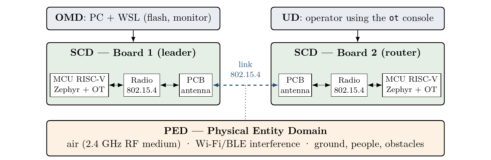

*Fig. 1.4 — Lab 1: the 802.15.4 proximity link joins two SCD devices through the physical medium (PED); the PC (OMD) and the operator (UD) stay outside the component.*

**Lab 2 — routed proximity network.** The mesh lives in the SCD; its stable ML-EIDs are the point of contact with the ASD.

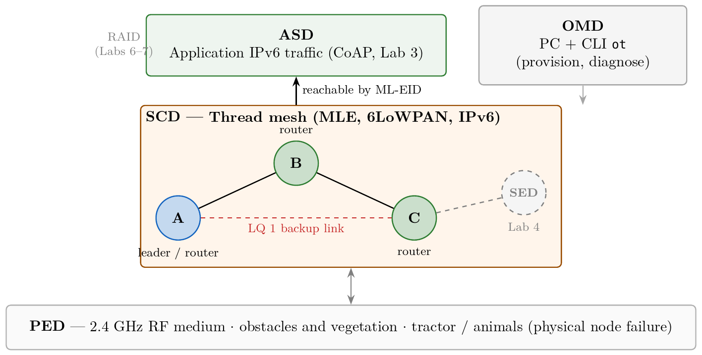

*Fig. 2.15 — Lab 2: the SCD proximity network becomes a routed mesh with a backup link, and its ML-EIDs are the point of contact with the ASD.*

**Labs 3–4 — services and sensing.** What is new lives mostly in the **ASD**: the URIs, the methods, the CBOR contracts and the Observe and CON interaction patterns are the service the rest of the system consumes. The mesh and UDP stay in the **SCD**, and so does the SED poll, which belongs to the device's communication subsystem and not to the application: CoAP is on the functional plane, while MLE keeps the mesh and the SED's link to its parent alive on the management plane. In Lab 4 the measured quantity is in the **PED**, the sensor and its checks are in the **SCD**, and the contract with freshness is in the **ASD**.

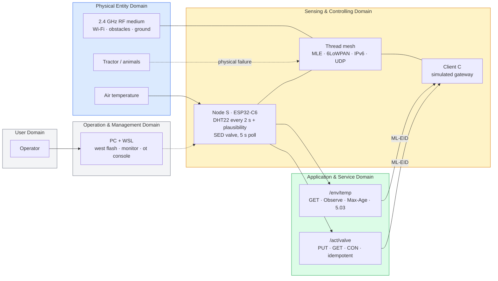
*Integrated map at the end of Lab 4 (drawn for this DDR from the four reports).*

### Component Capabilities

| Capability Category | Subcategory | Component/Feature | Active/Latent | Lab Introduced |
|---------------------|-------------|-------------------|---------------|----------------|
| Transducer | Actuating | On-board RGB LED: status indicator (Lab 1) and Thread-role indicator (Lab 2) | Active | Lab 1 |
| Transducer | Actuating | Irrigation valve `/act/valve` (state simulated in the firmware) | Active (simulated) | Lab 3 |
| Transducer | Sensing | Simulated temperature of `/env/temp` (±1 °C oscillation) | Replaced by the DHT22 in Lab 4 | Lab 3 |
| Transducer | Sensing | DHT22 on GPIO19: temperature (0.1 °C resolution) and humidity (0.1 %RH) | Active | Lab 4 |
| Data | Transferring | IEEE 802.15.4 TX/RX: sending and receiving frames | Active | Lab 1 |
| Data | Processing | RSSI averaging and LQ In in the neighbor table | Active | Lab 1 |
| Data | Storage | NVS: the Thread dataset stays in flash and survives reflashing the firmware | Active | Lab 1 |
| Data | Transferring | Packet forwarding as a router (B relayed the A↔C traffic) | Active | Lab 2 |
| Data | Processing | 6LoWPAN / IPHC compression so that IPv6 fits in 127 B | Active | Lab 2 |
| Data | Processing | MAC and IP counters (`ot counters`): evidence of the path through B | Active | Lab 2 |
| Data | Processing | CBOR encoding (`{"t": float16}`, `{"v": 0 \| 1}`) | Active | Lab 3 |
| Data | Processing | Notification on change (Observe: 0.5 °C threshold, heartbeat at 45 s) | Active | Lab 3 |
| Data | Processing | Plausibility (−40 to 85 °C, steps ≤ 5 °C) and freshness (Max-Age, 5.03) | Active | Lab 4 |
| Interface | Network | 802.15.4 / Thread network: proximity link (Lab 1) and multi-hop IPv6 mesh (Lab 2) | Active | Lab 1 |
| Interface | Application | CoAP server (UDP 5683) with `/env/temp` and `/act/valve` | Active | Lab 3 |
| Interface | Human UI | OpenThread console (`ot …`) and, from Lab 4 on, `soilsense` commands (`stats`, `log`, `inject`) | Active | Lab 1 |
| Interface | Management | Serial monitor (UART): firmware flashing and diagnosis | Active | Lab 1 |
| Interface | Network (testing) | MAC filter (`ot macfilter`) to shape the topology on a desk | Active, testing only | Lab 2 |
| Supporting | Security | MAC-layer AES-CCM encryption with the dataset's network key | Active, not assessed (→ Lab 6) | Lab 2 |
| Supporting | Security | Cryptographic accelerator for DTLS | Latent (→ Lab 6) | Lab 1 |
| Supporting | Energy | SED mode: sleep and poll the parent (`ot mode -`, `ot pollperiod`) | Active on the valve (latent in Lab 2) | Lab 3 |
| Supporting | Synchronization | Time synchronization | Latent: not needed for pings or CoAP | Lab 1 |
| Latent | Other radios | Bluetooth LE | Latent: could be used to commission nodes | Lab 1 |
| Latent | Other radios | Wi-Fi 6 | Latent: ruled out for its consumption; candidate for the border router (Lab 5) | Lab 1 |
| Latent | Interface | Native USB | Latent: debugging only | Lab 1 |

### Thread addressing (Lab 2)

Mesh-local prefix drawn by `ot dataset init new`: `fd60:8f9e:3328:3140::/64`. Addresses marked *derived* were not captured on the console: they follow from the prefix, the RLOC16 or the extended MAC.

| Node | Type | Address | Scope | Use | Source |
|------|------|---------|-------|-----|--------|
| A | ML-EID | `fd60:8f9e:3328:3140:8d73:8738:5e56:fa39` | mesh | identity (applications) | console (Fig. 2.4) |
| A | RLOC | `fd60:8f9e:3328:3140:0:ff:fe00:8800` | mesh | routing | console (Fig. 2.4) |
| A | ALOC | `fd60:8f9e:3328:3140:0:ff:fe00:fc00` | mesh | "the leader", whoever it is (on A only) | derived |
| B | ML-EID | `fd60:8f9e:3328:3140:3d4d:d6fc:696b:bcdd` | mesh | identity (applications) | console |
| B | RLOC | `fd60:8f9e:3328:3140:0:ff:fe00:6800` | mesh | routing | console |
| B | Link-local | `fe80::2406:d32b:3f3e:c3d0` | 1 hop | MLE with neighbors | derived |
| C | ML-EID | `fd60:8f9e:3328:3140:7708:1a28:cfa3:ea2f` | mesh | identity (applications) | console |
| C | RLOC | `fd60:8f9e:3328:3140:0:ff:fe00:a800` | mesh | routing | console |
| C | Link-local | `fe80::846f:e868:4c45:624b` | 1 hop | MLE with neighbors | derived |

*   The three RLOCs follow exactly the pattern `<prefix>:0:ff:fe00:<RLOC16>`, with the same RLOC16 as in the router table (`0x8800`, `0x6800`, `0xa800`).
*   The three ML-EIDs have an IID that resembles neither a MAC nor the RLOC16: it is random, as befits a stable identity that does not depend on the topology.
*   A's link-local address cannot be rebuilt: A's router table shows its own MAC as zeros, and `ot extaddr` was not run on A.

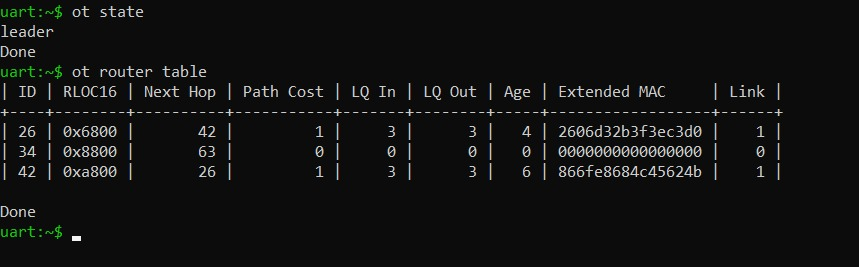

*Fig. 2.3 — Board A: `ot state` = leader and the router table with one row per router (including its own, with `Link 0`). `Link 1` on B and C means a direct radio link with LQ 3 both ways; using a relay would cost 1 + 1 = 2 against 1 for the direct link, so A talks to B and to C directly.*

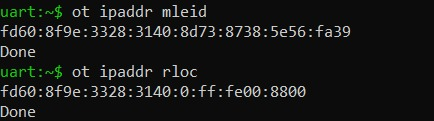

*Fig. 2.4 — Board A: `ot ipaddr mleid` and `ot ipaddr rloc`.*

**Derivations checked by hand**

*Link-local IID from the extended MAC (modified EUI-64, RFC 4291):* the universal/local bit, worth `0x02` in the first byte, is inverted; the other 7 bytes are copied as they are.

| Node | Extended MAC | 1st byte → ⊕ 0x02 | IID in `fe80::` |
|------|--------------|--------------------|-----------------|
| B | `2606d32b3f3ec3d0` | `0010 0110` → `0010 0100` = `24` | `2406:d32b:3f3e:c3d0` |
| C | `866fe8684c45624b` | `1000 0110` → `1000 0100` = `84` | `846f:e868:4c45:624b` |

*Router ID from the RLOC16:* the upper 6 bits are the router ID (ID = RLOC16 ≫ 10); on a router the lower 10 bits (bit 9 and the child ID) are zero.

| Node | RLOC16 | Binary (router ID · lower 10 bits) | ≫ 10 | ID in `ot router table` |
|------|--------|------------------------------------|-----:|-------------------------|
| A | `0x8800` | `100010` · `0000000000` | 34 | 34 ✓ |
| B | `0x6800` | `011010` · `0000000000` | 26 | 26 ✓ |
| C | `0xa800` | `101010` · `0000000000` | 42 | 42 ✓ |

**Multicast groups by role.** The "all routers" groups only appear on routers and the leader; on a child they disappear.

| Group | Meaning | Router / leader | Child |
|-------|---------|:---------------:|:-----:|
| `ff02::1` | All nodes on the link (one hop) | yes | yes |
| `ff03::1` | All nodes in the mesh (realm-local) | yes | yes |
| `ff02::2` | All routers on the link | yes | no |
| `ff03::2` | All routers in the mesh | yes | no |
| `ff03::fc` | MPL forwarders (multicast flooding in the mesh) | yes | yes |

The RLOC is built from the router ID, so it changes when the node reattaches elsewhere in the mesh; the ML-EID is random and does not change. That is why every coverage and healing test was aimed at C's ML-EID.

### Thread roles in the functional viewpoint (Lab 2)

| Thread role | ISO function | In our tests | Power |
|-------------|--------------|--------------|-------|
| Leader | Network coordination: assigns router IDs (max. 32 active) and holds the network data | Board A in Lab 2 (router 34) | Mains / solar |
| Router | Forwarding and route advertisement through MLE | B (router 26) and C (router 42); B was the relay for A → C | Mains / solar |
| REED | Standby forwarder: end device that can be promoted to router | B and C while they were children | Mains / solar |
| End device (FED) | Always-on leaf: does not forward, talks only to its parent | — | Mains / solar |
| Sleepy end device (SED) | Duty-cycled leaf; the only one that can sleep | Board B in Lab 3 as the valve (1, 5 and 15 s polls) | 2×AA batteries |

**Consequence for the Lab 1 battery target.** The 4.2 mW budget is equivalent to an average current of Ī = 4.2 mW / 3 V ≈ 1.4 mA. A router (and also the leader, a REED or a FED) keeps its receiver always on: even with the guide's optimistic 20 mA it would last 3000 mAh / 20 mA = 150 h ≈ 6 d, and with the datasheet's 73 mA RX current (Lab 3) about 41 h. An SED that wakes up 1 % of the time draws ≈0.01 × 20 mA = 0.2 mA plus its sleep current; the Lab 3 estimate with datasheet values gives 0.33 mA at a 5 s poll, below 1.4 mA. **Design conclusion:** routers need mains or solar power and battery nodes must operate as SEDs (ADR-002).

### API contracts — ASD entries (Labs 3–4)

The course firmware produces exactly these contracts; it was not modified.

**`/env/temp` — air temperature** (Lab 3 contract, updated in Lab 4)

| Field | Promise |
|-------|---------|
| Methods | GET; GET with Observe (RFC 7641) |
| Content-Format | 60 (`application/cbor`) |
| Payload | `{"t": float16}`, in °C, always 6 B |
| Accuracy *(Lab 4)* | DHT22: ±0.5 °C and ±2 %RH (datasheet); 0.1 °C resolution |
| Max-Age | Lab 3: 60 s. *Lab 4:* 60 s minus the age of the reading |
| Plausibility *(Lab 4)* | Rejected outside −40 to 85 °C or with steps > 5 °C between two samples (2 s) |
| No fresh reading *(Lab 4)* | `5.03 Service Unavailable`, Max-Age 10, payload `no fresh reading` |
| Observe policy | NON notification if the value changed by more than 0.5 °C since the last one; CON heartbeat after 45 s without notifying. *Lab 4:* one 5.03 notification (CON) when the reading stops being fresh, and the observation ends |

| Payload bytes | CBOR meaning | Detail |
|---------------|--------------|--------|
| `A1` | map with 1 pair | — |
| `61 74` | 1-byte text string | the key `"t"` |
| `F9 hh ll` | 16-bit number (IEEE 754 half precision) | big-endian |

*Check against the contract (Lab 3):* Board A received `a16174f94e52` and the server logged 25.28 C. With `0x4E52` = `0 10011 1001010010`: sign 0, exponent 10011₂ = 19, mantissa 1001010010₂ = 594, so t = 2^(19−15) · (1 + 594/1024) = 16 · 1.580078 = **25.28125 °C**, the same value the server logs and the one https://cbor.me gives.

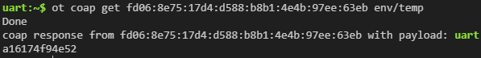

*Fig. 3.5 (E04a) — Board A: `ot coap get <MLEID_B> env/temp` (NON by default, path without a leading `/`) and payload `a16174f94e52`.*

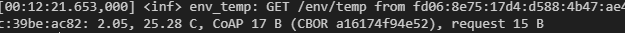

*Fig. 3.6 (E04b) — Board B: 2.05, 25.28 C, 17 B CoAP response and 15 B request.*

**`/act/valve` — irrigation valve** (Lab 3)

| Field | Promise |
|-------|---------|
| Methods | PUT (set) and GET (read) |
| Request payload | CBOR `{"v": 0 \| 1}` with Content-Format 60, or the text `0`/`1` without Content-Format (the OpenThread shell only sends text) |
| Response payload | Valve state in CBOR `{"v": 0 \| 1}`, Content-Format 60 |
| Codes | 2.04 Changed after PUT; 2.05 Content after GET; 4.00 Bad Request for any other payload |
| Delivery mode | CON (confirmable) |
| Idempotent | Yes: the same PUT twice leaves the same state |

| Response bytes | Value | State |
|----------------|-------|-------|
| `A1 61 76 00` | `{"v": 0}` | closed |
| `A1 61 76 01` | `{"v": 1}` | open |

*Check (Lab 3):* `put … con 1` → `a1617601` and on B `OPEN -> 2.04` (01:35:09.026); `get` → `a1617601` and `GET: OPEN -> 2.05` (01:36:13.992); `put … con 0` → `a1617600` and `CLOSED -> 2.04` (01:37:35.125). PUT request of 18 B, GET request of 16 B and 13 B responses. **Idempotence:** the second `con 1` in a row (01:39:55.528) logged `OPEN, no change -> 2.04`. **Invalid payload:** `con 7` produced a warning and **4.00** on B (01:40:47.474); Board A showed the response without a payload because the shell does not print the code, which is read in the server log.

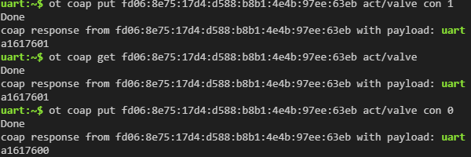

*Fig. 3.10 (E08a) — Board A: PUT con 1, GET and PUT con 0 (responses `a1617601`, `a1617601`, `a1617600`).*

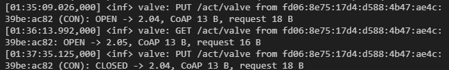

*Fig. 3.11 (E08b) — Board B: OPEN → 2.04, GET OPEN → 2.05 and CLOSED → 2.04.*

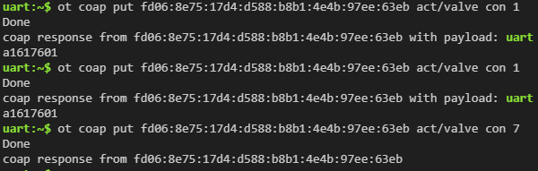

*Fig. 3.12 (E09a) — Board A: `con 1` twice and `con 7` (response without a payload).*

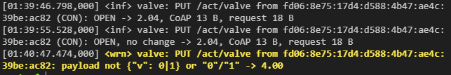

*Fig. 3.13 (E09b) — Board B: `OPEN`, `OPEN, no change` and the warning that ends in 4.00.*

**CDDL schema (RFC 8610)**

```
env-reading = { t: float16 }   ; degrees Celsius
valve-state = { v: 0 / 1 }     ; 0 = closed, 1 = open
```

---

## 5. First Principles Reflections

**Lab 1:**
1. **Why does RSSI drop with distance, and by how much per doubling?** The antenna spreads its power over an almost spherical wavefront of area 4πd², so the power density falls as 1/d². The receiving antenna only captures what falls on its effective aperture A_e = Gλ²/4π, hence the frequency term of the Friis formula, PL(d) = 20 log₁₀ d + 20 log₁₀ f − 147.55 dB (at 2.45 GHz, PL(1 m) ≈ 40.2 dB). In decibels, 1/d² means losing **6 dB every time the distance doubles**: the energy is not used up, it is spread out. In practice the drop was faster: the fitted slope of 32.4 dB per decade (n ≈ 3.2) is **≈9.8 dB per doubling**, for two reasons:
    *   *Absorption and obstacles:* the water in human bodies and in leaves absorbs strongly at 2.4 GHz.
    *   *Proximity to the ground:* for a 15 m link the first Fresnel zone has a radius of √(λd/4) ≈ 0.68 m at the midpoint, and a board a few centimetres above the desk or the floor has it obstructed. According to the two-ray model, beyond d_c = 4·h_t·h_r/λ the loss grows by 40 dB per decade: with antennas at 0.3 m, d_c ≈ 3 m; with antennas at 1 m, d_c ≈ 33 m. Raising the nodes is the cheapest way to gain range.
2. **The receiver decodes signals near −100 dBm. Why did PER < 1 % need a much stronger signal?** The data show it: at −89 dBm, still 11 dB above the sensitivity, 35 % of the packets were lost. Sensitivity is specified under ideal conditions (stable channel, no interference, short 20-byte frames). The margin is consumed like this:
    *   *Multipath fading:* the signal arrives over several paths that add up with different phases, and the instantaneous power fluctuates around the average (Rayleigh model). For it to fall below the minimum less than 1 % of the time, a margin of M = −10 log₁₀(−ln 0.99) ≈ 20 dB is needed. The Avg RSSI is an average and hides those fades; the difference of up to 5 dB between Avg and Last RSSI is evidence of the fluctuation.
    *   *Real noise and interference:* the thermal noise in 2 MHz is −174 + 10 log₁₀(2 × 10⁶) ≈ −111 dBm, but Wi-Fi, Bluetooth and other equipment in the building raise the noise floor.
    *   *Longer frames:* each 64 B ping travels in a frame much longer than the 20 B one of the specification; with the same bit error rate, a long frame is more likely to arrive corrupted.

    That is why the reliable link required RSSI ≥ −82 dBm, a margin of ∼18 dB over the sensitivity.
3. *(Optional)* **How does an 802.15.4 link survive Wi-Fi on the same band?**
    *   *DSSS:* each group of 4 bits travels as a sequence of 32 chips (O-QPSK at 2 Mchip/s, 250 kbit/s). The receiver correlates against those sequences: the right signal is concentrated and uncorrelated interference is attenuated by G_p = 10 log₁₀(2 Mchip/s / 250 kbit/s) ≈ 9 dB.
    *   *Narrow channel:* 802.15.4 occupies 2 MHz against Wi-Fi's 22 MHz, so choosing a channel in a gap (15, 20, 25 or 26) avoids the overlap.
    *   *CSMA-CA, ACK and retries:* the radio listens before transmitting and retransmits frames that are not acknowledged.

    Even so, 9 dB are not enough against a nearby Wi-Fi router on the same channel: channel selection is the first line of defense (ADR-001).

**Lab 2:**
1. **How does a 40-byte IPv6 header fit in a 127-byte frame? Which interface ID can the receiver rebuild from the MAC header, the RLOC's or the ML-EID's?** Of the frame's 127 B, the MAC header, the security header, the MIC and the FCS take about 20–25 B, so an uncompressed IPv6 header would eat almost half of the useful space. 6LoWPAN IPHC compression (RFC 6282) does not send the predictable fields: version, traffic class and flow label (almost always 6, 0 and 0), the length (deduced from the MAC frame) and the hop limit if it is 1, 64 or 255. The key is the addresses, 32 of the 40 bytes. The 64-bit prefix never travels: it is `fe80::` or the mesh-local prefix (`fd60:8f9e:3328:3140::/64` in our network), which every node holds as context 0. The IID depends on the address type:
    *   **RLOC** (e.g. `0:ff:fe00:a800` for C): a fixed pattern plus the 16 bits of the short address, which already travel in the MAC header (or in the *mesh header* when there are several hops). **The receiver rebuilds it** and 0 bytes are sent.
    *   **ML-EID** (e.g. `7708:1a28:cfa3:ea2f` for C): it is random, unrelated to any MAC, and its 8 bytes have to be sent.

    | Field | Uncompressed | RLOC → RLOC | ML-EID → ML-EID |
    |-------|-------------:|------------:|----------------:|
    | IPHC encoding | — | 2 B | 2 B |
    | Version, traffic class, flow label | 4 B | 0 | 0 |
    | Payload length | 2 B | 0 | 0 |
    | Next header (ICMPv6, inline) | 1 B | 1 B | 1 B |
    | Hop limit (64) | 1 B | 0 | 0 |
    | Source address (prefix + IID) | 16 B | 0 + 0 | 0 + 8 B |
    | Destination address (prefix + IID) | 16 B | 0 + 0 | 0 + 8 B |
    | **Total** | **40 B** | **3 B** | **19 B** |

    The 16 B of difference are payload lost by using ML-EIDs, so the fragmentation threshold towards an ML-EID is lower. Our 64 B pings (72 B of ICMPv6) to C's ML-EID fit without fragmentation. If a datagram does not fit, 6LoWPAN fragments it (RFC 4944): losing one fragment is enough to lose the datagram, and OpenThread drops a half-reassembled one after 2 s. That is why application payloads should stay below about 80 bytes; the Lab 3 CoAP payloads weigh less than 20 B.
2. **Why did healing take seconds and not minutes? What told A that B was gone, and what would happen on a link that carried no traffic?** Thread forgets a silent neighbor router after 100 s, but the pings recovered in 8 s. What raised the alarm first was the missing ACKs at the MAC layer: every ping request from A to B is a unicast frame that asks for an ACK; with B disconnected, every frame exhausted its retries and, after 4 consecutive failed frames, A declared the link down and recomputed: the only remaining route to C was the direct link (cost 4). The same happened to C with its replies, which is why exactly 4 + 4 = 8 pings were lost (184 to 191). When the topology changes, MLE advertisements are sent every second again (Trickle timer) and the new costs spread quickly. The 100 s timer was observed too, but only for deleting B from the table: about 116 s after the disconnection, B's row was gone (Fig. 2.13). **On a link with no traffic** there are no frames to fail, so nobody notices until that timer expires. Shortening it would require every router to advertise more often: more airtime, more energy and less room for data. Detection speed is paid for with duty cycle; in SoilSense, with periodic readings, the traffic itself acts as a link probe.
3. **Why does the tractor test need a *poor* A–C link and not *no* link? What does that mean for node spacing in Daniela's field?** Self-healing needs an alternative path. An LQ 1 link has a high cost (4) and routing avoids it while B is alive, but it is still a valid link that stays as a backup: it was exactly the one that carried the traffic from ping 192 on. With a MAC deny list instead of `add-lqi` the direct link would not exist: when B was disconnected, C would be isolated, the pings would never recover and, after about 120 s, C would form its own partition as leader, unable to talk to A until B came back. For the field this means that **the mesh is only resilient if the topology is redundant**: every node must hear at least two routers and no node must be able to split the network when it falls.
    *   The spacing between nodes must be smaller than the reliable range of Lab 1, so that each node has several neighbors with a usable link.
    *   "Bad" links (LQ 1, margin of 2 to 10 dB) also count: they are not used under normal conditions, but they are the escape route when a neighbor falls.
    *   Rows of nodes at the edge of the crop or along long paths (a single line) are the most fragile: they should be densified or given an extra router.
4. *(Optional)* **Why do applications use the ML-EID?** This test was not run; the answer is based on the observed addresses. The RLOC encodes the point of attachment: C's is `…:0:ff:fe00:a800` because C is router 42. If C reattaches as the child of another router or gets another router ID, its RLOC16 changes and the old address ceases to exist: a ping to the old RLOC fails even though C is connected. The ML-EID (`…:7708:1a28:cfa3:ea2f`) does not depend on the topology, and the network finds where it is with an address query. In the tractor test the route to C changed twice and the pings to the ML-EID never needed another address.

**Lab 3:**
1. **Why can CoAP use UDP where HTTP needs TCP? What does CON give back, and what does NON deliberately give up?** HTTP assumes a reliable, ordered byte stream, and that is why it needs TCP: connection, request, response and close, 7 or more packets per reading. CoAP carries reliability inside each message and makes it optional, so it travels in a connectionless UDP datagram: a reading costs 2 packets (15 B + 17 B measured). **CON gives back** the reliability TCP provided by default, but only for the messages that need it: an acknowledgment (ACK), retransmission with exponential back-off (first wait of 2–3 s, doubled each time, 4 retries) and, if everything fails, an explicit error. With B off the network, A retried for 71.28 s and ended in `ResponseTimeout`: the operator knows that the order was not confirmed. **NON gives up** exactly that: ACK, retries and failure notice. A NON PUT with B absent produced no message at all for more than 8 min. That is why NON suits data that is soon replaced (temperature notifications) and CON suits orders (valve).
2. **Why does Observe save battery compared with a GET every 60 s? Who knows when the value changed, and who pays for the radio?** With periodic GETs the client decides, and it does not know whether the value changed: every query costs a request and a response (15 B + 17 B, 2 packets) even if the value is the same, and changes between queries can be missed (the simulated sensor oscillates ±1 °C over 60 s, so sampling every 60 s would always see the same point of the cycle). With Observe **the server decides, and it is the one that measures**: the client registers once and the node only transmits when the change exceeds 0.5 °C, or as a heartbeat at 45 s. In Part 3: 31 notifications of 19 B (589 B, one packet each) against 300 GETs at 1 Hz (9600 B and 600 packets). **The radio is paid for by the node that transmits and the one that receives:** with queries both ends pay for each one, even when nothing changed; with Observe the server transmits only when there is new data. Fewer transmissions and receptions mean less time with the radio on.
3. **Why did the sleepy valve receive the same PUT twice, and why was that harmless? What would have happened with a "toggle valve" command?** With a 5 s poll the parent (A) holds the messages until B asks. The first CON retransmission happens between 2 and 3 s, before B asks again: if the next poll falls after that moment, the parent already holds two copies and B receives both together. That explains PUTs no. 2 and no. 4 (answered after 4 and 4.92 s, copies 53 and 139 ms apart); PUTs 1, 3 and 5 were answered after 2 s, before the retransmission, and arrived only once (Fig. 3.19–3.28). It was harmless because the PUT is **idempotent**: the second copy answered `CLOSED, no change -> 2.04`. With a "toggle" command, each copy would change the state: a duplicated "open" would end with the valve closed and the operator would believe the order had been carried out, because not even the confirmation would be reliable. The same holds for any CON retransmission on a lossy network: in Part 4 there was another one (after 2.06 s, without sleeping) that also ended in `no change`.
4. **Why CBOR and not a hand-made binary struct?** CBOR is self-describing: the map carries the key (`"t"`, `"v"`) and the type (`f9`, integer) together with the data, so any generic decoder (such as https://cbor.me) can interpret it without knowing the firmware. Our 6 B of payload hold 2 B of value and 4 B of structure: a small overhead that buys interoperability. A hand-made struct requires sender and receiver to share out of band the order, size and endianness of the fields, and any change breaks old clients. In a CBOR map a field can be added (for example `"h"` for humidity) and clients that do not know it simply ignore it; in a struct, adding it shifts the offsets. With CDDL the schema is written in a formal language that can be validated and cited as a contract (§4).

**Lab 4:**
1. **Why does `/env/temp` answer 5.03 instead of the last value it has? What would a stale value presented as current do to Daniela's decisions?** Max-Age is a freshness promise: the client may use the data only while it lasts. Serving an old value as current, like the 24 °C of the afternoon of the incident, would lead Daniela to decide the irrigation with false information. The 5.03 turns the missing data into an explicit fact.
2. **How does a client tell "sensor dead" from "node unreachable"? Which one needs an answer from the node, and which shows up only as silence?** With a dead sensor the node does answer: 5.03 with the text `no fresh reading`. With a dead node there is only silence and, with a CON request, `ResponseTimeout`. The first needs an answer from the node; the second shows up only as the absence of an answer.
3. **Why can't a plausibility check stop a value that is wrong but believable?** It only checks the physical range and the maximum rate of change, and a believable value close to the previous reading passes both: `inject 25.5` was accepted (Fig. 4.6). It would take a second sensor, a neighboring node's reading or a cryptographic signature (Lab 6) to catch it.
4. **Why can a busy radio make a sensor read fail? Compare a sensor whose protocol the CPU times bit by bit with one that has its own bus hardware.** The DHT22 is timed by the CPU bit by bit for about 22 ms (Fig. 4.2), and a radio interrupt can corrupt a bit: with the radio busy the failure rate rose from 0 % to 3.3 %†. A sensor with a hardware bus (for example the DS18B20 or the BMP280) does not depend on that exact timing: another pair's DS18B20 converts for 760 ms with the CPU free.

---

## 6. Performance Baselines

| Metric | Target | Measured | Status |
|--------|--------|----------|--------|
| Lab 1: Max Range | > 20m | **5 m** (PER < 1 %, indoors, 0 dBm); ≈22 m (est.) at +20 dBm | [ ] Pass — not met at 0 dBm; ADR-001b proposes +20 dBm |
| Lab 2: Healing Time | < 120s | **≈8 s** (8 pings lost out of 200; 1 run) | [x] Pass |
| Lab 3: CoAP Latency | < 200ms | **≈12 ms** (1-hop RTT: 12 / 12.1 / 13 ms with ICMP ping, as a proxy for the GET) | [x] Pass |
| Lab 3: Poll Latency (5 s period) | < 5s | **4.6 s** maximum (2.8 s mean) | [x] Pass |
| Lab 4: Time to see a lost sensor | ≤ 60s | **≈60 s†** (= the contract's Max-Age) | [x] Pass |
| Lab 4: Read failures, radio busy | < 5% | **3.3 %†** (2 of 60) | [x] Pass |

Reference metrics (no target in the template):

| Metric | Measured | Source |
|--------|----------|--------|
| RSSI threshold for PER < 1 % | −82 dBm | Lab 1, §6.1 |
| RTT of 64 B at 1 / 2 hops | 16.1 / 30.3 ms | Lab 2, §6.2 |
| RTT per additional hop | 14.2 ms | Lab 2, §6.2 |
| Frames forwarded by relay B for 20 pings | 40 TxUnicast | Lab 2, §6.2 |
| GET `/env/temp` (request / response) | 15 B / 17 B, 2 packets | Lab 3, §6.3 |
| Observe notifications vs. GETs at 1 Hz (5 min) | 31 vs. 300 (10.3 %) | Lab 3, §6.3 |
| CON wait until the error | 71.28 s (prediction 62–93 s) | Lab 3, §6.3 |
| Latency with 1 / 5 / 15 s poll (mean) | 0.49 / 2.83 / 7.51 s | Lab 3, §6.3 |
| Valve battery life with a 5 s poll | ≈256 d (est.) | Lab 3, §6.3 |
| DHT22 noise at rest (1 min) | 0.1 °C peak to peak (≈0.05 °C standard deviation) | Lab 4, §6.4 |
| Read failures at rest | 0 %† (0 of 60); 0.2 % over 843 readings (Fig. 4.2) | Lab 4, §6.4 |
| Sensor recovery after reconnecting it | ≈2 s† (next reading); GET back to 2.05 after ≈4 s† | Lab 4, §6.4 |

### 6.1 Lab 1 — Range, RSSI and packet loss

100 pings of 64 B per distance, from board 2 to board 1; RSSI read from board 2's neighbor table (full output in [Annex B](#annex-b--lab-1-terminal-output)).

| Distance (m) | Avg RSSI (dBm) | Last RSSI (dBm) | LQ In (0–3) | Received / sent | PER (%) | Mean RTT (ms) |
|---:|---:|---:|:---:|:---:|---:|---:|
| 0 | −72 | −67 | 3 | 100/100 | 0 | 14.07 |
| 5 | −82 | −79 | 2 | 100/100 | 0 | 14.01 |
| 10 | −89 | −85 | 1 | 65/100 | **35** | 14.28 |
| 15 | −98 | −100 | 0 | 0/100 | **100** | — |

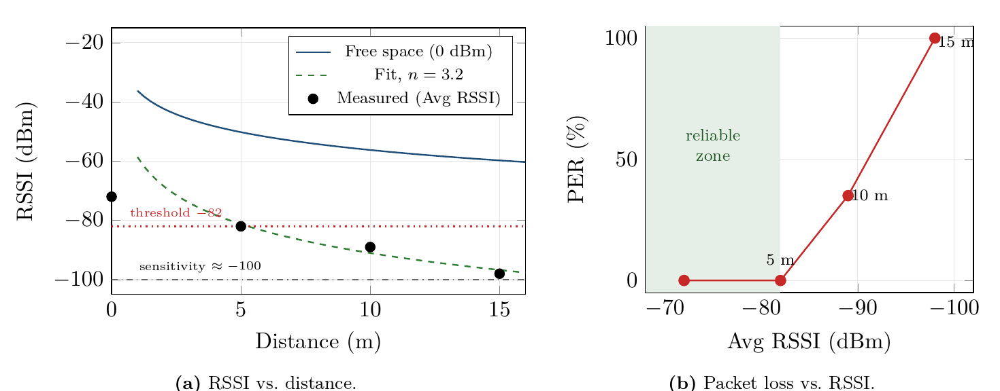

*Fig. 1.3 — (a) Measured RSSI against free space and the log-distance fit (n = 3.2); (b) the loss goes from 0 to 100 % within only ∼15 dB of RSSI.*

*   **RSSI threshold:** the loss went from 0 % at −82 dBm to 35 % at −89 dBm and to 100 % at −98 dBm. The link does not degrade gradually: it collapses within ∼15 dB. With the data available, the threshold for PER < 1 % is **RSSI ≥ −82 dBm**; the exact break point is between −82 and −89 dBm. OpenThread's LQ In indicator (3, 2, 1, 0) follows the same trend and works as a quick alarm in the field.
*   **Reliable range:** the last loss-free point was 5 m. With the fitted model the RSSI reaches −82 dBm at about 5.3 m, so the reliable range under these conditions is between 5 and 6 m, far below the 20 m target.
*   **Comparison with theory:** at 5, 10 and 15 m the measured losses (86, 93 and 102 dB, assuming P_tx = 0 dBm and 2 dBi antennas) exceed those of free space (54, 60 and 64 dB) by about 32–38 dB. A least-squares fit of the log-distance model to those three points gives **RSSI(d) ≈ −58.6 − 32.4 log₁₀ d dBm (n ≈ 3.2)**, with an error of ≈2 dB or less. The exponent is typical of indoor environments; the ∼22 dB extra at 1 m are explained by boards at desk or floor height (obstructed Fresnel zone), people and furniture in the path, the orientation of the printed antennas, reflections in the room and, possibly, an effective power lower than the nominal one.
*   **Measurement at 0 m:** with the boards side by side the RSSI was −72 dBm, much less than an extrapolation would give. A few centimetres apart the antennas are in each other's near field and detune each other, so Friis does not apply; the point only confirms that the link works and was not used in the fit.
*   **Latency:** the mean RTT was ≈14 ms at every distance. Propagation over 15 m takes 50 ns, so the airtime at 250 kbit/s, medium access (CSMA-CA) and processing dominate. At 10 m the maximum rose to 25 ms: the MAC layer had to retry frames.
*   **Limitations:** each distance was measured once and in a single direction. The ping PER is round-trip and includes the MAC's automatic retries, so the radio's frame error rate is higher than what the application sees. The per-channel energy scan was not recorded. The 20 and 30 m distances were not measured.

**Projections with the fitted model (est.).** These are not measurements; they serve to plan the next tests. The model predicts ≈ −101 dBm at 20 m and ≈ −107 dBm at 30 m, both below the sensitivity: with the lab's configuration no link is expected at those distances, which is consistent with the total loss observed from 15 m on. Since the RSSI rises dB for dB with the power, the range for a given threshold grows as d = 10^((RSSI₁ₘ + ΔP − threshold)/(10n)):

| TX power | Range with RSSI ≥ −82 dBm | Range with a 10 dB vegetation margin (RSSI ≥ −72 dBm) |
|----------|--------------------------:|------------------------------------------------------:|
| 0 dBm (lab) | 5 m (measured) | ≈3 m |
| +8 dBm | ≈9 m | ≈5 m |
| +14 dBm | ≈14 m | ≈7 m |
| +20 dBm (ESP32-C6 maximum) | ≈22 m | ≈11 m |

Only the maximum power reaches the 20 m target, and only without a vegetation margin: besides raising the power, the nodes must be raised and the test repeated outdoors, where a lower exponent than indoors is expected.

### 6.2 Lab 2 — Coverage, per-hop latency and self-healing

**Multi-hop coverage: the traffic goes through B.** On a desk the three boards hear each other. With `ot macfilter rss add-lqi`, A and C were told that their direct link is poor (LQ 1): the frames still arrive, only the quality assigned to them changes.

| | Direct A → C | Via B (A → B → C) | Chosen route |
|---|---|---|---|
| Without filter (Fig. 2.3) | 1 (LQ 3) | 1 + 1 = 2 | direct |
| With filter (Fig. 2.5) | 4 (LQ 1) | 1 + 1 = 2 (Next Hop 26 = B) | **via B** |

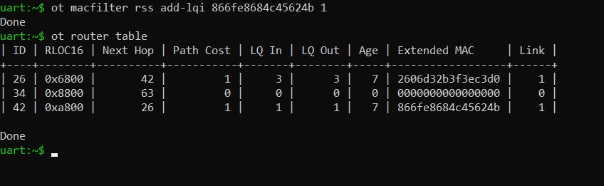

*Fig. 2.5 — Board A: MAC filter towards C; C's row already shows LQ In 1 and LQ Out 1. LQ Out also being 1 confirms that C applied the filter to A's frames.*

The table only shows costs. To prove that the packets go through B, its MAC counters were reset, 20 pings were sent from A to C, and the counters were read again:

| B counter | Measured | Expected | Pings received |
|-----------|---------:|----------|:--------------:|
| TxUnicast | **40** | 40 (20 requests + 20 replies) | 20/20 |
| TxTotal | 54 | 40 + MLE broadcast frames | — |


*Fig. 2.6 — Board B after the 20 pings with the filter active: TxTotal 54, TxUnicast 40.*

B transmitted **exactly 40 unicast frames**: one for each request it forwarded from A to C and one for each reply from C to A. This is direct proof that B is on the path. The 14 extra frames are broadcasts, mostly the MLE advertisements B sends as a router. The control reading without the filter was not recorded, but the RTT gives a second, independent piece of evidence: with the filter, the RTT to C doubles.

**RTT at one and two hops.** 20 pings of 64 B to C's ML-EID, one every 0.5 s: first without the filter (1 hop) and then with it (2 hops, via B). The one-hop measurement was made towards C and not towards B, which is equivalent: on the desk every link is LQ 3 and the boards were 1 m apart.

| Route | Hops | RTT min / mean / max (ms) | Loss | Estimate (ms) |
|-------|:----:|:-------------------------:|:----:|--------------:|
| A → C direct (no filter) | 1 | 15 / 16.1 / 31 | 0 % | ≈11 |
| A → B → C (with filter) | 2 | 30 / 30.3 / 32 | 0 % | ≈23 |

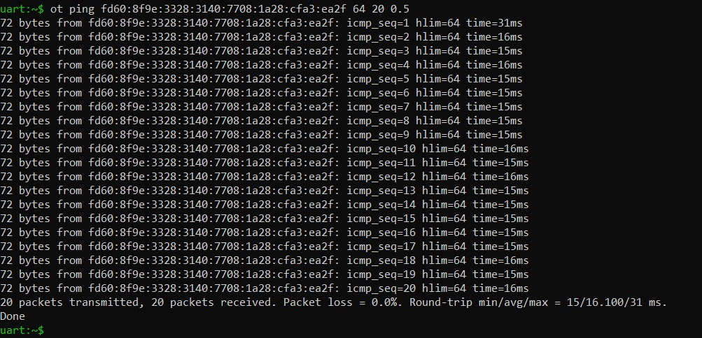

*Fig. 2.7 — Without the filter (1 hop, 1 m): RTT 15 / 16.1 / 31 ms, 0 % loss. The 31 ms maximum is only the first ping.*

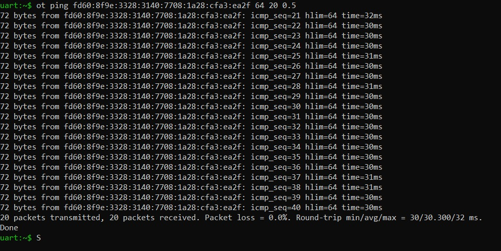

*Fig. 2.8 — With the filter (2 hops, via B): RTT 30 / 30.3 / 32 ms, 0 % loss.*

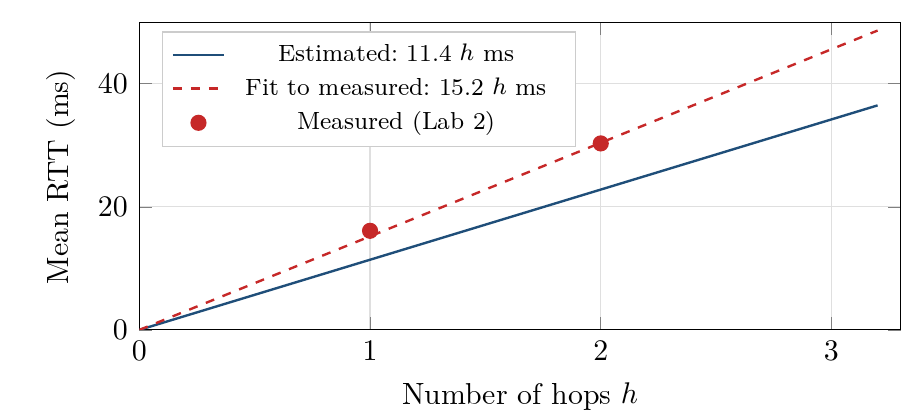

*Fig. 2.9 — Mean RTT vs. number of hops: theoretical estimate (11.4 h ms) and fit to the measurements (15.2 h ms).*

*   **Cost of the extra hop:** 30.3 − 16.1 = **14.2 ms** of RTT. The two-hop RTT is 1.88 times the one-hop RTT: it grows practically linearly (each hop adds one transmission on the way out and one on the way back).
*   **The 31 ms maximum at one hop is only the first ping** (`icmp_seq=1`): it waited for A to find out where C's ML-EID lives (*address query*). Without it, the one-hop mean is (20 × 16.1 − 31)/19 ≈ 15.3 ms and the spread is minimal (15–16 ms). At two hops the address was already cached and every ping stayed between 30 and 32 ms.
*   **Measured vs. estimated:** the per-hop estimate adds the airtime of a ≈121 B frame at 250 kbit/s (≈3.9 ms), the mean CSMA-CA back-off (≈1.1 ms), the clear-channel assessment and the RX/TX turnaround (≈0.3 ms) and the ACK (≈0.35 ms): ≈5.7 ms per transmission, or RTT ≈ 11.4·h ms. We measured ≈15 ms per hop; the ≈2 ms of difference per transmission are the processing in each node (OpenThread stack, frame encryption, 6LoWPAN compression and radio handling), which the estimate does not include.
*   **For valve control:** with ≈15 ms per hop, a command crossing 5 hops would have an RTT of the order of 75 ms. Against the 200 ms CoAP target, about 10 hops fit with margin, more than a crop with a central border router needs.

**The tractor test.** With the filter active, B is the only good path between A and C. A launched 200 pings, one per second, at C's ML-EID; after about eighty replies, B was disconnected. Each missing reply is ≈1 s of outage. A is never disconnected: it is the leader, and losing the leader is a different experiment.

| Run | Pings lost | Healing time | Route afterwards | Meets < 120 s |
|:---:|------------|:------------:|------------------|:-------------:|
| 1 | 8 of 200 (`icmp_seq` 184–191) | **≈8 s** | direct A–C (LQ 1) | yes |

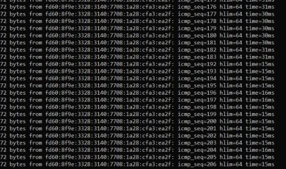

*Fig. 2.10 — Board A: up to `icmp_seq=183` the replies arrive in ≈30–31 ms (two hops, via B); 184 to 191 are missing; from 192 on they come back in ≈15 ms because A and C talk directly over the LQ 1 link.*

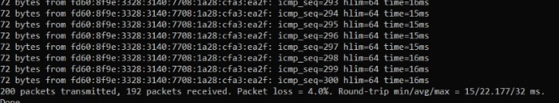

*Fig. 2.11 — 200 transmitted, 192 received: 4.0 % loss.*

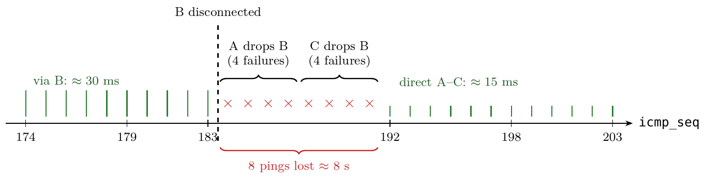

*Fig. 2.12 — Measured timeline: the loss of 8 pings matches the prediction of 4 ACK failures at A plus 4 at C. The height of the green bars is proportional to the RTT.*

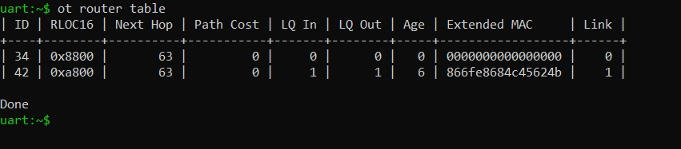

*Fig. 2.13 — Post-mortem on A: C with Next Hop 63 and `Link 1` (A no longer uses a relay and sends to C over the direct link) and B's row deleted. The table was read about 116 s after the disconnection, consistent with the 100 s timer after which Thread forgets a silent neighbor router.*

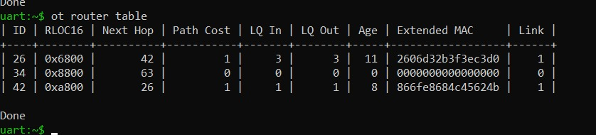

*Fig. 2.14 — After reconnecting B (`ot ifconfig up` and `ot thread start`; the dataset was still stored), B reappears with LQ 3 and C's Next Hop is 26 again: the route via B (cost 2) is preferred again without any intervention.*

**Analysis.** The healing time (≈8 s) is about 15 times below the 120 s target and matches the prediction: 4 failed frames from A to B and 4 from C to B, with one ping per second. The network does not only heal when a node is lost: it also returns to the optimal route by itself when the node comes back. **Limitation:** the guide asks for three runs and only one was recorded. Since the mechanism is deterministic (4 ACK failures at each end), repeated runs are expected to give the same result, ±1 ping depending on the exact moment of the disconnection.

### 6.3 Lab 3 — CoAP, Observe, CON vs. NON and the sleepy valve

**Network and radio path.** Both boards started from `ot factoryreset`. Board A went from *detached* to *leader* in 2.55 s; Board B became *child* 1.03 s after starting Thread and *router* after 30.1 s (in Part 5 it becomes *child* again). `ot coap start` is never run on B: it would take port 5683 and leave B's own server application deaf.

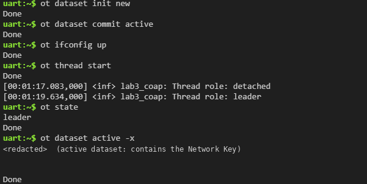

*Fig. 3.2 (E02a) — Board A: `leader` and `ot dataset active -x`. The dataset hex string is redacted because it contains the Network Key; decoded, it showed channel 20 (see ADR-001).*

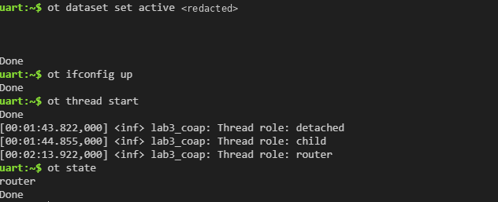

*Fig. 3.3 (E02b) — Board B: loads A's dataset (redacted), becomes `child` and then `router`.*

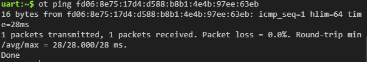

*Fig. 3.4 (E03) — Reachability check from A to B before using CoAP: 1 of 1, RTT of 28 ms.*

**CoAP latency (baseline row).** The shell does not print the duration of a CoAP transaction, so the RTT of a one-hop GET was approximated with 10 ICMP pings of 16 B from A to B, with B not yet sleeping: 9 of 10 received (10 % loss), RTT of **12 / 12.1 / 13 ms**. It is an ICMP value, not a CoAP one; a GET of 15 + 17 B uses frames of similar size, so the order of magnitude applies, and it is far below 200 ms.

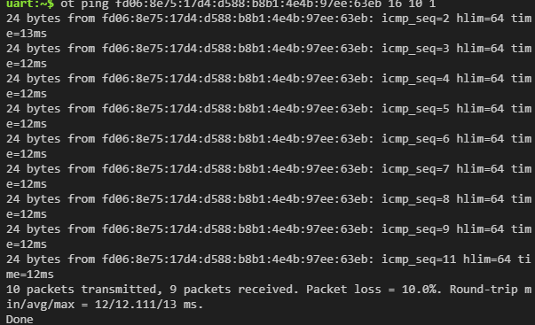

*Fig. 3.7 (E05) — One-hop baseline RTT (B not sleeping): 12 / 12.111 / 13 ms.*

**Byte budget.** The CoAP rows come from Board B's logs; the HTTP and MQTT rows are the guide's values for Lab 0 and were not measured.

| Exchange | Request | Response | Packets | Notes |
|----------|--------:|---------:|:-------:|-------|
| HTTP/JSON (Lab 0, guide value) | ∼150 B + TCP | ∼120 B + TCP | 7+ | Connect, GET, 200 OK, close |
| MQTT/JSON (Lab 0, guide value) | — | ∼40 B | 1 | Over an open TCP connection with keepalives |
| CoAP GET `/env/temp` | **15 B** | **17 B** | 2 | Fig. 3.6 |
| CoAP Observe notification | — | **19 B** | 1 | Fig. 3.9 |
| CoAP PUT `/act/valve` (CON) | **18 B** | **13 B** | 2 | Fig. 3.11 |

Other exchanges in the same logs: Observe registration, 16 B request and 19 B response; cancellation, 17 B and 17 B; valve GET, 16 B and 13 B.

*Does it fit in one 802.15.4 frame?* Each CoAP message gets 8 B of UDP and, as a worst-case bound, the uncompressed IPv6 header (40 B): if it fits like that, it fits with 6LoWPAN compression.

| Message | CoAP (B) | + UDP + IPv6 (B) | Total (B) |
|---------|---------:|-----------------:|----------:|
| GET `/env/temp`, request | 15 | 48 | 63 |
| GET `/env/temp`, response | 17 | 48 | 65 |
| Observe notification | 19 | 48 | 67 |
| PUT `/act/valve`, request | 18 | 48 | 66 |
| PUT `/act/valve`, response | 13 | 48 | 61 |

The frame takes 127 B; subtracting the MAC header with extended addresses (21 B), the security header (6 B), the integrity code (4 B) and the FCS (2 B) leaves about 94 B for data (our own estimate from the frame structure). The largest message (67 B) fits with room to spare: **every CoAP message fits in a single frame, with no fragmentation**, and with IPHC (Lab 2) the margin is even larger.

**Observe instead of polling.** With B's log visible, Board A ran `ot coap observe <MLEID_B> env/temp`, let the notifications arrive and cancelled. The first response (`OBS=2`, 25.34 °C) is the registration's and does not count. Lines `OBS=3` to `OBS=33` are the **31 notifications**, all of them threshold-triggered (NON) and none a heartbeat (CON); the counters in B's last log line (`[threshold 31, heartbeat 0]`) agree. According to B's timestamps, the registration was at 01:20:09.613 and the cancellation at 01:25:35.693: a window of **326.08 s**, somewhat longer than the nominal 300 s. The garbled lines on A (for example `OBS=uart:~$ ot coa`) are the cancel command being typed while notifications were arriving, not a communication error.

| Window | Threshold | Heartbeat | GETs at 1 Hz | Ratio |
|--------|----------:|----------:|-------------:|------:|
| 5 min (nominal, the guide's reference) | 31 | 0 | 300 | **10.3 %** |
| Actual window of 326.08 s | 31 | 0 | ≈326 | 9.5 % |
| First 300 s | 28 | 0 | 300 | 9.3 % |

The interval between notifications was 4 to 24 s (mean 10.3 s, median 7 s); the change that triggered them was 0.51 to 0.67 °C (mean 0.56 °C), always above the 0.5 °C threshold; the simulated temperature oscillated between 23.51 and 25.52 °C. There were no heartbeats because the longest interval (24 s) never reached 45 s. Each notification weighed 19 B. The details are in [Annex C](#annex-c--the-31-observe-notifications-lab-3).

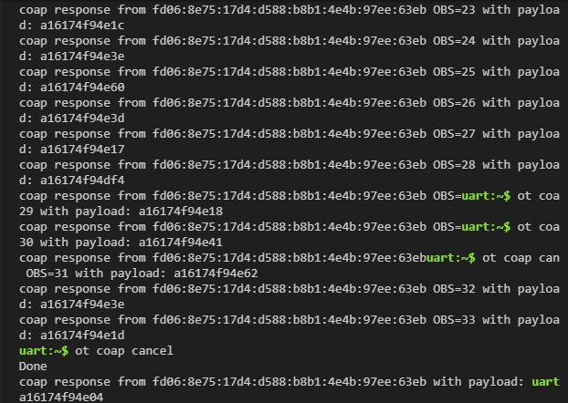

*Fig. 3.8 (E06) — Board A: notifications `OBS=23` to `OBS=33` and the cancellation.*

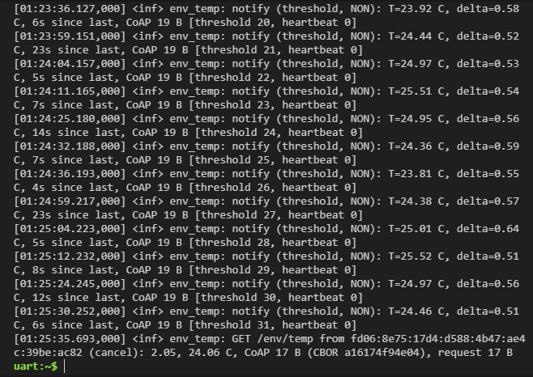

*Fig. 3.9 (E07) — Board B: each notification with its temperature, its delta, the seconds since the previous one, 19 B and the running counters.*

**CON vs. NON when the destination disappears.** `ot thread stop` was run on B. Prediction: with a random first wait t₀ between 2 and 3 s that doubles at each of the 4 retransmissions, the total wait is t₀(1 + 2 + 4 + 8 + 16) = 31·t₀, i.e., **between 62 and 93 s**.

| Test | Measurement / observation | Comment |
|------|---------------------------|---------|
| CON PUT with B absent | Immediate `Done` (only confirms the command reached the radio) and `ResponseTimeout` (error 28) after **71.28 s** | Within the predicted range; equivalent to t₀ ≈ 71.28/31 = 2.30 s |
| NON PUT with B absent | Immediate `Done` and **nothing else for more than 8 min** | Fails silently: without ACK or retries, the client never finds out |
| CON PUT after B rejoined | Response `a1617601`; B logged 2 PUTs: `OPEN -> 2.04` (02:04:09.661) and `OPEN, no change -> 2.04` (02:04:11.717) | Retransmission after 2.06 s, consistent with CON's first retry (2–3 s) |

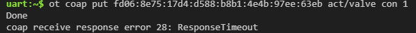

*Fig. 3.14 (E11) — CON PUT with B off the network: `ResponseTimeout` after 71.28 s.*


*Fig. 3.15 (E12) — NON PUT with B off the network: `Done` and no other message for more than 8 min.*

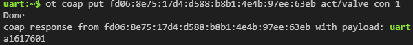

*Fig. 3.16 (E13a) — CON PUT after B rejoined: response `a1617601` on Board A.*

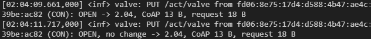

*Fig. 3.17 (E13b) — Board B: `OPEN` and `OPEN, no change`: the retransmission arrived and changed nothing.*

**A valve that sleeps: latency per poll period.** On B: `ot mode -` (receiver off when idle, minimal device) and `ot pollperiod 1000`; B went to *detached* and 1.05 s later to *child*, with A as its parent. For each period (1000, 5000 and 15,000 ms), A ran `ot ping <MLEID_B> 16 10 1.3 64 40`: 10 pings of 16 B every 1.3 s, with a 40 s timeout longer than the poll period. In all three runs 10 of 10 arrived.

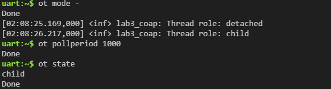

*Fig. 3.18 (E14) — Board B as an SED: `child` with a 1000 ms poll.*

| Poll | Min RTT (ms) | Mean RTT (ms) | Max RTT (ms) | Mean / poll | Radio on (est.) |
|------|-------------:|--------------:|-------------:|------------:|----------------:|
| 1 s | 65 | 493.1 | 957 | 0.49 | 1.0 % |
| 5 s | 622 | 2828.7 | 4617 | 0.57 | 0.2 % |
| 15 s | 1141 | 7506.4 | 14,777 | 0.50 | 0.067 % |

The maximum never exceeded the poll period and the mean was about half the period: the parent holds the ping until the child asks, and the moment of the ping within the poll cycle is random between 0 and the period. Latency grows linearly with the period, while the fraction of time with the radio on (10 ms per poll, the guide's assumption) falls in inverse proportion.

**Duplicates with a 5 s poll.** With `ot pollperiod 5000` on B, Board A sent five alternating PUTs to `act/valve`; for each one, the wait for the response on A was timed (resolution ≈ ±0.5 s) and the number of times B logged it was counted. A first attempt with the path misspelled (`act/value`) answered quickly and without a payload; B logged nothing because the resource does not exist, and the attempt was discarded. The PUTs were 1.7 to 2.9 min apart because they were run by hand.

| No. | Command | Wait on A | B log (time) | Copies |
|:---:|---------|:---------:|--------------|:------:|
| 1 | `con 1` | 2 s | OPEN (02:30:07.405) | 1 |
| 2 | `con 0` | 4 s | CLOSED (02:33:02.440); CLOSED, no change (02:33:02.493) | **2** |
| 3 | `con 1` | 2 s | OPEN (02:34:42.687) | 1 |
| 4 | `con 0` | 4.92 s | CLOSED (02:36:23.052); CLOSED, no change (02:36:23.191) | **2** |
| 5 | `con 1` | 2 s | OPEN (02:38:08.185) | 1 |

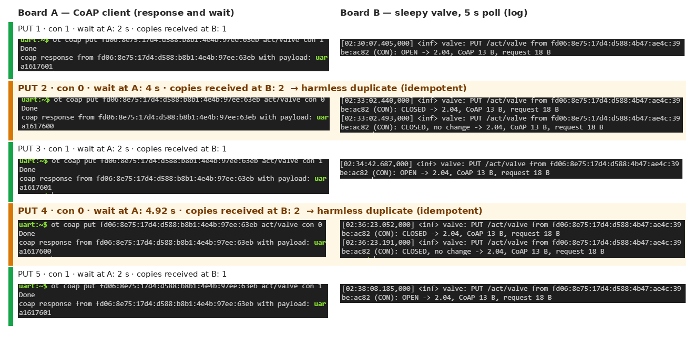

*Fig. 3.19–3.28 (E18) — Composite of the ten screenshots of Task 5.3 (the originals are in [`img/lab3/`](img/lab3/)). PUTs 2 and 4 arrived twice, with copies 53 and 139 ms apart; the second copy answered `no change`. Explanation in §5, Lab 3, Q3.*

At the end, the guide calls for `ot mode rdn` and `ot pollperiod 0` on Board B to make it a node with an always-on receiver again.

**Energy estimate for the sleepy valve.** From the ESP32-C6-WROOM-1/-1U datasheet (Espressif, v1.0): 802.15.4 receive current of **73 mA** (Table 16, *Current Consumption for 802.15.4 in Active Mode*) and Light-sleep current of **180 µA** (Table 18, *Current Consumption in Low-Power Modes*, with the CPU and the wireless modules powered down and the peripheral clocks disabled). Assumptions: each poll keeps the radio on for 10 ms (guide); 2×AA with 2000 mAh (to be confirmed with the cell's datasheet); transmission, CPU wake-up, Thread maintenance messages, self-discharge and the minimum cut-off voltage are neglected, so the resulting life is an **upper bound**.

I_avg = [I_RX · t_on + I_sleep · (T − t_on)] / T  ·  Life = C / I_avg

| Poll T | I_avg (mA) | Life (h) | Life (d) | Share due to the poll |
|--------|-----------:|---------:|---------:|----------------------:|
| 1 s | 0.908 | 2202 | 91.8 | 80 % |
| **5 s** | **0.326** | **6142** | **255.9** | 45 % |
| 15 s | 0.229 | 8751 | 364.6 | 21 % |

Example for T = 5 s: I_avg = (73 × 0.010 + 0.18 × 4.99)/5 = 0.3256 mA and life = 2000/0.3256 = 6142 h ≈ 256 d. Sensitivity: with the 35 µA Light-sleep current that the same table gives (peripherals powered down), the life would be 109, 461 and 996 d for 1, 5 and 15 s. Labs 1–2 used 3000 mAh for 2×AA; with that capacity the lives would be 1.5 times longer (≈138, 384 and 547 d). With the chosen poll the order of magnitude is hundreds of days against the 4 d of the Wi-Fi prototype; the comparison is indicative because the assumptions differ.

### 6.4 Lab 4 — Real sensor: integrity, availability, reliability and resilience

**Integrity: is the number right?** One minute was logged without touching the sensor (31 samples, 30 valid readings):

| Quantity | Value |
|----------|-------|
| Temperature resolution | 0.1 °C |
| Humidity resolution | 0.1 %RH |
| Temperature spread (max − min) | 0.1 °C (22.9 to 23.0 °C) |
| Approximate standard deviation | 0.05 °C |
| Humidity spread | 0.3 %RH (67.8 to 68.1) |
| Failed reads in the minute | 1 of 31 (3.2 %): `Read failed (-5)` at 00:33:42 |

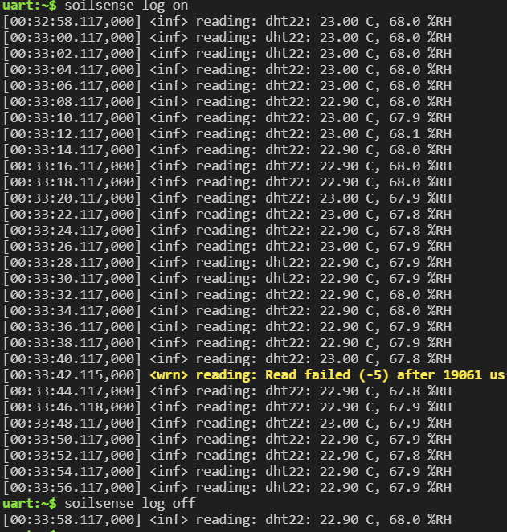

*Fig. 4.3 (E07) — One minute of readings every 2 s with `soilsense log on`: the value only toggles between 22.90 and 23.00 °C, and one failed read appears.*

*   **Offset:** reference next to the sensor 22.7 °C†, DHT22 reading 22.9 °C†, offset **+0.2 °C†**, within the stated accuracy of ±0.5 °C.
*   **Breath response:** with Board B observing `/env/temp`, we breathed on the sensor for 3–5 s.

| Quantity | Value |
|----------|-------|
| Baseline temperature | 22.4–22.5 °C |
| Maximum temperature | 25.3 °C |
| Rise | ≈2.9 °C |
| Time to half of the rise | 2–4 s (2 s resolution) |
| Maximum humidity | 99.9 %RH, saturated for more than 1 min |
| Notifications sent | 8† |

The humidity hits the top of its range and stays at 99.9 %RH while the element dries: a value stuck at the limit is not a measurement. The temperature returns slowly to its initial level (23.4 °C when the log was closed).

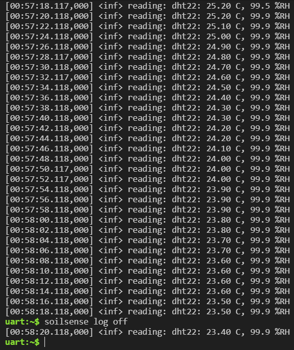

*Fig. 4.4 (E09a) — Board A: decay from 25.2 °C with the humidity stuck at 99.9 %RH.*

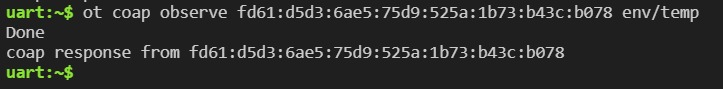

*Fig. 4.5 (E09b) — Board B during the observation: the screenshot shows the response to the registration; the notifications do not appear in it.*

*   **Plausibility:** three values were injected with `soilsense inject`. 90 °C was rejected for being outside −40…85 °C; 31.5 °C was rejected for a +9.2 °C jump in one sample; 25.5 °C, wrong but believable, was accepted. A single node cannot detect the third one (§5, Lab 4, Q3).

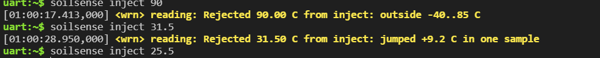

*Fig. 4.6 (E10) — `Rejected 90.00 C … outside -40..85 C`, `Rejected 31.50 C … jumped +9.2 C in one sample` and the 25.5 °C injection without rejection.*

**Availability: can the client get the data?**
1. *The sensor dies.* The DAT wire was disconnected with Board B observing. After three failed reads, Board A logged `Sensor lost` (≈6 s†); notifications continued as heartbeats with the last good value. With a GET every 15 s, the Max-Age served dropped with the age of the reading (≈45, 30 and 15 s†). ≈60 s† after the last good reading, A logged `GET now answers 5.03`; at that moment there was no active observation left to close (`0 observation(s) ended`). B's shell does not show the response code (Fig. 4.8), so the 5.03 is read in A's log (Fig. 4.7).
2. *The node dies.* After reconnecting the wire and seeing `Sensor back`, the observation was registered again and `ot thread stop` was run on A. An `ot coap get <S-mleid> env/temp con` from B ended in `ResponseTimeout` after ≈45 s†; the observation printed nothing while A was off the network.

> **Note on the ≈45 s†.** With the default CoAP parameters a CON cannot end in `ResponseTimeout` before 31 × 2 s = 62 s (range 62 to 93 s), and 71.28 s were measured in Lab 3 with the same shell. The Lab 4 value has no screenshot and this measurement should be repeated; until then, the reliable reference is the Lab 3 one.


*Fig. 4.7 (E11) — Board A: `No reading younger than 60 s: GET now answers 5.03; 0 observation(s) ended`.*

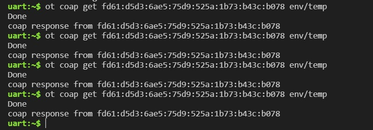

*Fig. 4.8 (E12) — Board B: responses to `ot coap get` on `env/temp`; the shell does not show the response code.*

**Reliability: failure rate at rest and with the radio busy.** The radio load was generated from Board B with `ot ping <S-mleid> 64 1200 0.1`.

| Condition (2 min) | Reads | Failed | Rate |
|-------------------|------:|-------:|-----:|
| At rest | 60† | 0† | 0.0 %† |
| Radio busy | 60† | 2† | 3.3 %† |

With the DHT22 the CPU times every bit for about 22 ms, so radio activity can corrupt a read: the rate rises when the channel is busy, although it stays below the 5 % target. As a reference with a screenshot, 843 readings at rest had 2 failures (0.2 %, Fig. 4.2).

**Resilience.** After reconnecting the wire, A logged `Sensor back` within ≈2 s† (the next reading) and the GET answered 2.05 again after ≈4 s†. The observation does not resume by itself: it ended with the 5.03 and Board B must register it again. After pressing reset on Board A:

| Element | Does it survive? | Who acts |
|---------|------------------|----------|
| Thread network | Rejoins by itself† | The node, automatically |
| Last good reading | No | The node, at the next reading (2 s) |
| Counters | No, back to zero | Nobody (they reset) |
| Client's observation | No | Board B must register it again |

**Class table.** Our row and that of another pair in the class, with a DS18B20 (data from their record):

| Sensor | Resolution | 1-min noise | Offset | Breath: rise / half-time | Read time | Failures at rest / busy | Recovers? |
|--------|-----------:|------------:|-------:|--------------------------|----------:|-------------------------|-----------|
| DHT22 (our pair) | 0.1 °C | 0.1 °C | +0.2 °C† | 2.9 °C / 2–4 s | ≈21.8 ms (Fig. 4.2) | 0 % / 3.3 %† | Yes |
| DS18B20 (another pair) | 0.06 °C | 0.25 °C | — | 1.5 °C / ≈4 s | 760.7 ms | 0 % (84 reads) / — | — |

The DS18B20 has a finer resolution and its 760 ms read leaves the CPU free while it converts, but it responds to breath more slowly than the bare DHT22. The DHT22 reads in ≈22 ms with the CPU busy, hence its sensitivity to the radio.

---

## 7. Ethics & Sustainability Checklist

*   [x] **Lab 1:** Verified interference doesn't disrupt neighbors. — No intentional interference (*jamming*) was generated: only test pings. The lab's low power (0 dBm) was used, which limits the effect on the building's Wi-Fi networks, and the boards were disconnected at the end. *Pending:* the effect on neighboring networks was not measured and the passive channel scan was not recorded (ADR-001).
*   [x] **Lab 2:** Our own network only, and radios off. — The dataset was generated with `ot dataset init new` (random PAN ID, network key and prefix `fd60:8f9e:3328:3140::/64`), so no other group could join it by accident, nor we theirs. The three boards operated at 0 dBm on the ADR-001 channel. At the end the MAC filters were cleared (`ot macfilter rss clear`) and Thread was stopped (`ot thread stop`) on the three boards (Fig. 2.16).
*   [x] **Lab 3:** Safety for a lost CLOSE, and a poll period justified by a stakeholder need. — Case: the valve receives OPEN and the network dies before the CLOSE. The safety design requires **the valve to close by itself when it loses the network**. *Proposal for the timing (to be validated; the Lab 3 report does not give it):* an OPEN order expires unless it is renewed; the gateway repeats the same PUT `{"v": 1}` every 30 s while irrigation should continue (the PUT is idempotent, so repeating it changes nothing), and if the valve goes **75 s** without receiving it, it closes by itself. Those 75 s exceed the 71 s after which the gateway declares the valve unreachable (§6.3), so both ends reach the same safe state at almost the same time: valve closed and order not confirmed. The 5 s poll period was justified with Edwin's and Daniela's needs (ADR-004).
*   [x] **Lab 4:** Safe default when sensor data is missing (Safety). — The irrigation rule that uses `/env/temp` treats a 5.03 or no answer as **data unavailable**, never as the last reading. Default: **do not start new irrigation and keep the valve closed**. Wait: retry according to the 10 s Max-Age and apply the default after **70 s** without a fresh reading (60 s of freshness plus one retry), alerting the field staff to check the sensor and the node. The contract states the sensor's real accuracy (±0.5 °C and ±2 %RH).

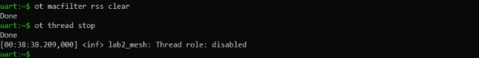

*Fig. 2.16a — Board A at the end of Lab 2: filter cleared and Thread stopped.*

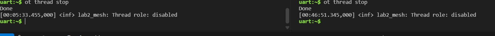

*Fig. 2.16b — Boards B and C: Thread stopped (role `disabled`).*

---

## 8. Viewpoint Analysis

| Viewpoint | Labs Addressed | Key Concerns Documented |
|-----------|----------------|-------------------------|
| Foundational | Lab 1–2 | The IoT component is the ESP32-C6: RISC-V MCU, 802.15.4 radio, printed antenna and firmware; the RF medium (PED) and the provisioning PC (OMD) are outside the boundary. Characteristics that already appear at this level: proximity communication (802.15.4), resource constraints (4.2 mW average budget), autonomy (board 2 promoted itself from child to router) and scalability (the measured range sets how many nodes a field needs). In Lab 2 the hierarchy goes up from a component to a network of components: the routed mesh. |
| Business | Lab 1 (and Lab 3) | Cost per field: 10 ha ≈ 4000 nodes (US\$160,000) with the measured range, ≈250 nodes (US\$10,000) if 22 m are validated at +20 dBm; verdict "test more" (§2, Lab 1). Estimated valve battery life: ≈256 d with a 5 s poll vs. 4 d for the Wi-Fi prototype (ADR-004). |
| Usage | Labs 1–4 | Roles and how they interact with the system: the field technician (Edwin) installs nodes and checks links; the architect (Samuel) sets channel, power, spacing and addresses; product (Gustavo) estimates nodes and cost per hectare; the farmer (Daniela) uses the dashboard. Documented: node installation flow and field cards (Labs 1–2), order confirmation and expected latency (Lab 3), how to tell a dead sensor from a dead node (Lab 4). |
| Functional | Labs 2–4 | Thread roles with their function and power profile (§4, Lab 2); functional plane (CoAP, ASD contracts) vs. management plane (MLE and the SED poll) (Lab 3); freshness function with Max-Age and 5.03 (Lab 4). |
| Trustworthiness | Lab 4 | First audit (§9): availability, integrity, reliability and resilience with evidence from Tasks B–D and their gaps; safe default (§7). Confidentiality and integrity against malicious actors → Lab 6. |
| Construction | — | Pending for Lab 8 (team DDR). Available base: one firmware per lab, built with `west` for `esp32c6_devkitc/esp32c6/hpcore`, and the sensor overlay (§1, Annex A). |

---

## 9. Trustworthiness Audit (Lab 4+)

| Characteristic | Addressed? | How | Gaps |
|----------------|------------|-----|------|
| Availability | Yes (Lab 4; also Labs 2–3) | 5.03 with Max-Age 10 when there is no fresh reading; the lost sensor is seen within ≈60 s† (Figs. 4.7 and 4.8). The mesh heals in ≈8 s when a router is lost (Lab 2). CON turns a loss into an explicit error after 71 s (Lab 3). | A dead node is only detected through silence; the ≈45 s† of Lab 4 has no screenshot and does not match CoAP's 62–93 s (§6.4). |
| Confidentiality | Partial → Lab 6 | Thread encrypts the MAC frames with the dataset's network key (AES-CCM): active but not assessed (Lab 2). Each lab used its own random dataset. | No end-to-end encryption (DTLS, Lab 6). In the Lab 3 report the active dataset, with the Network Key, appeared in full; here Figs. 3.2 and 3.3 are published redacted, as the repository rules require. |
| Integrity | Partial | 0.1 °C resolution, 0.1 °C noise and +0.2 °C† offset; values outside −40…85 °C and steps > 5 °C are rejected (Figs. 4.3 and 4.6). The CBOR payload was decoded by hand against the contract (Lab 3). | A wrong but believable value passes the filters (`inject 25.5`); integrity against malicious actors → Lab 6. |
| Reliability | Yes | Read failures < 5 %: 0 %† at rest and 3.3 %† with the radio busy; 0.2 % over 843 readings with a screenshot (Fig. 4.2). Orders use CON with retries (Lab 3). | The DHT22 depends on CPU timing and degrades under radio load; the 2-minute counts have no screenshot. |
| Resilience | Yes | The sensor recovers by itself (`Sensor back` in ≈2 s†; GET back to 2.05 after ≈4 s†) and after a reset the node rejoins the network by itself†. The mesh heals by itself and returns to the optimal route when the router comes back (Lab 2). | The observation does not resume: every client must register it again. After a reset the last reading and the counters are lost. The mesh only heals if there is an alternative route. |
| Safety | Yes (design) | Irrigation rule: 5.03 or silence = data unavailable → do not irrigate and keep the valve closed; applied at 70 s, with an alert (Lab 4). The valve closes by itself if it loses the network (Lab 3). Orders are idempotent, so duplicates do not change the state (Fig. 3.19–3.28). | The rules are not implemented or tested in firmware; the timing of the autonomous closing (75 s) is a proposal to be validated. |
| Compliance | Not addressed | Operation in the 2.4 GHz ISM band; every test at 0 dBm. | Check the power limits of the applicable spectrum regulation before using +20 dBm (ADR-001b); privacy of the farm's data → Labs 6–8. |

---

## Evidence

Photos and screenshots go in [`img/`](img/), one folder per lab. Each image is embedded next to the section it supports; this index lists them all. The vector figures (diagrams and plots) were cropped from the report PDFs and their Spanish labels translated, keeping the original fonts; the screenshots were extracted at their original resolution. In Figs. 3.2 and 3.3 the Thread dataset hex string was replaced with `<redacted>` because it contains the Network Key.

**Lab 1** — [`img/lab1/`](img/lab1/)

| Fig. | File | What it shows | Section |
|------|------|---------------|---------|
| 1.1 | [fig1-1_802154_channels_vs_wifi.png](img/lab1/fig1-1_802154_channels_vs_wifi.png) | 802.15.4 channels vs. Wi-Fi 1, 6 and 11 | §3, ADR-001 |
| 1.2 | [fig1-2_test_setup.png](img/lab1/fig1-2_test_setup.png) | Range test setup | §2, Lab 1 |
| 1.3 | [fig1-3_rssi_and_per_vs_distance.png](img/lab1/fig1-3_rssi_and_per_vs_distance.png) | RSSI vs. distance and PER vs. RSSI | §6.1 |
| 1.4 | [fig1-4_iso_domain_mapping.png](img/lab1/fig1-4_iso_domain_mapping.png) | ISO/IEC 30141 domain mapping for Lab 1 | §4 |
| — | Terminal output (text) | Pings and neighbor tables at 0, 5, 10 and 15 m | [Annex B](#annex-b--lab-1-terminal-output) |

**Lab 2** — [`img/lab2/`](img/lab2/)

| Fig. | File | What it shows | Section |
|------|------|---------------|---------|
| 2.1 | [fig2-01_protocol_stack.png](img/lab2/fig2-01_protocol_stack.png) | Protocol stack of the node | §1 |
| 2.2 | [fig2-02_topology_mac_filter.png](img/lab2/fig2-02_topology_mac_filter.png) | Topology with and without the MAC filter | §2, Lab 2 |
| 2.3 | [fig2-03_router_table_a_no_filter.png](img/lab2/fig2-03_router_table_a_no_filter.png) | A's router table with the mesh formed | §4 |
| 2.4 | [fig2-04_mleid_rloc_a.png](img/lab2/fig2-04_mleid_rloc_a.png) | A's ML-EID and RLOC | §4 |
| 2.5 | [fig2-05_macfilter_router_table_a.png](img/lab2/fig2-05_macfilter_router_table_a.png) | MAC filter and A–C link at LQ 1 | §6.2 |
| 2.6 | [fig2-06_mac_counters_b.png](img/lab2/fig2-06_mac_counters_b.png) | B's MAC counters: 40 TxUnicast | §6.2 |
| 2.7 | [fig2-07_ping_1_hop.png](img/lab2/fig2-07_ping_1_hop.png) | 20 pings at one hop | §6.2 |
| 2.8 | [fig2-08_ping_2_hops.png](img/lab2/fig2-08_ping_2_hops.png) | 20 pings at two hops | §6.2 |
| 2.9 | [fig2-09_rtt_vs_hops.png](img/lab2/fig2-09_rtt_vs_hops.png) | Mean RTT vs. number of hops | §6.2 |
| 2.10 | [fig2-10_tractor_ping_gap.png](img/lab2/fig2-10_tractor_ping_gap.png) | Tractor test: gap in the replies | §6.2 |
| 2.11 | [fig2-11_tractor_ping_summary.png](img/lab2/fig2-11_tractor_ping_summary.png) | Ping summary: 192 of 200 | §6.2 |
| 2.12 | [fig2-12_tractor_timeline.png](img/lab2/fig2-12_tractor_timeline.png) | Healing timeline | §6.2 |
| 2.13 | [fig2-13_postmortem_router_table.png](img/lab2/fig2-13_postmortem_router_table.png) | Router table after the failure | §6.2 |
| 2.14 | [fig2-14_reconnect_router_table.png](img/lab2/fig2-14_reconnect_router_table.png) | Router table after reconnecting B | §6.2 |
| 2.15 | [fig2-15_iso_domain_mapping.png](img/lab2/fig2-15_iso_domain_mapping.png) | ISO/IEC 30141 domain mapping for Lab 2 | §4 |
| 2.16a | [fig2-16a_cleanup_a.png](img/lab2/fig2-16a_cleanup_a.png) | Cleanup on board A | §7 |
| 2.16b | [fig2-16b_cleanup_b_c.png](img/lab2/fig2-16b_cleanup_b_c.png) | Cleanup on boards B and C | §7 |

**Lab 3** — [`img/lab3/`](img/lab3/)

| Fig. | File | What it shows | Section |
|------|------|---------------|---------|
| 3.1 | [fig3-01_architecture.png](img/lab3/fig3-01_architecture.png) | Lab architecture | §2, Lab 3 |
| 3.2 (E02a) | [e02a_network_leader_a.png](img/lab3/e02a_network_leader_a.png) | A forms the network and becomes leader | §6.3 |
| 3.3 (E02b) | [e02b_join_b.png](img/lab3/e02b_join_b.png) | B joins: child, then router | §6.3 |
| 3.4 (E03) | [e03_reachability_ping.png](img/lab3/e03_reachability_ping.png) | Ping from A to B before CoAP | §6.3 |
| 3.5 (E04a) | [e04a_get_temp_a.png](img/lab3/e04a_get_temp_a.png) | GET of `/env/temp` on A | §4 |
| 3.6 (E04b) | [e04b_get_temp_log_b.png](img/lab3/e04b_get_temp_log_b.png) | B's log for that GET | §4 |
| 3.7 (E05) | [e05_baseline_rtt_ping.png](img/lab3/e05_baseline_rtt_ping.png) | One-hop baseline RTT | §6.3 |
| 3.8 (E06) | [e06_observe_a.png](img/lab3/e06_observe_a.png) | Observe on A | §6.3 |
| 3.9 (E07) | [e07_observe_log_b.png](img/lab3/e07_observe_log_b.png) | Notifications in B's log | §6.3 |
| 3.10 (E08a) | [e08a_valve_put_get_a.png](img/lab3/e08a_valve_put_get_a.png) | Valve PUT, GET and PUT on A | §4 |
| 3.11 (E08b) | [e08b_valve_log_b.png](img/lab3/e08b_valve_log_b.png) | Valve log on B | §4 |
| 3.12 (E09a) | [e09a_idempotence_invalid_payload_a.png](img/lab3/e09a_idempotence_invalid_payload_a.png) | Idempotence and invalid payload on A | §4 |
| 3.13 (E09b) | [e09b_idempotence_log_b.png](img/lab3/e09b_idempotence_log_b.png) | `no change` and 4.00 on B | §4 |
| 3.14 (E11) | [e11_put_con_timeout.png](img/lab3/e11_put_con_timeout.png) | CON PUT with B absent: `ResponseTimeout` | §6.3 |
| 3.15 (E12) | [e12_put_non_silence.png](img/lab3/e12_put_non_silence.png) | NON PUT with B absent: silence | §6.3 |
| 3.16 (E13a) | [e13a_put_con_rejoined_a.png](img/lab3/e13a_put_con_rejoined_a.png) | CON PUT after B rejoined | §6.3 |
| 3.17 (E13b) | [e13b_retransmission_log_b.png](img/lab3/e13b_retransmission_log_b.png) | Retransmission in B's log | §6.3 |
| 3.18 (E14) | [e14_sed_child_poll.png](img/lab3/e14_sed_child_poll.png) | B as an SED with a 1000 ms poll | §6.3 |
| 3.19–3.28 (E18) | [e18_duplicates_poll5s_summary.png](img/lab3/e18_duplicates_poll5s_summary.png) (composite). Originals: PUT 1 [A](img/lab3/e18_put1_a.png) · [B](img/lab3/e18_put1_b.png); PUT 2 [A](img/lab3/e18_put2_a.png) · [B](img/lab3/e18_put2_b.png); PUT 3 [A](img/lab3/e18_put3_a.png) · [B](img/lab3/e18_put3_b.png); PUT 4 [A](img/lab3/e18_put4_a.png) · [B](img/lab3/e18_put4_b.png); PUT 5 [A](img/lab3/e18_put5_a.png) · [B](img/lab3/e18_put5_b.png) | Five PUTs with a 5 s poll: responses on A and copies on B | §6.3 |

**Lab 4** — [`img/lab4/`](img/lab4/)

| Fig. | File | What it shows | Section |
|------|------|---------------|---------|
| 4.1 (E05) | [e05_thread_network.png](img/lab4/e05_thread_network.png) | Thread network and ping to the field node | §2, Lab 4 |
| 4.2 (E06) | [e06_soilsense_stats.png](img/lab4/e06_soilsense_stats.png) | `soilsense stats`: 843 readings, 0.2 % failures | §2, Lab 4 |
| 4.3 (E07) | [e07_one_minute_log.png](img/lab4/e07_one_minute_log.png) | One minute of readings at rest | §6.4 |
| 4.4 (E09a) | [e09a_breath_log_a.png](img/lab4/e09a_breath_log_a.png) | Breath response on A | §6.4 |
| 4.5 (E09b) | [e09b_breath_observe_b.png](img/lab4/e09b_breath_observe_b.png) | Observation from B | §6.4 |
| 4.6 (E10) | [e10_plausibility_injections.png](img/lab4/e10_plausibility_injections.png) | Injections and plausibility checks | §6.4 |
| 4.7 (E11) | [e11_get_5_03_log_a.png](img/lab4/e11_get_5_03_log_a.png) | `GET now answers 5.03` | §6.4 |
| 4.8 (E12) | [e12_get_responses_b.png](img/lab4/e12_get_responses_b.png) | Responses to `ot coap get` on B | §6.4 |

**No screenshot in the reports:** the three latency runs per poll period of Lab 3 (transcribed as text in §6.3) and the Lab 4 values marked with †. If those screenshots exist, they should be added to `img/lab3/` and `img/lab4/` and the mark removed.

---

## Annexes

### Annex A — Commands per lab

The build commands go in the **Ubuntu (WSL)** terminal; the ones that start with `ot` or `soilsense` go in the **board console** (`uart:~$`), opened with `west espressif monitor`.

<details>
<summary><b>Lab 1</b> — <code>lab1_radio</code> firmware, two-node network and range measurement</summary>

```bash
# Ubuntu (WSL), on each computer
source ~/zephyrproject/env.sh
cd firmware/lab1_radio
west build -p always -b esp32c6_devkitc/esp32c6/hpcore .
west flash
west espressif monitor -p /dev/ttyUSB0
```

```text
# Board 1 console (leader)
ot dataset init new
ot dataset commit active
ot ifconfig up
ot thread start
ot dataset active -x            # hex string for board 2

# Board 2 console
ot dataset set active <hex-string>
ot ifconfig up
ot thread start

# Measurement at each distance (from board 2)
ot ping <board-1-RLOC> 64 100 0.2   # 100 pings of 64 B every 0.2 s
ot neighbor table                   # Avg RSSI, Last RSSI, LQ In
```
</details>

<details>
<summary><b>Lab 2</b> — <code>lab2_mesh</code> firmware, three-node mesh, MAC filter and tractor test</summary>

```bash
# Ubuntu (WSL), on each computer
source ~/zephyrproject/env.sh
cd firmware/lab2_mesh
west build -p always -b esp32c6_devkitc/esp32c6/hpcore .
west flash
west espressif monitor -p /dev/ttyUSB0
```

```text
# On all three boards, before starting (the Lab 1 dataset survives reflashing)
ot factoryreset
ot txpower 0

# A
ot dataset init new
ot dataset channel 15            # ADR-001 channel
ot dataset commit active
ot ifconfig up
ot thread start
ot state                         # leader
ot dataset active -x             # copy the hex string

# B and C
ot dataset set active <hex from A>
ot ifconfig up
ot thread start
ot state                         # child, then router within ~2 min

# Addresses and router table
ot ipaddr mleid
ot ipaddr rloc
ot router table

# MAC filter: poor A–C link (LQ 1)
ot macfilter rss add-lqi 866fe8684c45624b 1     # on A, with C's extended MAC
ot macfilter rss add-lqi <A-extaddr> 1          # on C, with A's extended MAC

# Counter test
ot counters mac reset                                          # on B
ot ping fd60:8f9e:3328:3140:7708:1a28:cfa3:ea2f 64 20 0.5      # on A
ot counters mac                                                # on B

# Tractor test (on A; disconnect B after ~80 replies)
ot ping fd60:8f9e:3328:3140:7708:1a28:cfa3:ea2f 64 200 1
ot router table                  # post-mortem
ot ifconfig up                   # on B, after reconnecting it
ot thread start                  # on B

# Cleanup
ot macfilter rss clear           # on A and C
ot thread stop                   # on all three
```
</details>

<details>
<summary><b>Lab 3</b> — <code>lab3_coap</code> firmware, CoAP, CON/NON and the sleepy valve</summary>

```bash
# Ubuntu (WSL)
source ~/zephyrproject/env.sh
cd firmware/lab3_coap
west build -p always -b esp32c6_devkitc/esp32c6/hpcore .
west flash
west espressif monitor -p /dev/ttyUSB0
```

```text
# Board A (client and leader)
ot factoryreset
ot dataset init new
#   recommended: ot dataset channel 15   (ADR-001; it was not set in the lab and the network ended up on channel 20)
ot dataset commit active
ot ifconfig up
ot thread start
ot state
ot dataset active -x

# Board B (server), after ot factoryreset
ot dataset set active <DATASET_HEX_FROM_A>
ot ifconfig up
ot thread start
ot state
ot ipaddr mleid                  # <MLEID_B>; never ot coap start on B

# Board A
ot coap start
ot ping <MLEID_B>
ot coap get <MLEID_B> env/temp
ot ping <MLEID_B> 16 10 1
ot coap observe <MLEID_B> env/temp
ot coap cancel
ot coap put <MLEID_B> act/valve con 1
ot coap get <MLEID_B> act/valve
ot coap put <MLEID_B> act/valve con 0
ot coap put <MLEID_B> act/valve con 7       # invalid payload -> 4.00

# CON vs. NON
ot thread stop                              # on B
ot coap put <MLEID_B> act/valve con 1       # on A: ResponseTimeout after 71.28 s
ot coap put <MLEID_B> act/valve non-con 1   # on A: silence
ot thread start                             # on B; then repeat the CON PUT on A

# Sleepy valve (on B)
ot mode -
ot pollperiod 1000                          # then 5000 and 15000
ot state                                    # child
ot ping <MLEID_B> 16 10 1.3 64 40           # on A, for each period

# Duplicates: ot pollperiod 5000 on B and five alternating PUTs on A (con 1, con 0, ...)

# Restore B
ot mode rdn
ot pollperiod 0
```
</details>

<details>
<summary><b>Lab 4</b> — <code>lab4_sensors</code> firmware with the DHT22</summary>

```bash
# Ubuntu (WSL), inside firmware/lab4_sensors
# Board A = S (with the DHT22 overlay)
west build -p always -d build_A -b esp32c6_devkitc/esp32c6/hpcore . -- -DEXTRA_DTC_OVERLAY_FILE=sensors/dht22.overlay
west flash -d build_A
# Board B = C (no overlay)
west build -p always -d build_B -b esp32c6_devkitc/esp32c6/hpcore .
west flash -d build_B
```

```text
# Board B (leader and client)
ot coap start
ot state
ot ping <S-mleid>

# Board A (field node)
ot ipaddr mleid
soilsense stats
soilsense log on                 # ... soilsense log off
soilsense inject 90              # out of range -> rejected
soilsense inject 31.5            # step > 5 °C -> rejected
soilsense inject 25.5            # believable -> accepted

# Board B
ot coap observe <S-mleid> env/temp
ot coap get <S-mleid> env/temp
ot coap get <S-mleid> env/temp con
ot ping <S-mleid> 64 1200 0.1    # radio load to measure read failures

# Board A: node off the network
ot thread stop
```
</details>

### Annex B — Lab 1 terminal output

<details>
<summary>Pings and neighbor tables at 0, 5, 10 and 15 m (copied from the console)</summary>

```text
0 m (boards side by side)
...
72 bytes from fd80:8181:81d9:3c1f:0:ff:fe00:3c00: icmp_seq=97 hlim=64 time=14ms
72 bytes from fd80:8181:81d9:3c1f:0:ff:fe00:3c00: icmp_seq=98 hlim=64 time=14ms
72 bytes from fd80:8181:81d9:3c1f:0:ff:fe00:3c00: icmp_seq=99 hlim=64 time=14ms
72 bytes from fd80:8181:81d9:3c1f:0:ff:fe00:3c00: icmp_seq=100 hlim=64 time=14ms
100 packets transmitted, 100 packets received. Packet loss = 0.0%. Round-trip min/avg/max = 14/14.070/19 ms.
Done
uart:~$ ot neighbor table
|Role|RLOC16|Age|Avg RSSI|Last RSSI|LQ In|R|D|N|Extended MAC|Version|
|R|0x3c00|2|-72|-67|3|1|1|1|4aad8e407792b07e|2|
Done

5 m (board 2 -> board 1)
...
72 bytes from fd3e:3e3f:3f48:4848:0:ff:fe00:cc00: icmp_seq=98 hlim=64 time=14ms
72 bytes from fd3e:3e3f:3f48:4848:0:ff:fe00:cc00: icmp_seq=99 hlim=64 time=14ms
72 bytes from fd3e:3e3f:3f48:4848:0:ff:fe00:cc00: icmp_seq=100 hlim=64 time=14ms
72 bytes from fd3e:3e3f:3f48:4848:0:ff:fe00:cc00: icmp_seq=101 hlim=64 time=14ms
100 packets transmitted, 100 packets received. Packet loss = 0.0%. Round-trip min/avg/max = 14/14.010/15 ms.
Done
uart:~$ ot neighbor table
|Role|RLOC16|Age|Avg RSSI|Last RSSI|LQ In|R|D|N|Extended MAC|Version|
|R|0xcc00|2|-82|-79|2|1|1|1|36e410573beb1e59|2|
Done

10 m (board 2 -> board 1)
...
72 bytes from fd3e:3e3f:3f48:4848:0:ff:fe00:cc00: icmp_seq=197 hlim=64 time=14ms
72 bytes from fd3e:3e3f:3f48:4848:0:ff:fe00:cc00: icmp_seq=199 hlim=64 time=14ms
72 bytes from fd3e:3e3f:3f48:4848:0:ff:fe00:cc00: icmp_seq=200 hlim=64 time=14ms
72 bytes from fd3e:3e3f:3f48:4848:0:ff:fe00:cc00: icmp_seq=201 hlim=64 time=14ms
100 packets transmitted, 65 packets received. Packet loss = 35.0%. Round-trip min/avg/max = 14/14.276/25 ms.
Done
uart:~$ ot neighbor table
|Role|RLOC16|Age|Avg RSSI|Last RSSI|LQ In|R|D|N|Extended MAC|Version|
|R|0xcc00|6|-89|-85|1|1|1|1|36e410573beb1e59|2|
Done

15 m (board 2 -> board 1)
uart:~$ ot ping fd3e:3e3f:3f48:4848:0:ff:fe00:cc00 64 100 0.2
100 packets transmitted, 0 packets received. Packet loss = 100.0%.
Done
uart:~$ ot neighbor table
|Role|RLOC16|Age|Avg RSSI|Last RSSI|LQ In|R|D|N|Extended MAC|Version|
|R|0xcc00|14|-98|-100|0|1|1|1|36e410573beb1e59|2|
Done
```
</details>

### Annex C — The 31 Observe notifications (Lab 3)

<details>
<summary><code>notify (threshold, NON)</code> notifications logged by Board B: all 19 B, counters <code>[threshold n, heartbeat 0]</code></summary>

| n | Time (B) | T (°C) | Δ (°C) | s since previous |
|--:|----------|-------:|-------:|-----------------:|
| 1 | 01:20:25.918 | 24.82 | 0.52 | 16 |
| 2 | 01:20:31.925 | 24.22 | 0.59 | 6 |
| 3 | 01:20:38.933 | 23.71 | 0.51 | 7 |
| 4 | 01:20:57.953 | 24.25 | 0.54 | 19 |
| 5 | 01:21:02.959 | 24.86 | 0.61 | 5 |
| 6 | 01:21:09.967 | 25.38 | 0.51 | 7 |
| 7 | 01:21:26.985 | 24.78 | 0.59 | 17 |
| 8 | 01:21:31.991 | 24.19 | 0.59 | 5 |
| 9 | 01:21:40.000 | 23.62 | 0.57 | 8 |
| 10 | 01:21:56.017 | 24.16 | 0.54 | 16 |
| 11 | 01:22:02.024 | 24.73 | 0.57 | 6 |
| 12 | 01:22:09.032 | 25.31 | 0.58 | 7 |
| 13 | 01:22:27.051 | 24.79 | 0.51 | 18 |
| 14 | 01:22:33.058 | 24.12 | 0.67 | 6 |
| 15 | 01:22:41.067 | 23.51 | 0.62 | 8 |
| 16 | 01:22:55.082 | 24.06 | 0.55 | 14 |
| 17 | 01:23:01.089 | 24.57 | 0.52 | 6 |
| 18 | 01:23:06.095 | 25.11 | 0.54 | 5 |
| 19 | 01:23:30.120 | 24.50 | 0.61 | 24 |
| 20 | 01:23:36.127 | 23.92 | 0.58 | 6 |
| 21 | 01:23:59.151 | 24.44 | 0.52 | 23 |
| 22 | 01:24:04.157 | 24.97 | 0.53 | 5 |
| 23 | 01:24:11.165 | 25.51 | 0.54 | 7 |
| 24 | 01:24:25.180 | 24.95 | 0.56 | 14 |
| 25 | 01:24:32.188 | 24.36 | 0.59 | 7 |
| 26 | 01:24:36.193 | 23.81 | 0.55 | 4 |
| 27 | 01:24:59.217 | 24.38 | 0.57 | 23 |
| 28 | 01:25:04.223 | 25.01 | 0.64 | 5 |
| 29 | 01:25:12.232 | 25.52 | 0.51 | 8 |
| 30 | 01:25:24.245 | 24.97 | 0.56 | 12 |
| 31 | 01:25:30.252 | 24.46 | 0.51 | 6 |
</details>

---

## References

1. S. Cifuentes, *IoT Systems Design (4201327)*, course repository (Lab 1–4 guides, DDR template and guide), Universidad Nacional de Colombia, 2026. https://github.com/saacifuentesmu/4201327-iot_systems_design
2. IEEE, *IEEE Std 802.15.4-2020: Standard for Low-Rate Wireless Networks*, 2020.
3. ISO/IEC, *ISO/IEC 30141:2024 — Internet of Things (IoT) — Reference architecture*, 2024.
4. Thread Group, *Thread Specification*, v1.3.
5. OpenThread, *CLI Reference* (including the `coap` commands) and *Thread Primer: IPv6 Addressing and Router Selection*. https://openthread.io/reference/cli · https://openthread.io/guides/thread-primer
6. Espressif Systems, *ESP32-C6 Series Datasheet* and *ESP32-C6-WROOM-1 & ESP32-C6-WROOM-1U Datasheet*, v1.0 (Tables 16 and 18).
7. J. Hui and P. Thubert, *RFC 6282: Compression Format for IPv6 Datagrams over IEEE 802.15.4-Based Networks*, IETF, 2011.
8. G. Montenegro *et al.*, *RFC 4944: Transmission of IPv6 Packets over IEEE 802.15.4 Networks*, IETF, 2007.
9. S. Deering and R. Hinden, *RFC 8200: Internet Protocol, Version 6 (IPv6) Specification*, IETF, 2017.
10. R. Hinden and S. Deering, *RFC 4291: IP Version 6 Addressing Architecture*, IETF, 2006.
11. Z. Shelby, K. Hartke and C. Bormann, *RFC 7252: The Constrained Application Protocol (CoAP)*, IETF, 2014.
12. K. Hartke, *RFC 7641: Observing Resources in the Constrained Application Protocol (CoAP)*, IETF, 2015.
13. C. Bormann and P. Hoffman, *RFC 8949: Concise Binary Object Representation (CBOR)*, IETF, 2020.
14. H. Birkholz, C. Vigano and C. Bormann, *RFC 8610: Concise Data Definition Language (CDDL)*, IETF, 2019.
15. Zephyr Project, *CoAP server* (networking documentation). https://docs.zephyrproject.org/latest/connectivity/networking/api/coap_server.html
16. T. S. Rappaport, *Wireless Communications: Principles and Practice*, 2nd ed., Prentice Hall, 2002.
17. https://cbor.me — CBOR decoding check.
