# Design & Decision Record (DDR) — Labs 5–8, Team L4F
**GreenField Technologies | IoT Systems Design**

**Team Members (Los4Fantasticos):**
1. Nicolas Castaño
2. Oscar Andres Tepud
3. Anderson Kaleth Angel
4. Camilo Obando

> Labs 1–4 were done in pairs; their records are in [Pair 1's DDR](../labs1-4_pareja1/DDR.md) and [Pair 2's DDR](../labs1-4_pareja2/DDR.md). Measurements this DDR compares against (for example the in-mesh RTT of earlier labs) come from there.
>
> **Sources.** Lab 5 numbers come from the console output of the four boards on 29 Oct 2026 and from the photos in [`img/lab5/`](img/lab5/). Times on the Ubuntu laptop (dashboard, VS Code) run about one hour ahead of the phone and the Mac; we quote each time as its device showed it.

---

## 1. System Overview

*   **System Type:** [ ] Component (Lab 1-2) | [x] System (Lab 3-6) | [ ] Environment (Lab 7-8)
*   **Description:** The SoilSense mesh from Labs 3–4 (field node **S** with a DHT22 sensor and the valve LED, client node **C**, both ESP32-C6 running `lab4_sensors`) now reaches the Internet through an **OpenThread Border Router (OTBR)**. The OTBR is two boards acting as one: an **ESP32-S3-DevKitC-1 with 8 MB PSRAM** (Wi-Fi, IPv6 routing, NAT64, `ot` shell, firmware `lab5_border_router`) drives the 802.15.4 radio of a third **ESP32-C6** (the RCP, firmware `lab5_rcp`) over a UART with the Spinel protocol. The OTBR joins a phone hotspot over Wi-Fi; a laptop and a phone on that hotspot read `/env/temp` and command `/act/valve` on S.

| Element | Hardware / firmware | Identifiers |
|---|---|---|
| OTBR host | ESP32-S3-DevKitC-1, 8 MB embedded PSRAM · `lab5_border_router` | Wi-Fi MAC `E0:72:A1:F3:D3:48`, IPv4 `172.20.10.3`, link-local `fe80::e272:a1ff:fef3:d348`, ML-EID `fd7f:1c87:7a93:f63e:2569:5b86:c58a:43ea` |
| RCP | ESP32-C6 · `lab5_rcp` | No shell; answers `ot rcp version` through the S3 |
| S | ESP32-C6 · `lab4_sensors` + DHT22 (GPIO19) | OMR `fd5d:ecb4:d503:1:616e:e859:f0ed:628a`, ML-EID `fd7f:1c87:7a93:f63e:fff5:77be:db6:6b9c` |
| C | ESP32-C6 · `lab4_sensors`, no sensor | ML-EID `fd7f:1c87:7a93:f63e:677:5cff:334b:d27c` |
| Laptop | Ubuntu, Wi-Fi `wlo1` | IPv4 `172.20.10.2`, IPv6 `2803:1800:1305:97ba:6381:67e0:5af0:b4d5` |
| Hotspot | iPhone, 2.4 GHz (Wi-Fi channel 6), WPA2 | Gateway `172.20.10.1` |

Both OTBR firmwares were built with the course's pinned Zephyr (`v4.4.0-13939-g2f0bc11264a8`, SDK 1.0.1).

---

## 2. Lab Log & Stakeholder Summaries

### Lab 5: Border Router
*   **To Daniela:** **Yes, you can now see and control the field from your phone.** On the same Wi-Fi as the farm's border router, your phone opened the dashboard, showed the soil-temperature chart and opened and closed the valve; the node confirmed each command. A reading reaches the laptop in about **0.1 s** (median 102 ms). The border router is the only door between the field and your phone, so **if it dies, the field keeps working on its own**: when we unplugged it, the in-field controller still opened and closed the valve instantly. What you lose is remote access: the laptop gave up after 1½ minutes, and access came back about 40 seconds after we plugged the border router in again.

---

### Lab 6: Security
*   **To Edward (Security):**

### Lab 7: Dashboard
*   **To Gustavo (Product):**

### Lab 8: Final Integration
*   **To All:**

---

## 3. Architecture Decision Records (ADRs)

**ADR-005: One OTBR for the pilot**
*   **Context:** The Thread mesh (S, C) is an island: it speaks IPv6 over 802.15.4 and nothing off the mesh can reach it. Daniela wants her phone to see the field and open the valve, and Edwin needs the field to keep working if the new box fails.
*   **Decision:** Deploy **a single OTBR** (ESP32-S3 + ESP32-C6 RCP) on mains power, joined to the farm Wi-Fi, with **Wi-Fi power save off**. It advertises an OMR prefix into the mesh, a route to that prefix on Wi-Fi, and NAT64 for IPv4 destinations.
*   **Rationale (measured, Lab 5):**
    *   **The OTBR's cost is small.** Laptop → OTBR: **16.6 ms** with power save off. Laptop → S through the OTBR: **94.5 ms**. So the OTBR and the mesh hop add **77.9 ms** (target < 100 ms). A CoAP GET to S has a median of **102 ms** (target < 200 ms), and NAT64 to 8.8.8.8 averages **182.4 ms** (target < 200 ms).
    *   **Power save must be off.** With it on, the same Wi-Fi hop took **385.1 ms with 30 % loss** (216.4 ms in an earlier run), 23× slower than with it off.
    *   **It is a single point of failure only for off-mesh access.** With the OTBR unplugged, C → S `PUT /act/valve` (mesh-local address) still answered `2.04` immediately, while the laptop's GET failed with `ConRetransmitsExceeded` after **94 s**. After reconnection the OTBR rejoined in ≈40 s as a child of the surviving partition, with the **same OMR prefix and IPv4**, so clients needed no change.
    *   A second OTBR would remove the remote-access outage but doubles cost and adds prefix/leader arbitration. For a pilot, an outage of remote reads while local control keeps working is acceptable.
*   **Status:** [ ] Proposed | [x] Accepted | [ ] Deprecated

**ADR-___: [Title]**
*   **Context:**
*   **Decision:**
*   **Rationale:**
*   **Status:** [ ] Proposed | [ ] Accepted | [ ] Deprecated

---

## 4. ISO/IEC 30141 Mapping

### Domain Mapping

| Component | ISO Domain | Justification |
|---|---|---|
| Soil/air temperature | PED | The physical quantity S observes |
| S (DHT22, valve LED), C | SCD | Sensing and control devices in the field |
| **OTBR (ESP32-S3 + C6 RCP)** | **SCD** (SCD-hosted IoT gateway) | Lives in the field next to the devices and connects the SCD to other domains (ISO/IEC 30141 Figure A.5) |
| Dashboard (`tools/dashboard_coap.py` on the laptop) | ASD | Application that reads `/env/temp` and drives `/act/valve` |
| Daniela's phone | UD | User interface over HTTP to the dashboard |
| Cloud / remote access services | RAID | Not used yet (Labs 6–7); **not** claimed for the OTBR |

### Table A.3 — the OTBR as an IoT gateway

> *"IoT gateways are devices which connect SCD with other domains. IoT gateways provide functions such as protocol conversion, address mapping, data processing, information fusion, certification, and equipment management."* — ISO/IEC 30141, Table A.3

| Gateway function | Does the OTBR do it? | Evidence (Lab 5) |
|---|---|---|
| Protocol conversion | **Yes** | 802.15.4/6LoWPAN on the mesh side ↔ 802.11 on the Wi-Fi side; same CoAP/CBOR bytes on both sides |
| Address mapping | **Yes** | OMR prefix `fd5d:ecb4:d503:1::/64` advertised to the mesh (SLAAC) and to Wi-Fi (RA with Route Information); NAT64 `fd5d:ecb4:d503:2::/96` ↔ IPv4 (`8.8.8.8` → `…:808:808`) |
| Data processing | No | Forwards packets; does not touch `/env/temp` |
| Information fusion | No | No aggregation of several nodes |
| Certification | No | `ot` shell has no authentication; CoAP has no DTLS (→ Lab 6) |
| Equipment management | Partial | Only through the local USB shell (`ot`, `wifi` commands) |

The OTBR is tagged an **SCD-hosted IoT gateway**, not RAID: it bridges networks at IP level but offers no access or interchange service of its own.

### Table A.4 — the four networks

| Network (Table A.4) | In SoilSense | Addresses we saw |
|---|---|---|
| Proximity | The Thread mesh: S, C and the OTBR's radio | Mesh-local `fd7f:1c87:7a93:f63e::/64`; OMR `fd5d:ecb4:d503:1::/64` |
| Access | OTBR Wi-Fi and the phone hotspot | OTBR `172.20.10.3/28`, `fe80::e272:a1ff:fef3:d348`; hotspot prefix `2803:1800:1305:97ba::/64`; gateway `172.20.10.1` |
| Services | Dashboard on the laptop; Internet via NAT64 | `http://172.20.10.2:5000`; `8.8.8.8` reached as `fd5d:ecb4:d503:2::808:808` |
| User | Daniela's phone | On the hotspot (`172.20.10.x`), whatever the carrier gives it outside |

### Component Capabilities

| Capability Category | Subcategory | Component/Feature | Active/Latent | Lab Introduced |
|---|---|---|---|---|
| Interface | Network | OTBR Wi-Fi station (802.11n, WPA2) | Active | Lab 5 |
| Interface | Network | OTBR Thread radio via RCP (Spinel over UART1, 460800 baud) | Active | Lab 5 |
| Data | Transferring | IPv6 routing mesh ↔ Wi-Fi; NAT64 translator | Active | Lab 5 |
| Interface | Human UI | Dashboard over HTTP (laptop and phone) | Active | Lab 5 |
| Supplemental | Management | `ot` / `wifi` shell over USB | Active (unauthenticated) | Lab 5 |
| Supplemental | Security | DTLS on CoAP | Latent | → Lab 6 |

---

## 5. First Principles Reflections

**Lab 5:**
1. **Why does a prefix advertisement plus SLAAC make S reachable from outside, with no gateway "magic"?** The OTBR publishes one prefix on both sides. In the mesh, the Network Data carries `fd5d:ecb4:d503:1::/64 paros`, and S builds its own address in it by SLAAC (`…:616e:e859:f0ed:628a`) — that is the extra address S showed in `ot ipaddr`. On Wi-Fi, its Router Advertisements carry a Route Information Option for the same prefix (RFC 4191); the laptop's kernel installed `fd5d:ecb4:d503:1::/64 via fe80::e272:a1ff:fef3:d348 dev wlo1 proto ra`. From then on, it is plain IPv6 routing: the laptop sends to the OTBR, the OTBR forwards into the mesh. The `ttl=63` on the laptop's ping replies shows exactly one router in between. No NAT, no port mapping, no application proxy.
2. **Why is NAT64 needed when Thread is IPv6?** The mesh only speaks IPv6, but the hotspot only gives Internet access over IPv4 (its IPv6 prefix is on-link and not delegated). NAT64 lets an IPv6-only node reach IPv4 hosts: S pings `8.8.8.8`, its stack synthesizes `fd5d:ecb4:d503:2:0:0:808:808` (the `/96` NAT64 prefix plus the IPv4 address in hex, RFC 6052), and the OTBR translates that packet to IPv4 and back (RFC 6146). 10/10 replies, 182.4 ms average.
3. **Why are the bytes of `/env/temp` the same on both sides of the OTBR?** The OTBR routes at the IP layer: it only changes the link (802.15.4 with 6LoWPAN compression on one side, 802.11 on the other) and decrements the hop limit. UDP, CoAP and the CBOR payload travel end to end untouched. The laptop received `a1 61 74 f9 4dcd` (= `{"t": 23.20}`), the same 6-byte CBOR that S logs and that C sees inside the mesh.
4. **Why should a mains-powered gateway turn Wi-Fi power save off, when a battery node would do the opposite?** With power save, the station sleeps between beacons and the access point buffers frames until the next beacon (DTIM). Every packet to the OTBR waits up to one beacon interval: we measured **385.1 ms average with 30 % loss** with power save on, against **16.6 ms and 0 % loss** with it off. The OTBR is mains-powered, so saving a few milliwatts buys nothing and costs latency to every node behind it. A battery node is the opposite case: its energy budget dominates and it tolerates seconds of delay.

**Lab 6:**
1.

**Lab 7:**
1.

**Lab 8:**
1.

---

## 6. Performance Baselines

| Metric | Target | Measured | Status |
|---|---|---|---|
| Lab 5: OTBR added latency | < 100ms | **77.9 ms** (94.5 − 16.6) | [x] Pass |
| Lab 5: NAT64 RTT | < 200ms | **182.4 ms** (avg of 10; median ≈100 ms, one 888 ms outlier) | [x] Pass |
| Lab 6: DTLS Time | < 3s | ___ s | [ ] Pass |

**Lab 5 measurements** (ping: average of 10; CoAP: median of 10):

| Quantity | Value | Target |
|---|---|---|
| In-mesh RTT, C → S (`ot ping <S-mleid> 32 10`) | **15.3 ms** (13 / 15.3 / 30, 0 % loss) | Earlier labs: 14 ms (Lab 1), 16 ms one hop (Lab 2) |
| Wi-Fi hop, laptop → OTBR, power save **on** | **385.1 ms** (251–717, mdev 151, **30 % loss**); an earlier run gave 216.4 ms, 0 % loss | — |
| Wi-Fi hop, laptop → OTBR, power save **off** | **16.6 ms** (8.6–68.5, mdev 17.5, 0 % loss); earlier run 16.7 ms | — |
| Laptop → S, `ping -6` (OMR) | **94.5 ms** (52.8–139.2, mdev 29.0, 0 % loss, `ttl=63`) | — |
| Laptop → S, CoAP GET `/env/temp` | **median 102 ms** (min 50, max 244), 10/10 `2.05 Content` | < 200 ms ✅ |
| OTBR added latency | **77.9 ms** | < 100 ms ✅ |
| NAT64: S → 8.8.8.8 | **182.4 ms** (58–888), 10/10 | < 200 ms ✅ |
| OTBR off: C → S `PUT /act/valve` | **Works immediately** (`2.04`) | Works ✅ |
| OTBR off: laptop → S GET | Fails: `ConRetransmitsExceeded` after **1 min 34 s** | Must fail ✅ |

The CON timeout of 94 s matches CoAP's MAX_TRANSMIT_WAIT (RFC 7252, ≈93 s with the default 2 s ACK_TIMEOUT and 4 retransmissions). The NAT64 average is pulled up by a single 888 ms reply; the other nine were 58–170 ms, so the peak is variation of the phone's cellular uplink, not of the OTBR.

---

## 7. Ethics & Sustainability Checklist

*   [x] **Lab 5:** System works locally without cloud (Sustainability). With the OTBR unplugged, C → S valve commands kept working immediately over the mesh-local address (Task F); only remote access was lost.
*   [ ] **Lab 5 (Security):** The OTBR's `ot` and `wifi` shell has **no authentication**: whoever holds its USB cable controls the network (dataset, Wi-Fi credentials, routing). The S3 also boots with the warning `Using a potentially insecure PSA ITS encryption key provider`. To fix before production.
*   [ ] **Lab 5 (Privacy):** CoAP runs without encryption end to end, so **anyone on the hotspot can read S and open the valve** — we did exactly that from a phone. → Lab 6.
*   [ ] **Lab 6:** Encryption enabled (Privacy).
*   [ ] **Lab 8:** End-of-Life plan considered.

---

## 8. Viewpoint Analysis

| Viewpoint | Labs Addressed | Key Concerns Documented |
|---|---|---|
| Foundational | Lab 5 | Four networks (Table A.4) and their addresses |
| Business | Lab 5 | ADR-005: one OTBR for the pilot, single point of failure accepted for off-mesh access only |
| Usage | Lab 5 | Daniela reads and commands from her phone; behaviour when the OTBR dies |
| Functional | Lab 5 | OTBR placed as SCD-hosted IoT gateway; dashboard in ASD |
| Trustworthiness | Lab 5 | Availability without the OTBR (Task F); unauthenticated shell; open CoAP → Lab 6 |
| Construction | Lab 5 | Enterprise system pattern (Table A.3 / Figure A.5) and enterprise networking pattern (Table A.4 / Figure A.6) |

---

## 9. Trustworthiness Audit (Lab 4+)

| Characteristic | Addressed? | How | Gaps |
|---|---|---|---|
| Availability | Partly | In-mesh control works without the OTBR (Task F); OTBR rejoins in ≈40 s with the same OMR | Single OTBR: remote access down while it is off; Thread and Wi-Fi settings live in RAM and must be re-entered after every reset |
| Confidentiality | No | Thread link-layer encryption only inside the mesh | Plain CoAP on Wi-Fi → Lab 6 |
| Integrity | Partly | CBOR payload unchanged across the OTBR | No authentication of commands → Lab 6 |
| Reliability | Partly | 10/10 CoAP GETs, 0 % ping loss with power save off | Hotspot Wi-Fi dropped the OTBR once during the session; S's DHT22 had intermittent `Read failed (-5)` |
| Resilience | Yes | Mesh reorganized without the OTBR; OTBR re-attached as child | — |
| Safety | No | — | Valve has no local fail-safe if the network dies after OPEN |
| Compliance | No | — | Unauthenticated shell; PSA ITS key provider warning |

---

## 10. Construction Viewpoint - IoT System Pattern (Lab 8)

| Pattern Element | Category | Your System |
|-----------------|----------|-------------|
| IoT System |            |             |
| IoT Components |         |             |
| Digital Network |        |             |
| IoT Devices |            |             |
| Primary Capability (observation) | |   |
| Primary Capability (control) | |       |
| Secondary Capability (processing) | |  |
| Secondary Capability (transferring) | | |
| Secondary Capability (storage) | |     |
| Interface (network) |    |             |
| Interface (human UI) |   |             |
| Interface (application) | |            |
| Supplemental (security) | |            |
| Supplemental (orchestration) | |       |
| Supplemental (management) | |          |

---

## Lab 5 — Task evidence

### Task A — Build the Border Router

Wiring (each board on its own USB, never 3V3/5V between them; C6 powered first):

| ESP32-S3 | → | ESP32-C6 (RCP) |
|---|---|---|
| GPIO5 (UART1 TX) | → | GPIO4 (UART1 RX) |
| GPIO4 (UART1 RX) | → | GPIO5 (UART1 TX) |
| GND | → | GND |

```
I (esp_psram): Found 8MB PSRAM device
*** Booting Zephyr OS build v4.4.0-13939-g2f0bc11264a8 ***
uart:~$ ot rcp version
OPENTHREAD/e4d97681c; Zephyr; Oct 29 2026 09:16:26
uart:~$ ot version
OPENTHREAD/e4d97681c; Zephyr; Oct 29 2026 09:18:19
uart:~$ ot state
disabled
```

Both boards were rebuilt and reflashed later the same day when the OTBR moved back to the Mac; `ot rcp version` then answered `Oct 29 2026 16:31:35`.

Lesson learned: the pins printed "TX"/"RX" on both boards are **UART0, the console** (GPIO43/44 on the S3, GPIO16/17 on the C6). Wiring the RCP there made the S3 completely silent, even to `esptool`. The Spinel link uses the pins labelled **4** and **5**.

### Task B — Wi-Fi, a Thread network and border routing

```
uart:~$ wifi status
State: COMPLETED · Interface Mode: STATION · Link Mode: WIFI 4 (802.11n/HT)
Band: 2.4GHz · Channel: 6 · Security: WPA2-PSK · RSSI: -40
uart:~$ ot state
leader
uart:~$ ot br state
running
uart:~$ ot nat64 state
PrefixManager: Active
Translator: Active
uart:~$ ot br omrprefix
Local: fd5d:ecb4:d503:1::/64
Favored: fd5d:ecb4:d503:1::/64 prf:low
uart:~$ ot netdata show
Prefixes:
fd5d:ecb4:d503:1::/64 paros low 5800
Routes:
::/0 sa med 5800
fd5d:ecb4:d503:2:0:0::/96 sn low 5800
```

Thread network: `SoilSense-L4F`, channel 25 (clear of Wi-Fi 1, 6, 11), PAN ID `0x12ab`.

**Which prefix does the OTBR advertise, with which flags, and why a ULA?** It advertises `fd5d:ecb4:d503:1::/64` with flags `paros`: **p**referred, **a** (SLAAC), **r** (default route), **o**n-mesh, **s**table. It is a ULA (`fd…`), the OTBR's own `Local` prefix, because a phone hotspot does not delegate a global prefix (no DHCPv6-PD). The hotspot does have a global `/64` (`2803:1800:1305:97ba::/64`), but it is on-link for Wi-Fi clients only and cannot be split into the mesh.

### Task C — Bring S and C over

On the OTBR, after S and C loaded the dataset:

```
uart:~$ ot state
router
uart:~$ ot router table
| ID | RLOC16 | Next Hop | Path Cost | LQ In | LQ Out | Age | Extended MAC     | Link |
| 10 | 0x2800 |       58 |         1 |     3 |      3 |   1 | 526ad410bf5b166c |    1 |
| 22 | 0x5800 |       63 |         0 |     0 |      0 |   0 | fe9e9df9cc1a8f0b |    0 |   ← the OTBR itself
| 58 | 0xe800 |       10 |         1 |     3 |      3 |   0 | eade2ec22fe48e28 |    1 |
uart:~$ ot child table
(empty — S and C are routers)
```

S and C are routers `0x2800` and `0xe800`, both with a direct link (LQ 3/3) to the OTBR. The OTBR reaches S on both of its addresses: ML-EID 3/3 (29 ms avg) and OMR 4/5 (22 ms).

**S's extra address.** Compared with Lab 4, S's `ot ipaddr` now includes `fd5d:ecb4:d503:1:616e:e859:f0ed:628a`: its **OMR** address. The OTBR told S the prefix through the Thread Network Data; S formed the address itself by SLAAC.

| S address | Type |
|---|---|
| `fd5d:ecb4:d503:1:616e:e859:f0ed:628a` | OMR (routable from Wi-Fi) |
| `fd7f:1c87:7a93:f63e:fff5:77be:db6:6b9c` | Mesh-local EID (`ot ipaddr mleid`) |
| `fd7f:1c87:7a93:f63e:0:ff:fe00:<RLOC16>` | RLOC |
| `fe80::/64` | Link-local |

In-mesh RTT, C → S: `10 packets transmitted, 10 packets received. Round-trip min/avg/max = 13/15.300/30 ms`.

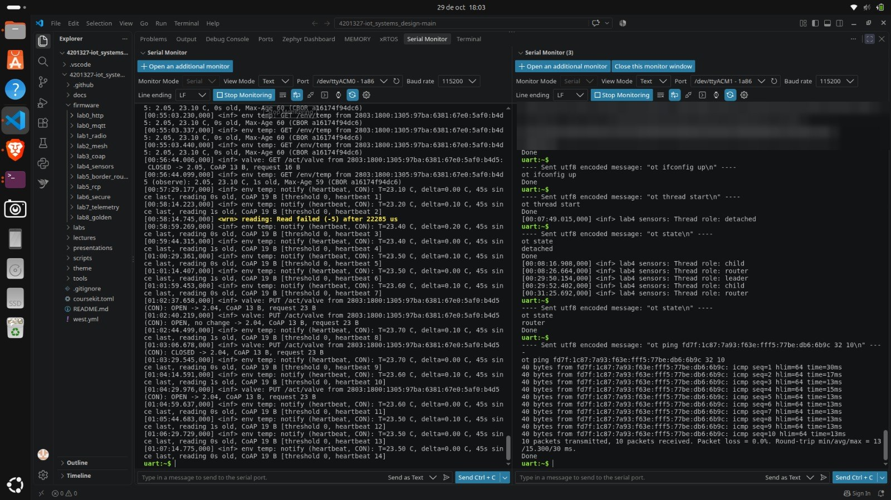
*Fig. 5.1 — Left, S: GETs from the laptop (`2.05, 23.10 C, 0s old, Max-Age 60`), heartbeat notifications as CON every 45 s, and valve PUTs from the laptop's IPv6 address. Right, C: joins the network (child → router) and pings S's ML-EID: 15.3 ms average. The dataset hex is pixelated.*

### Task D — Reach S from outside the mesh

**Route on the laptop** — installed by the kernel from the OTBR's Router Advertisement (Route Information Option, RFC 4191), not by hand:

```
$ ip -6 route | grep fd5d
fd5d:ecb4:d503:1::/64 via fe80::e272:a1ff:fef3:d348 dev wlo1 proto ra metric 600 pref medium
```

**Wi-Fi hop, with power save on and off** (`wifi ps on` / `wifi ps off` on the OTBR):

```
power save on:  10 packets transmitted, 7 received, 30% packet loss
                rtt min/avg/max/mdev = 250.730/385.122/716.614/150.536 ms
power save off: 10 packets transmitted, 10 received, 0% packet loss
                rtt min/avg/max/mdev = 8.626/16.557/68.486/17.535 ms
```

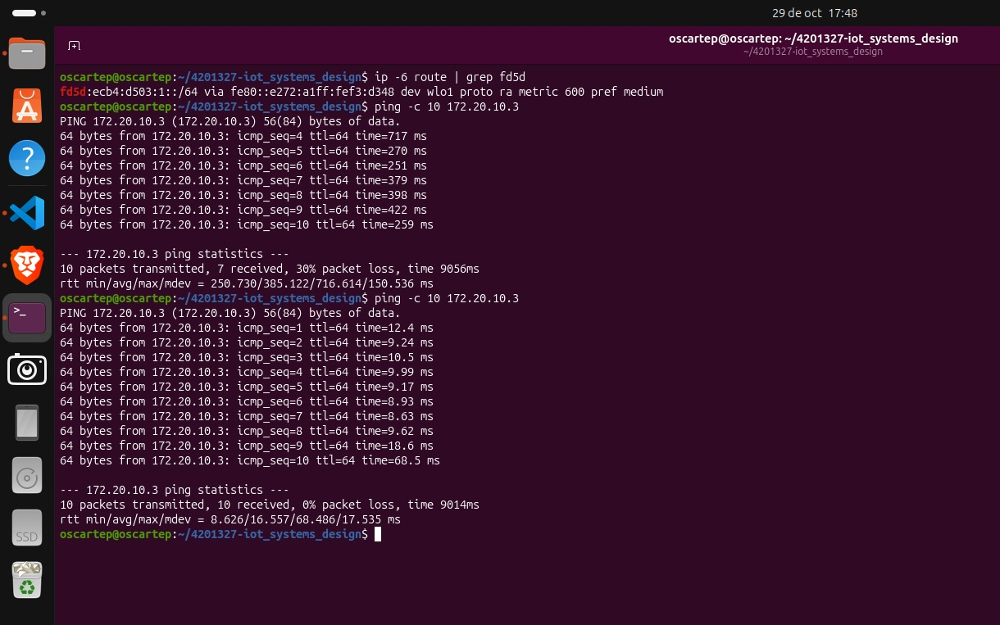
*Fig. 5.2 — The `proto ra` route to the OMR prefix, then `ping -c 10 172.20.10.3` with power save on (385 ms, 30 % loss) and off (16.6 ms, 0 % loss).*

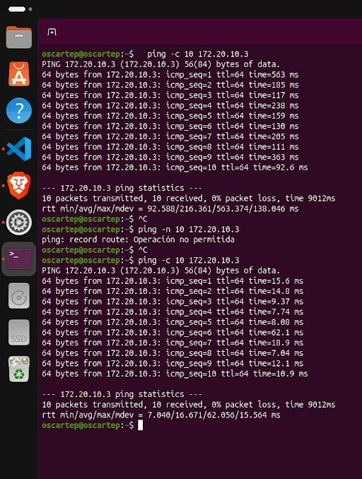
*Fig. 5.3 — An earlier run the same day: 216.4 ms with power save on, 16.7 ms with it off.*

**Laptop → S:**

```
$ ping -6 -c 10 fd5d:ecb4:d503:1:616e:e859:f0ed:628a
10 packets transmitted, 10 received, 0% packet loss
rtt min/avg/max/mdev = 52.817/94.466/139.180/28.974 ms          (ttl=63)
$ python tools/coap_client.py --host $S_OMR --count 10 get /env/temp
[1] Code: 2.05 Content  RTT: 50 ms
Payload (CBOR): {'t': 23.203125} [a16174f94dcd]
...
10/10 responses, median RTT 102 ms (min 50, max 244)
```

**Dashboard on the phone.** `python tools/dashboard_coap.py --host <S-omr>` on the laptop; the phone, on the same hotspot, opened `http://172.20.10.2:5000`. The phone talks HTTP to the laptop; the laptop talks CoAP to S through the OTBR. Over the session the dashboard received 17 Observe notifications of 6 bytes each, against 890 requests that 1 Hz polling would have needed.

S's log for the valve PUTs sent from the dashboard (source = the laptop's IPv6 address):

```
[01:02:37.658] valve: PUT /act/valve from 2803:1800:1305:97ba:6381:67e0:5af0:b4d5 (CON): OPEN -> 2.04, CoAP 13 B
[01:03:06.678] valve: PUT /act/valve from 2803:1800:1305:97ba:6381:67e0:5af0:b4d5 (CON): CLOSED -> 2.04, CoAP 13 B
```

and the dashboard's own log: `[CoAP] PUT /act/valve 1: 2.04 Changed` / `[CoAP] PUT /act/valve 0: 2.04 Changed`.

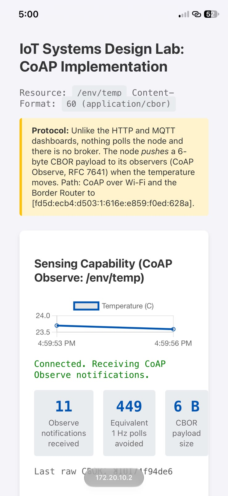
*Fig. 5.4 — The dashboard on the phone at `172.20.10.2`: "CoAP over Wi-Fi and the Border Router to [fd5d:ecb4:d503:1:616e:e859:f0ed:628a]".*

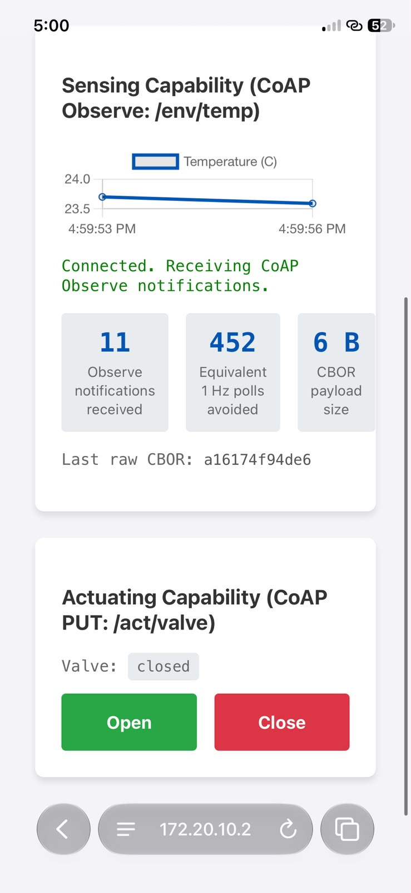 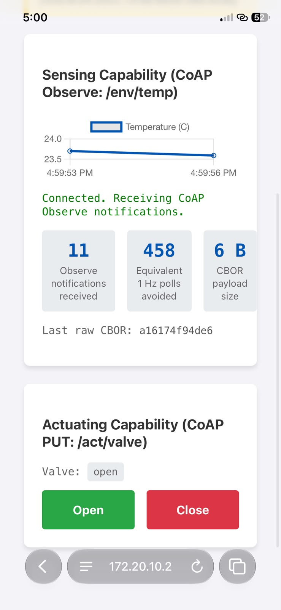
*Fig. 5.5 — From the phone: valve closed, then open after pressing **Open** (11 Observe notifications, 6-byte CBOR).*

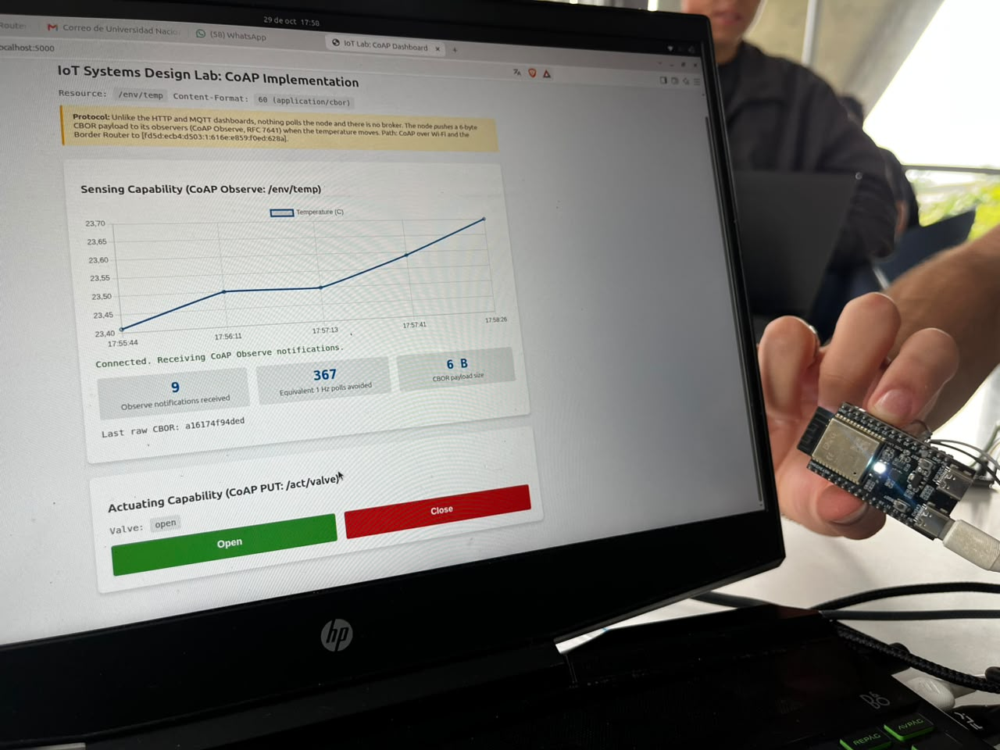
*Fig. 5.6 — Valve open: S's LED turns white.*

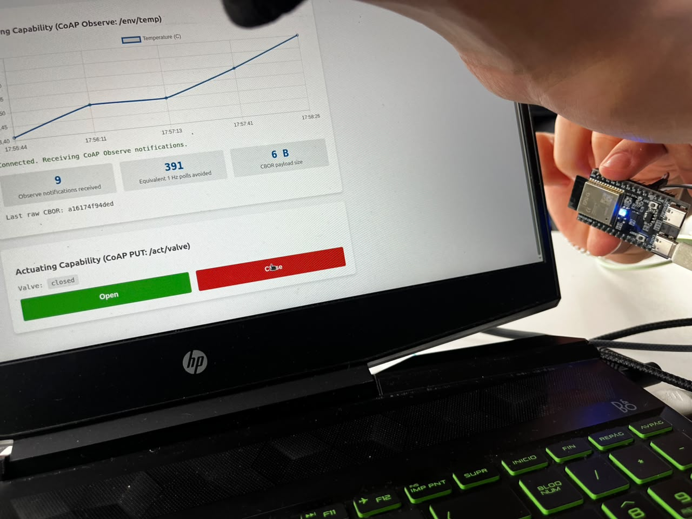
*Fig. 5.7 — Pressing **Close**: S's LED returns to its role colour.*

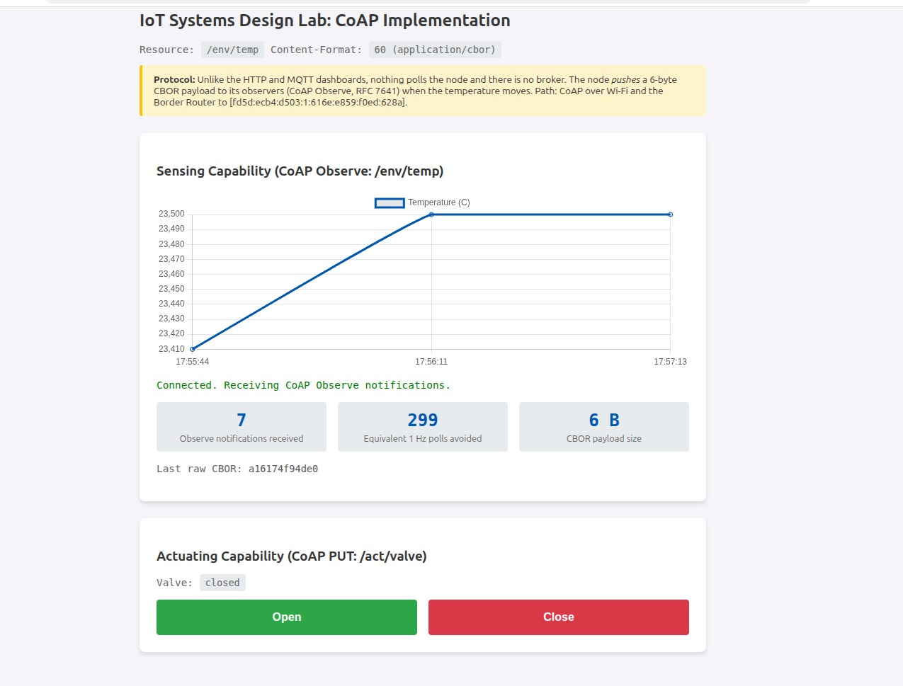 
*Fig. 5.8 — The chart filling up as Observe notifications arrive (7, then 8).*

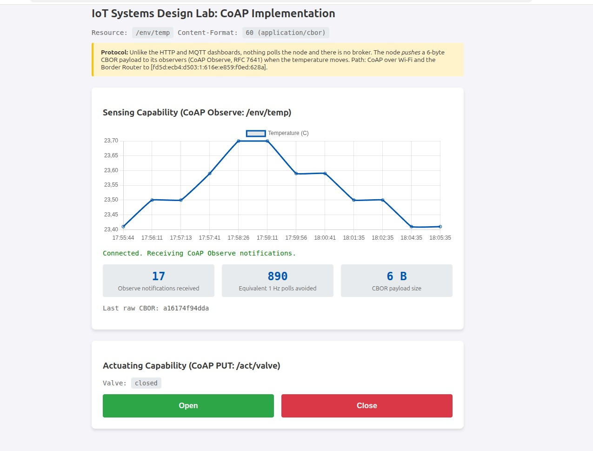
*Fig. 5.9 — Ten minutes later: 17 notifications, 23.41–23.70 °C, 890 equivalent 1 Hz polls avoided.*

### Task E — NAT64

```
[S] uart:~$ ot ping 8.8.8.8 32 10
Pinging synthesized IPv6 address: fd5d:ecb4:d503:2:0:0:808:808
40 bytes from fd5d:ecb4:d503:2:0:0:808:808: icmp_seq=1 hlim=116 time=170ms
...
10 packets transmitted, 10 packets received. Packet loss = 0.0%. Round-trip min/avg/max = 58/182.400/888 ms.
[OTBR] uart:~$ ot netdata show
fd5d:ecb4:d503:2:0:0::/96 sn low 5800          ← the NAT64 route
```

The synthesized address is the NAT64 `/96` prefix followed by `8.8.8.8` in hex (`08 08 08 08` → `808:808`).

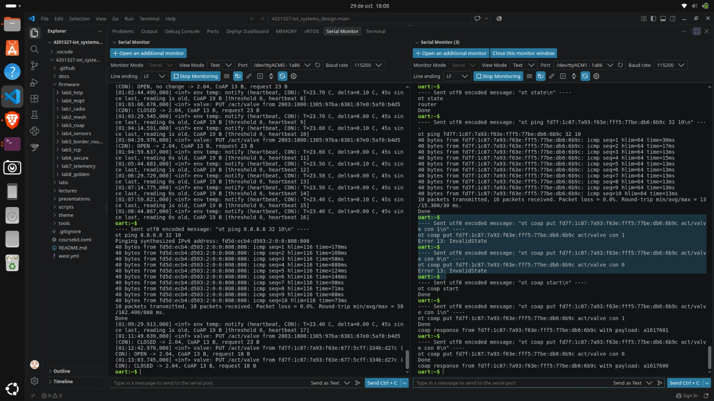
*Fig. 5.10 — Left, S: `ot ping 8.8.8.8` through NAT64. Right, C: `ot coap put` failed with `Error 13: InvalidState` until `ot coap start`, then `a1617601` / `a1617600`.*

### Task F — Kill the Border Router

With the S3 unplugged (≈17:14):

```
[C] ot coap put fd7f:1c87:7a93:f63e:fff5:77be:db6:6b9c act/valve con 1
    coap response from fd7f:…:6b9c with payload: a1617601      ({"v":1})
[C] ot coap put fd7f:1c87:7a93:f63e:fff5:77be:db6:6b9c act/valve con 0
    coap response from fd7f:…:6b9c with payload: a1617600      ({"v":0})
[S] [01:16:21.843] valve: PUT /act/valve from fd7f:1c87:7a93:f63e:677:5cff:334b:d27c (CON): OPEN -> 2.04
[S] [01:16:33.997] valve: PUT /act/valve from fd7f:1c87:7a93:f63e:677:5cff:334b:d27c (CON): CLOSED -> 2.04
[laptop] $ time python tools/coap_client.py --host $S_OMR get /env/temp
[1] Error: Network error: ConRetransmitsExceeded
real    1m34,023s
```

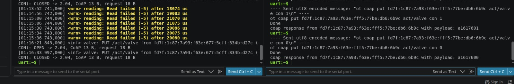
*Fig. 5.11 — OTBR unplugged: C's PUTs to S's mesh-local address are answered immediately, and S logs both. The `Read failed (-5)` lines above are DHT22 read errors, unrelated to the test.*

**What still works, what fails, how quickly:** control inside the mesh works immediately because it uses the mesh-local address, which does not depend on the OTBR. Everything that enters from Wi-Fi fails, and the client only notices after the full CoAP retransmission window (94 s). In an earlier run of the same test, C's log showed the mesh electing a new leader without the OTBR: `leader` → `child` → `router` between 01:50:39 and 01:51:22 (≈43 s).

**Restore** (S3 plugged back in at 17:21, then `ot dataset set active <hex>`, `ot ifconfig up`, `ot thread start`, `wifi connect …`):

```
uart:~$ ot state
child                                           (RLOC16 0x2801, parent 0x2800)
uart:~$ ot br state
running
uart:~$ ot br omrprefix
Local: fd5d:ecb4:d503:1::/64                    (unchanged)
uart:~$ ot netdata show
fd5d:ecb4:d503:1::/64 paros low 2801
fd5d:ecb4:d503:2:0:0::/96 sn low 2801
```

**Does it rejoin as leader? No.** S and C kept their own partition while the OTBR was off. When it came back with the same dataset, it found that partition and attached as a **child**, instead of founding a new one. Earlier in the session it later promoted itself to router on its own. Being a child does not stop border routing: it re-published the OMR prefix and the NAT64 route within ≈40 s, with the **same prefix and the same IPv4** (`172.20.10.3`), so no client had to change anything.

### Operational notes

*   The OTBR keeps Thread and Wi-Fi settings in RAM. After any reset: `ot dataset set active <hex>`, `ot ifconfig up`, `ot thread start`, `wifi connect -s "<SSID>" -p <key> -k 1` (quote SSIDs with spaces), and `wifi ps off` again.
*   On macOS, opening the S3's serial port toggles DTR/RTS and **resets the board**; keep a single monitor open for the whole session.
*   S and C are built with `CONFIG_OPENTHREAD_MANUAL_START`: after every reboot they need `ot ifconfig up` and `ot thread start`, and C also needs `ot coap start` (never on S, it would take port 5683 from the application).
*   C must not share S's DHT22 data line: C's GPIO19 on the same breadboard row made S's reads fail 100 % of the time (always 18.1 ms).
*   Thread network names are limited to 16 characters (`SoilSense-Los4Fantasticos` did not fit, hence `SoilSense-L4F`).
